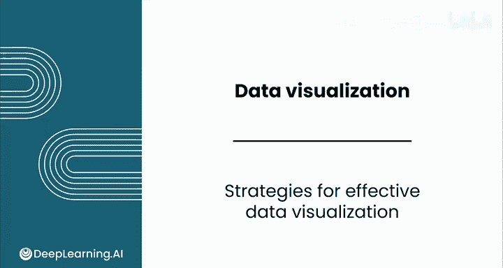
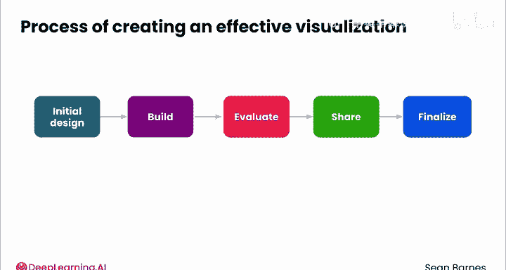
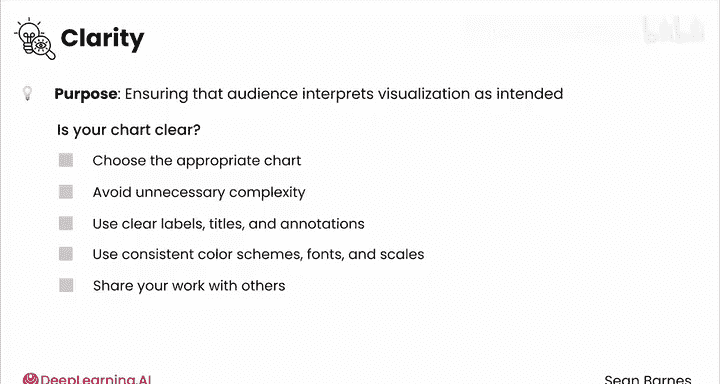
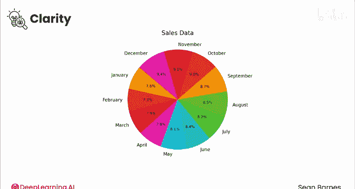
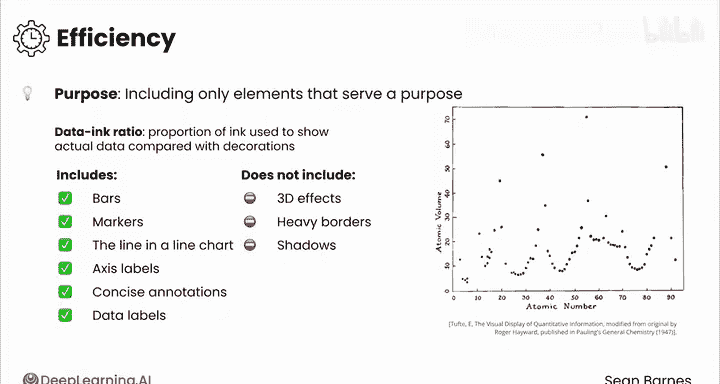
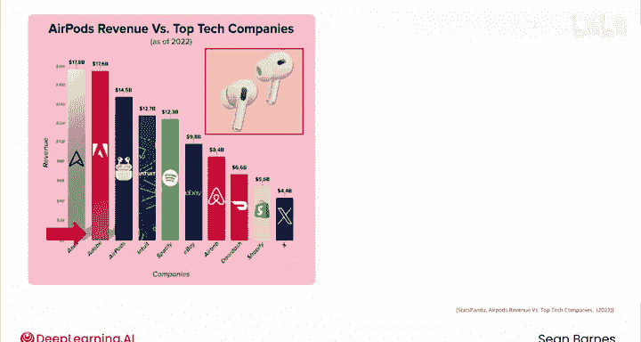
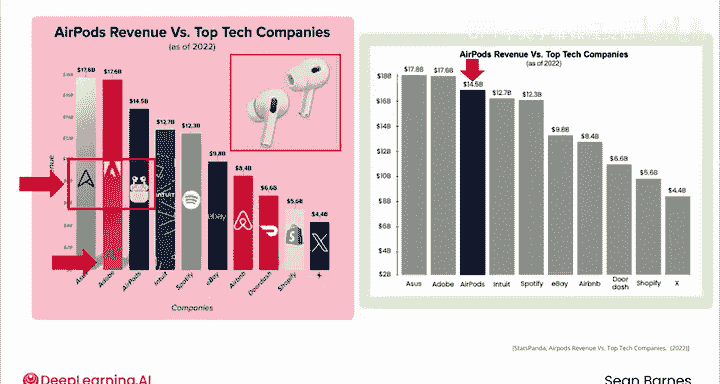
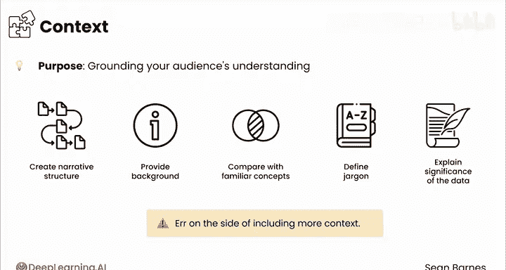

# 吴恩达《数据分析（数据分析基础／应用统计学，1-2课／共5课）｜DeepLearning.AI Data Analytics》中英字幕（claude-4-s - P51：50_有效数据可视化策略.zh_en - GPT中英字幕课程资源 - BV1SCXrYuEwr

Take a look at this image for a moment。 What do you see？

Is it a staircase leading downwards from left to right or the same staircase， but upside down。

 It could be either one。 two reasonable people can come to two completely different conclusions about this same image。

 If you're not careful， your data visualizations can end up like this optical illusion。

 Also called shorter stairs。 You'll show them to your stakeholders and each one will come away with a different insight。

 How do you avoid this confusion。 First， I'll talk about the process。

Start by sketching out an initial design while there are often several ways to convey the same information。

 One is likely best。 then build the initial draft as you work。

 consider how your visualization will be consumed Next。

 evaluate whether your visualization effectively conveys the key insights。

 then share your visualization to get colleagues initial reactions see whether it's clearly understood。

 Lastly， finalize the visualization。 Incorpo insights from the previous steps。

 depending on the importance of the visualization and the stake involved。

 you might iterate through these steps multiple times。 when evaluating your own visualizations。

 focus on three key principles。 Clity is about ensuring that your audience interprets your visualization in the way you intend your goal should be to have as many people as possible。

 especially your most important stakeholders come away with the same insights。

 how do you know if your chart is clear。 First， choose the appropriate chart type for your data which you already。

😊。

knownow how to do Second， avoid unnecessary complexity。 Use simple clean designs and avoid clutter。

 Third， use clear labels and titles so your audience understands what they're looking at。

 Plus annotations to highlight key insights。 Next， make sure you're consistent with your color schemes。

 fonts and scales。 Tri check that your chart is legible。

 font size that's too small is a common mistake since it can be challenging to fit so much information and one graphic。

 La font sizes are necessary for presentations。 Lastly， share your work with others。

 Your manager peers and trusted stakeholders can provide valuable feedback。

 Getting a fresh perspective is crucial。 Here's a visualization of monthly sales。

 What do you think is it clear what's happening。 First of all， the chart type isn't right。

 In a pie chart， it's hard to compare the relative sizes of many slices。

 and it's not suited for time series data。 There are so many colors and it's missing key information like the year and the actual sales figures。

😊。

I don't get a clear sense of the trend in sales either。 What else can I say。 But that's so wrong。

 Now， here's another chart of the same data。 This time。

 a line chart with time on the X axis and sales on the y axis。 At first glance。

 I can tell that sales trended consistently upward throughout the time period。

 which was the year 2023。 The axes are clearly labeled。

 and I can estimate the sales figures from the Y axis。

 Efficency means including only the elements that serve a purpose。 Ask yourself。

 Is there anything in your chart that doesn't contribute to the story you're trying to tell。

 Statistician Edwardward Tuftty， one of my inspirations。 First coined the term data to ink ratio。

 It's the proportion of ink or pixels that is used to show the actual data compared with decorative elements。

 Abo all else。 Fo on the data。 Here's an example of a chart with a very high data to ink ratio。

 which shows the atomic number of an element on the X axis and its volume on the Y axis。

 It displays only the most crucial information for interpretation data ink。😊。

Includes bars， markers， the line in a line chart， access labels。

 concise annotations and data labels On the other hand， 3D effects heavy borders， shadows。

 excessive grid lines， overly descriptive annotations and so on are non-data ink tufty also use the term chart junk to characterize distracting decorations that do not enhance the audience's understanding decorations。

 extra text， too many colors if you find yourself just adding stuff just to make your chart more interesting stop let the data speak。

Earlier， you saw a similar chart of Airpods revenue。

 This one is actually the original with the chart junk intact。 Ask yourself。

 what does this picture of Airpods in the corner really do。

 Why do the columns have shadows primarily it distracts the audience's attention from the core insight about just how much money Airpods make。

 You may remember the same data from this chart in an earlier lesson。

 Exneous elements like the Airpod's picture and logos have been subtracted out while the Airpod's revenue has been highlighted with color。

 It may be simpler， but it's much faster to interpret Conext is about grounding your audience's understanding。

 Consider what background knowledge your audience has about this data。

 You'll want to create a clear narrative structure。 Sttelling。 Pro relevant background information。

 Compare the insight with familiar concepts。 Def jargon Ex the significance of the data。

 Depend on who you're presenting to。 you may need to adjust your context。

 Air on the side of including more context。 You'll rarely hear complaints about。😊。

Providing too much information， but a lack of it can lead to misinterpretation。

A well designed visualization that tells a clear story will have lasting impact。

 Remember that your goal is to create a visualization where everyone who looks at it comes away with the same correct interpretation。

 I'll leave you with one last image。 Do you see an old woman or a young one。😊。

Join me in the next video to learn more about data visualization design。

