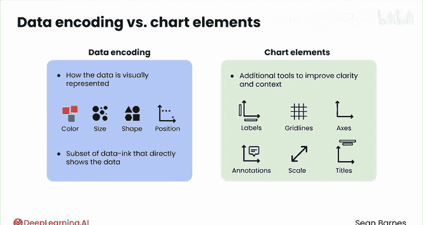
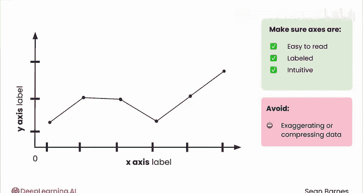
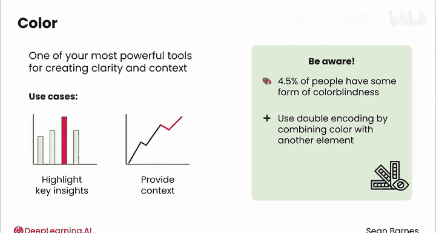
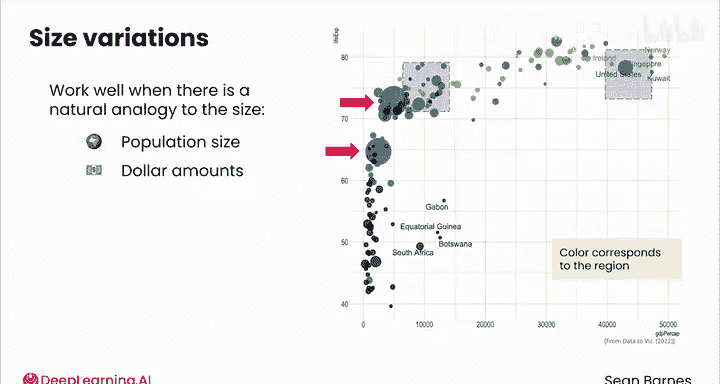

# 吴恩达《数据分析（数据分析基础／应用统计学，1-2课／共5课）｜DeepLearning.AI Data Analytics》中英字幕（claude-4-s - P52：51_数据编码.zh_en - GPT中英字幕课程资源 - BV1SCXrYuEwr

You know the playbook for effective data visualization design， clarity， efficiency and context。

 but how do you actually create a chart that follows them the way I typically think about it is to first make sure your axes including scale and labels are impeccable then think really hard about how you can use color and then think really really hard before you add anything else。

 Let's talk more about this hierarchy。 First， there is a distinction between data encoding elements and chart elements。

 data encoding means how the data is visually represented using elements like color， size。

 shape and position。 you can think of data encoding as the subset of data ink that directly shows the data。

 not the labels， grid lines， axes and so on。 data encoding forms the backbone of your visualization chart elements include everything else labelbels and grid lines and axes。

 plus annotations， scale adjustments and titles These are additional tools you can use to improve clarity and context that they should be used judiciously to maintain。

😊，In this video， I'll focus on data encoding with chart elements in the next one。

 Let's return to that basic process from earlier。 Start with your X and Y axes make sure they are easy to read labeled and intuitive including zero for numerical features Sc your axes appropriately avoid exaggerating or compressing the data which can distort the message labels should be clear and concise they're especially helpful when it's difficult to read exact values from gridlines color is one of your most powerful tools for creating clarity and context for instance。

 you can use color to highlight key insights like your company's performance compared to competitors or you can use color to context like graying out historical data to focus attention on the current year' performance be aware that some of your audience may have difficulty differentiating colors about 4。

5% of people worldwide have some form of colorblinness typically red green colorblinness when possible use double encoding by combining color with another。

Like unique markers，Additional clarity helps everyone。

 but be mindful of how many dimensions you're asking your audience to interpret simultaneously in general。

 keeping your data to two dimensions X and Y helps your audience interpret the right insight If you truly need to show three or more dimensions try having multiple plots next to each other Here's an example say you're trying to create a chart to show the number of birds you observe each day in your backyard based on the temperature。

 there are two species of birds you typically track Robbins and Blue Jays So your data has three dimensions temperature number of birds observed and species Let's see all those dimensions plotted on the same chart temperature on the X axis number of birds on the Y and the bird species in different colors。

 these two species seem to prefer different temperatures。

 Robbins prefer moderate temperatures while blue Jays prefer higher temperatures I find myself similar to the robins but there are a lot of observations on this graph and it's hard to tell the two apart。

 one option to improve clarity is to separate this data into two scattered plots。

Each with a single species， the patterns for the individual species become clearer while still allowing your audience to compare habits across species。

 The remaining elements you'll see in this video should be used judiciously。

 They're often more difficult to interpret。 Let's start with markers。

 markers are a data encoding element， typically used in scatter plots to add a third dimension to the data。

 you saw the bird scatterplot a moment ago with color differentiating the two series。

 Here's that same data， this time using markers rather than color for different。

 Do you think this graph is easier or harder to interpret。 I'd say harder。

 Since the markers are so small， the different shapes don't jump out any。

 markers can be useful if the comparison is clear。 But if you find yourself using more than two types。

 it might be time to rethink your approach。 Consider using color instead or separating your data into multiple charts。

 size variations often seen in bubble charts， Also add a third dimension to your visualization。

 They work well when there's a natural analogy to size like population size。😊。

Dollar amount Here's an example of a bubble chart with population size determining the bubbles。

 It plots countries by wealth on the X axis and life expectancy on the Y axis。

 Annotations help the audience spot some of the most interesting points。

 Can you spot China and India， the world's two most populous countries。There here。

 the two largest bubbles， by the way， color adds a fourth dimension to this chart， can you guess？

Color corresponds to the region with purple for Africa， light blue for Asia。

 green for Europe and dark blue for the Americas， that's a lot of data to interpret at once。

 remember， efficiency is key， don't overdo it with visual elements each edition should serve a clear purpose in enhancing understanding。

Now that you're familiar with using data encoding in your charts。

 join me in the next video to explore how chart elements can make your insights even clear。

 I'll see you there。