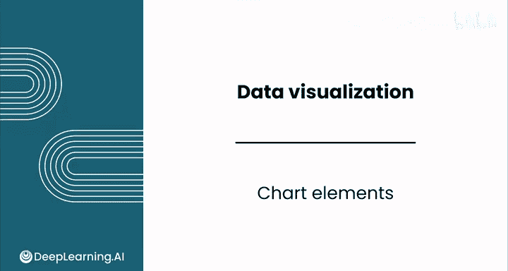
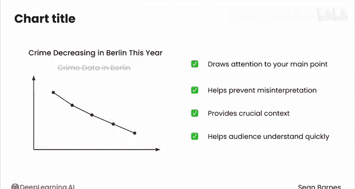

# 吴恩达《数据分析（数据分析基础／应用统计学，1-2课／共5课）｜DeepLearning.AI Data Analytics》中英字幕（claude-4-s - P53：52_图表元素.zh_en - GPT中英字幕课程资源 - BV1SCXrYuEwr

Now let's talk chart elements。 These are the parts of the chart that don't directly represent the data。

 Take a look at this graph of internet hosts， which means the number of devices connected to the internet。

 the X axis shows time while the Y axis shows the number of internet hosts。

 It's clear that internet usage skyrocketed between the start and end years。

But the change in devices between 1981 and 1997 isn't as clear。

 How could you better show this data One technique is to use a logarithmic scale instead of a linear one on a linear scale values are evenly spaced。

 If you plot 10100 and 1000。 the second distance is 10 times larger than the first。

 A logarithmic scale transforms these values making 10100 and 1000 evenly spaced。

 It changes the distances between the values on the y axis。

 spreading out smaller values and compressing larger ones。

 making patterns across the lower range more visible。

 You can create a log scale by transforming the values in your data using a base 10 logarithm。

 Don't worry about the math。 software will do this step for you。

 Here's the same data set of internet hosts。 This time with the logarithmic scale on the Y axis。

 noticeice how the distance between 1 and 10000， which is 9000 is the same length as the distance between 10 and 100000 which is 90000。

 It's much clearer in this version of the chart that there was substantial。

rowth between 1981 and 1997 consider a log scale when you want to cover a large range of data。

 emphasize proportional changes over absolute values or spread out cluster data points for visibility One limitation of the log scale is that it cannot be used with negative or zero values again。

 don't worry too much about the math but the log of negative numbers and zero is undefined which you just can't graph while I am a big fan of log scale you have to be careful about how well the audience can interpret what they're seeing People's brains don't naturally think logarithmically consider whether the storytelling value is worth the added complexity Here's an example of two graphs of CoVd-19 deaths over time both of them show time on the X axis and total deaths on the y axis however。

 the graph on the left uses a linear scale on the y axis while the graph on the right uses a logarithmic one researchers study people's interpretations of these graphs which do you think is easier to interpret。

They found that people who were given the graph on the right scored significantly lower on comprehension when asked to compare deaths across weeks and predict the number of deaths in a future week。

 One issue is that the log scale can't display values before around March 1 when covid cases where0。

 That's because the log of 0 is undefined。 It's tough for the casual viewer to understand what the abrupt start of the line means。

 So a good rule of thumb。 if your data is bunched up in one area on a linear scale。

 it might be time to consider a log scale or adjust your access limits。

 Just be mindful of how your audience will interpret the scale。 Finally， with regard to access scale。

 consider including0。 This tactic helps communicate the magnitude of your data in particular。

 when absolute values matter more than relative value。

 Le out zero is a common tactic in misleading graphs。 That said。

 excluding zero by truncating one of your axes can be helpful if you need to emphasize small differences。

 you can think of it like zooming in on your range of interests。

 Here's a graph of pretzel sales in 196。😊，With time on the X axis and sales on the Y axis。

 it looks like golden loops is really beating off the twist and shop brand。

 But look the scale starts at 950。 It emphasizes the differences。

 here's the same data with zero included in the scale showing the absolute values。

 It looks like these two brands are pretty competitive。

 either of these graphs could be appropriate depending on the circumstance。

 The graph on the left may be helpful and a twist and shop brainstorm about taking over golden loops Since it zooms in on the differences between the two brands。

 The graph on the right might be more helpful for a supermarket looking to assess the most popular brand Next up annotations these are a fantastic tool for guiding your audiences attention without annotations people's eyes might wander all over your chart with well- placed annotations you can lock in their focus on the most important elements。

 Remember efficiency is key Don't overwhelm your chart with annotations Choose just one to three key points to highlight should also consider how your audience will encounter the chart。

 if you're presenting。😊，you can use a laser pointer for additional callouts so if fewer annotations may be needed。

 if your chart will be viewed independently， such as in a report。

 consider adding a caption to explain key points since you won't be there to tell the narrative。

 Once you've chosen your scale and added annotations。

 you'll want to pick a great chart title your title isn't limited to just describing what the chart shows。

 Use it as an opportunity to highlight your key insight instead of crime data in Berlin consider something like crime decreasing in Berlin this year This immediately draws attention to your main point and helps prevent misinterpretation Tiles can also provide crucial context like the time period your data covers which helps your audience quickly understand what they're looking at At this point。

 you've seen the core techniques for building beautiful and functional data visualizations Jo me in the next video to see how to improve some cool charts。

 you won't look at a graphic in the news the same way again。 Trust me。 I'll see you there。

