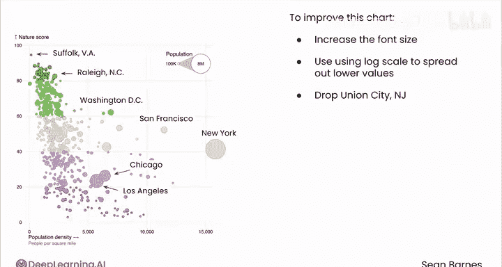

# 吴恩达《数据分析（数据分析基础／应用统计学，1-2课／共5课）｜DeepLearning.AI Data Analytics》中英字幕（claude-4-s - P54：53_数据可视化案例：优劣分析.zh_en - GPT中英字幕课程资源 - BV1SCXrYuEwr

Well， it's time to adopt a critical eye and explore some data visualizations I found in the wild for each chart。

 I encourage you to pause the video and think about the story it's trying to tell。

 Consider what improvements you convey to help the story stand out。

 Then you can hear my side of things。 Let's get into it。 Here's our first graph。

 Pause the video for a moment and see how you might interpret and improve it。😊，So right off。

 we're looking at a graph showing the market share of US carbonated soft drinks。

 pretty straightforward title there on the X axis。 we've got time running from 2000 to right after 2020。

 That's a two decade span。 The Y axis shows the percent market share of each drink because this is time series data a line chart seems to be the right visualization so far so good checking for encoded categories。

 the different soft drink brands are colorcod。 the colors also more or less matched the brand colors associated with each drink。

 which is a nice touch。 There aren't many annotations。

 but the note at the bottom about volume of case sales provides context on what we're actually measuring here Looking at the big picture you can see some interesting trends。

 Coke's been dominating the whole time。 but it had a dip in the middle there。 Meanwhile。

 Pepsi's been on a steady decline。 Dr。 Pepper and Sprite have been slowly climbing up while Di Coke saw a bump but then started falling again。

 One key insight which I can barely make out is that Dr。 Pepper appears to be overtaking Pepsi。

 especially when you consider the。😊，Of each soda to improve this chart。

 you could make it wider for easier reading， adding some grid lines wouldn't hurt so the audience can more easily compare the sales across the different brands just having 10 and 20% makes analysis pre course。

 the axis labels could also be more consistent。 Access titles could improve readability。 Finally。

 an improved title would help the audience focus on the main insight。 Consider an option like Dr。

 Pepper tops Pepsi for second most popular US soft drink。

 All let's check out this chart which is published on the website for the US Bureau of Labor statistics。

 This is an interactive chart。 So you'll see an updating dynamically as a mouse over the different elements。

 First up， we've got a pretty clear title here average hours per day spent in selected activities by age 2023 annual averages Str enough。

 it doesn't tell us a key insight but rather sets the context for the chart。

 Looking at the X axis we're dealing with hours per day running from zero to 12 on the Y axis。

 we've got a list of different activity。No label needed here since it' selfexplanatory Now。

 encoded categories color is used to represent age group 15 to 19 year olds are dark blue。

35 to 44 year olds in light blue and 75 plus in green。

 The distinct colors may comparison an easy However。

 even distinct colors likely wouldn't make comparing across all eight categories easy especially since these colors don't have a logical correspondence allowing the audience to select only the age groups relevant to them makes the graph easier to interpret a horizontal bar chart makes sense here。

 given all these categories we're comparing across Since the chart is grouped that helps the audience compare within an activity to interpret insights like 15 to 19 year olds spend significantly more time on educational activities than either of the other two age groups the light red lines are just right。

 they give the audience a sense of scale without cluttering things up。

 No need for super precise measurements here。 Big picture there's a lot to unpack here。

 Personal care and sleep is taking up most time。Aross all age groups。 No surprise there。

 But check out how worktime peaks in the middle age groups and then drops off and leisure time。

 that's on the up and up as people get older。 If you wanted to improve this chart。

 you might consider making the x axis label clear。 maybe average hours spent per day。

 You could also group by age instead of activity that could give us a clearer picture of how a typical day looks for each age group。

 We'll wrap up with a bubble chart， which is a variant of a scatter plot you've seen before。

 I know the font size is tough to read。 I'll address that in a moment。

 Let's start with the title access to nature where you live。

 It's relatively clear but doesn't share the key insight on the X axis。

 you're looking at population density measured in people per square mile。

 it runs from 0 to 30000 showing a wide range。 The y axis shows us the nature score which goes from 0 to 100。

 I'm assuming that higher scores mean better access to nature。 The chart type。

 a scatter plot is a solid choice when you want to show the relationship between two numerical features。

This case， population density and the nature score Now let's talk about those end categories This chart has doubleencoding going on with color。

 which helps to find categories of nature score using a diverging color scale greener means higher score purple means lower and tan is in the middle green for a higher nature score is a nice touch since most people will associate green with nature I'm not sure purple is as intuitive on the lower scale The size of the dots is another encoded feature representing population bigger cities get bigger dots which makes sense。

 The legend in the top right is helpful showing us the scale for population size it gives context to the dot sizes we're seeing in terms of annotations they've done a good job here we've got labels for just a few of the bigger cities and some outliers like Union City。

 New Jersey and Suffolk Virginia which seems like a nice place to live it's not colored but gives us some reference points especially for more populationist cities the audience may be familiar with looking at the big picture you can see a relationship as population density increases。

Right on the chart， the nature score tends to decrease moving down， but there's some variability。

 It's not a perfect correlation。 Some cities， but the trend。 Washington， D。 C。 for example。

 has a relatively high nature score， despite its population density on the flip side， Union City。

 New Jersey is way out there with super high density and very low nature score Unfortunately。

 If you wanted to improve this scatter plot， first increase the font size。

 you'll also notice how the data is all clustered together on the lefthand side of the chart with nearly half of the X axis dedicated to just two cities。

 Can you think of one way to solve that。You could use a log scale。

 Lo scales help spread out lower values。 Another option is just drop Union City New Jersey since it's such a significant outlier。

 More grid lines would help with fine grain comparison。

 You could also consider adding a trendread line to make the overall relationship even clearer。

 The title could use some work too。 Maybe something like cities with lower population density Off better access to nature。

 The relationship between population density and access to nature is clear。

 but there's enough nuance to keep it interesting。 It's the cut of chart you could spend a while exploring and still find new insights。

 Great work analyzing those chart with me。 I want you to feel inspired。

 make your visualizations memorable。 And one professional tip for you。

 have a personal hall of fame of your best data of Viz work。 It will come in handy in the job search。

 That takes us to the end of this lesson。 Once you've completed the practice assessment。

 joinin me in the next lesson to learn how to leverage LLMs for data visualization。

 I'll see you there。😊。

