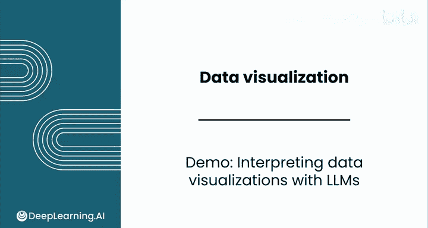

# 吴恩达《数据分析（数据分析基础／应用统计学，1-2课／共5课）｜DeepLearning.AI Data Analytics》中英字幕（claude-4-s - P55：54_演示：用LLM解释数据可视化.zh_en - GPT中英字幕课程资源 - BV1SCXrYuEwr

So earlier in this course I didn't quite tell you the whole truth， I told you that Cloud 3。

5 Sonet and ChaGptT 40 are both LLMs， large language models， but they're actually more than that。

 they're large multimodal models， large multimodal models can interpret different types of inputs。

 typically text and images。This is really cool for data visualization because they can help you interpret charts。

 as well as create them， which you will see in the next video。 These models do make mistakes。

 and you will have to check them， but they can help your process a lot。

 Let's see what that looks like。😊，Earlier in this module。

 you saw this visualization of population density and nature score。

 Let's ask Claude to interpret this chart for us。 So in this case。

 I'm going to screenshot the chart and drag it here to add the file to the chat。

 Walk me through this chart and explain the key insights。 It's a pretty simple prompt。

It says the chart visualizes the relationship between population density。

 access to nature and population size for various cities and regions in the US。

 That seems pretty accurate on the x axis it visualizes population density in people per square mile and the y axis it visualizes the nature score。

 It also detects that each data point is a bubble representing a city or an area's probably a city based on the data that's labeled in the chart。

 It also highlights that the size of the bubble indicates the population size。

 It also notices the color scale highlighting that the color of the bubbles seem to correspond to the nature score。

 It highlights the inverse relationship between population density and nature score as population density increases the nature score tends to decrease It also identifies union city as an extreme outlier with very high population density and a very low nature score。

 It also makes a comment about the fact that the larger bubbles tend to cluster towards the lower right of the chart。

 This is not totally incorrect， but these larger cities do not cluster that closely to each other。

Maybe this could be said a little bit more precisely。 You just saw Cla 3。5 sonnet capabilities。

 Keep in mind that at the time that you're viewing this video。

 there are likely more advanced models out than this one as model capabilities are changing very quickly。

 Let's see how you can use a large multimodto model to critique your own charts。

 Let's take a look at chatpt40's capabilities。 And in this case。

 we're going to use this visualization of the number of birds observed versus the temperature。

 In this case， there are actually three bird types on the graph。 I saved an image of this graph。

 and now I'm just going to upload it。 and I'll use a little bit more complex of a prompt。

 Start off by giving the model a role。 you're an expert data analyst with a passion for data visualization。

 And then a task Ex each distinct area for improvement in this chart with a specific suggestion for how to fix the issue。

 Be concise and don't waste my time。 So don't be afraid to tell the model exactly what you wanted to do。

 So let's see the output。Because of the way the prompt is formatted。

 Ask for an issue and a suggestion， it's going to give you a nicely formatted answer。

 The first issue is that the colors for bird 1 and bird2 can be hard to differentiate。

 Arrguably all three of these colors are too similar。

 So it's interesting that it only pointed out that bird1 and bird 2 are too similar。

 It also highlights that the legend is placed over some of the data points in the chart。

 potentially obscuring information。 It's an interesting observation。 Since technically。

 the legend doesn't overlap any data points。 Perhaps it thought it was close， but overall。

 I think this is okay。 It talks about the marker size being too large and densely packed。

 making it hard to see individual data points。 some areas。 That's true in some areas， but overall。

 I don't think the markers are that large。 The problem mostly stems from the values at 0。

 which are overlapping quite densely。 It also mentions the y axis limits extend up to 20。

 but most data points are concentrated below that。 This causes wasted space and reduces focus on the relevant data。

 We do have some data points extend above 20。 So we certainly want。

Axies to extend this high you already learned one additional strategy for addressing overlap。

 which is to separate the data for each bird into its own chart。

It also mentions that the grid lines dominate the visual space distracting from the data points。

 I don't think the opacity of the grid lines is too big of a deal。

 They're pretty light gray through the background。 So overall， this was kind of a bust。

 The LLM did spot a few major issues like the similar colors and overlapping data。

 but it also identified some nonissues and its suggestions weren't great。

 So it can be a great second pair of eyes， but ultimately。

 your judgment will be incredibly valuable for creating good visualization。

 Let's see that same prompt with clo。 It's great to test out different models and see what's working best。

 especially when it comes to really advanced capabilities like interpreting a very complex data visualization。

 Different models may perform better。 I'm going to copy and paste this figure and then copy the same prompts。

😊。

You can see there's a lot of similarities to chatGT it highlights things like overpllotting。

 color choice， Yx scale， etc。 Many of these comments are reaching a little bit in a lot of cases they're actually okay but the main items around overlapping data points and color choice are excellent suggestions。

 One interesting point that it calls out is the lack of trend lines It states that it's difficult to see overall patterns for each species it suggests adding a smooth trend line for each bird species that's something to consider。

Between these two use cases， it seems like LLMs are more useful for interpreting data visualizations。

 and may be less useful， though still a good second pair of eyes for critiquing it。

 so don't hesitate to take a screenshot and throw it into Cloududutter chattTBT to see what kind of insights they can help you with。

