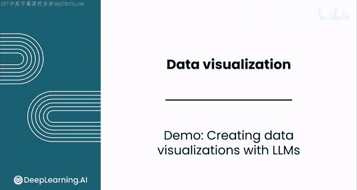
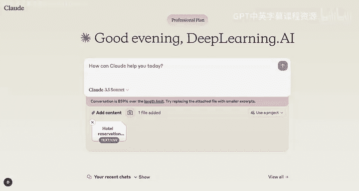
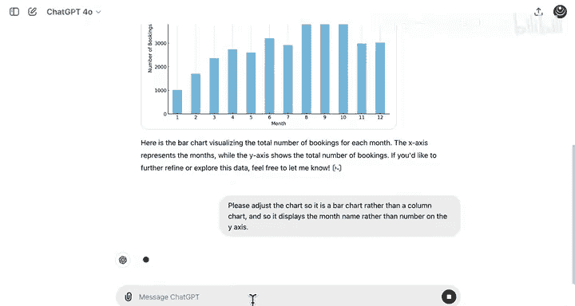
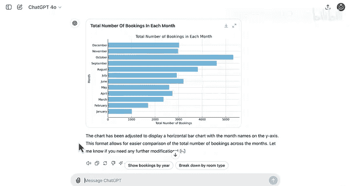
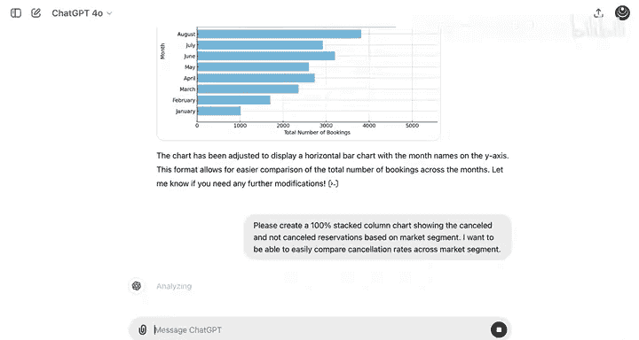
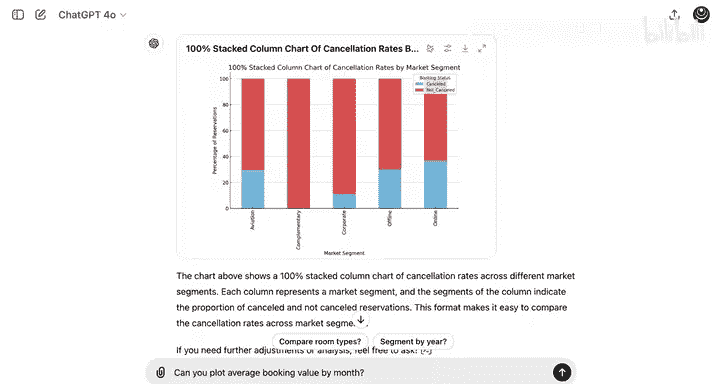
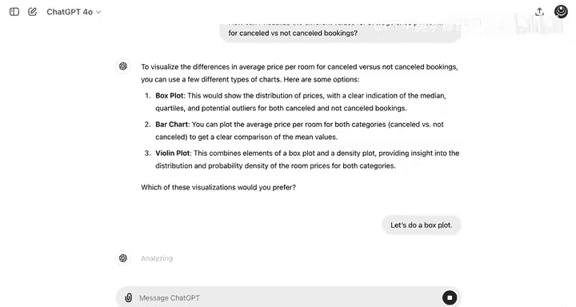
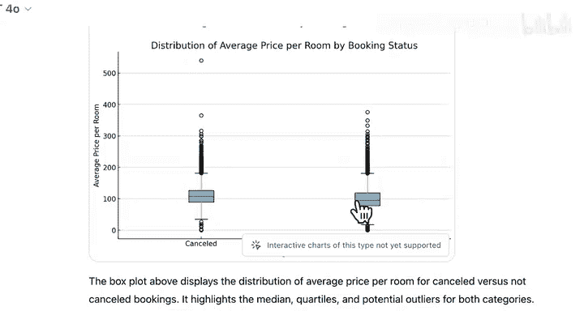

# 吴恩达《数据分析（数据分析基础／应用统计学，1-2课／共5课）｜DeepLearning.AI Data Analytics》中英字幕（claude-4-s - P56：55_演示：用LLM创建数据可视化.zh_en - GPT中英字幕课程资源 - BV1SCXrYuEwr

Let's see how an LLM， like Claude or ChattptT can help create data visualizations。

 Let's start with Claude。 You can grab your data like the hotel reservation CSV file and add it to the conversation。

 This file is much too large for Claude to handle 36000 rows。

 That's a sign that you need to interact with this tool differently。 Instead。

 you can use a different model。 All'll use chat EptT。😊。

So let's go over to Chat EPT， I'm going to upload my entire data set all 36。

000 rows and Chat EPT is completely fine with that， it doesn't have to read 36。

000 rows of data every prompt， help me visualize the total number of bookings in each of the 12 months。

And it gives me this nice visualization。 You can see that in general。

 the number of bookings increases throughout the year。

 and then there's a sharp decrease for November and December。

 sayy I want the month name rather than the number to be displayed on the X axis。

 and I want this to be a bar chart rather than a column chart right now， monthth is on the X axis。

 but I'm treating these more as categories rather than a series over time。

 So I'm going to tell it to make these adjustments。

Okay， each month is shown on the Y axis increasing from January to December and the bars represent the total number of the bookings。

 let's say I wanted to visualize cancellation rates across market segments。

 here's one way to do that。

Looks good。 You can check against your spreadsheet。

 Remember that about two thirds of reservations aren't canceled， so that seems to check out here。

 Let's try two more visualizations for fun。 You can ask if it can plot the average booking value by month。

In general， in the winter months， the average booking value is lower。

 and then it peaks in the middle during the summer months where travel is likely more popular。

 you can also ask it to create a bar chart to visualize lead time by repeated guests and booking status。

Notice that this is a comparison of a numerical variable across multiple categorical variables。Okay。

 now I get a grouped bar chart again， comparing lead time across repeated guests and booking status。

 One pattern that we've observed already is that average lead time tends to be longer for canceled booking statuses。

 The average lead time for bookings that are not canceled by repeating guests is extremely short。

 and average lead time for canceled reservations is much longer。

 There's an interesting choice of colors on this chart。

 It shows blue for canceled and red for not canceled， which is a little counterintuitive。

 Let's ask one more question。 How can I visualize the different values for average price per room for canceled versus not canceled bookings。

 It suggests a box or violin plot。 You might not have seen these before。

 Let's just try a box plot for fun。 You'll learn more about box plots in the following course。😊。

The range of values is between 0 and around 550。 This central line is the median or the middle value for canceled bookings。

 it looks like the median is a tabbit higher than for not canceled ones， maybe by about 10 euros。

 The range of average prices per room， though， is pretty similar。

 You've seen that LLMs can be a really helpful part of your workflow to both enhance your own visualizations。

 as well as create new visualizations for you。 Great work。 you're almost to the end of this module。

 Next up， you'll complete a practice lab to test your skills working with LLMs for data visualization。

 When you're done。 you'll take the graded assessment and graded lab。

 The lab explores market research for a bike sharing service。

 I know you'll have fun creating tons of cool visualizations to support your insights。

 Once you're done， following me to the next and final module of this course。

 which is all about your role in the data analytics lifecycle。 I'll see there。😊。

