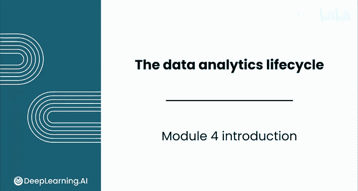
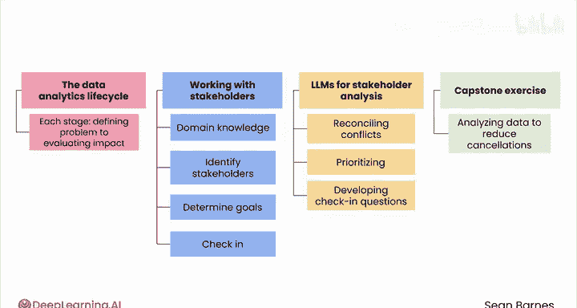

# 吴恩达《数据分析（数据分析基础／应用统计学，1-2课／共5课）｜DeepLearning.AI Data Analytics》中英字幕（claude-4-s - P57：56_模块4 简介.zh_en - GPT中英字幕课程资源 - BV1SCXrYuEwr

Welcome to the final module of this course， the data analytics lifecycle You've seen how to analyze and visualize data using spreadsheets。

 and now it's time to put those skills in context In this module。

 you'll unravel the data analytics lifecycle a structured approach to solving problems with data you'll cover each stage from defining the problem to evaluating your solutions impact you'll also learn how to main knowledge in stakeholder collaboration。

 can drastically improve your outcomes。 you'll learn how to identify who your stakeholders are determine their goals and check in with them effectively working with stakeholders can be challenging。

 you'll practice using LLms for stakeholder analysis including reconciling conflicting requests。

 prioritizing opportunities and developing good check in questions And finally。

 you'll in this module with a cumulative capstone exercise。

 a telecom company has tasked you with analyzing customer data to reduce service cancellations and modules one through three。

 you learn many of the hard skills you'll use daily as a data analysis。 This module focuses on the。😊。

Saw skills that will set you apart， including adaptability。

 communication and strategic thinking By the end of this module。

 you'll be equipped to tackle data analytics projects with confidence from start to finish Let's do it。

