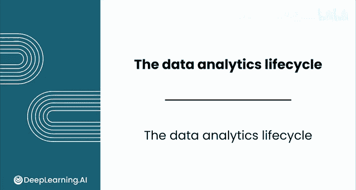
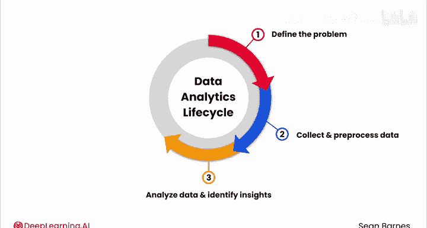
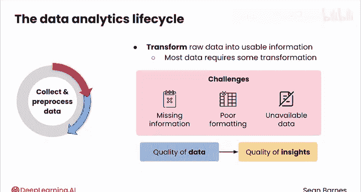
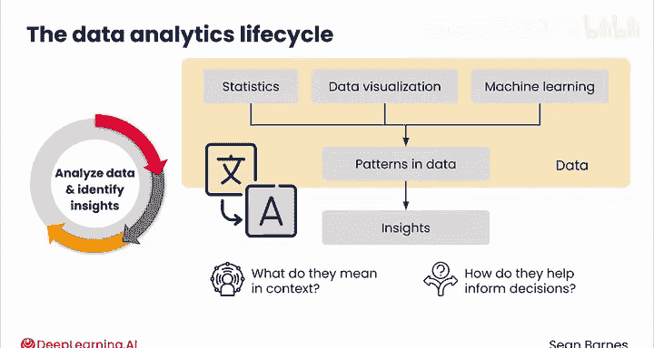
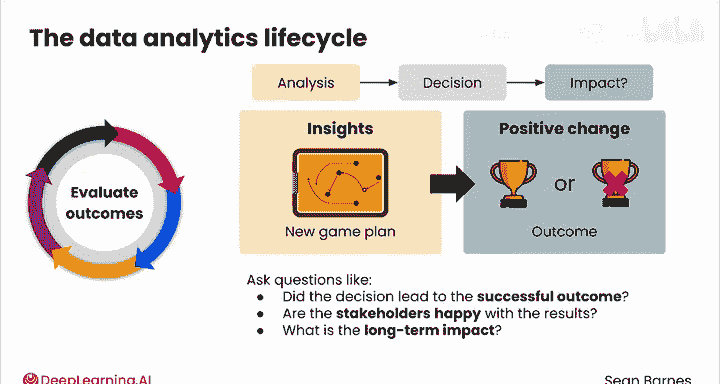

# 吴恩达《数据分析（数据分析基础／应用统计学，1-2课／共5课）｜DeepLearning.AI Data Analytics》中英字幕（claude-4-s - P58：57_数据分析生命周期.zh_en - GPT中英字幕课程资源 - BV1SCXrYuEwr

It's easy to get lost in the complexity of a data analytics project。

 how can you navigate the requirements， the data， the formulas。

 a handy framework is the data analytics lifecycle。

 an end to end iterative process that will help you structure vastly different projects using the same core approach The data analytics lifecycle breaks down into five key stages。

First， define the problem。 What are you trying to solve。 Second， collect and preprocess data。

 Where is the information you need and how do you prepare for analysis。 Third。

 analyze data and identify insights。 What analysis do you need to conduct。

 What insights did you find。 Four， Sha results。 How do you communicate your insights to help inform decision making。

5th， evaluateval outcomes。 How well did you solve the problem。 You'll often revisit earlier stages。

 and the success of your projects will often depend just as much on the stages surrounding the analysis as on the analysis itself。

 The time you spend on each stage will also vary from project to project。

 You must be willing to adapt your approach。 Let's examine each stage in a bit more detail。

 Defing the problem is the foundation of your analysis。

 The point is first to narrow your decision space。 As you rule out incorrect approaches。

 you can focus on the most fruitful ideas。 Second， your clearly setting expectations about what success looks like for this project。

 Here are some。

Questions to ask what are the business goals， What decisions need to be made to achieve those goals。

 Who are the stakeholders making those decisions and what are their needs。

 What does success look like for this project， Take the time to get this right。 If you don't。

 you'll waste time by trying to solve the wrong issue。

 Albert Einstein famously said if I had an hour to solve a problem。

 I'd spend 55 minutes thinking about the problem and five minutes thinking about the solution。

 It's a quote I live by。 the data collection and preprocessing stage is where you transform raw data into usable information。

 As you saw in module 1， most data requires some transformation before it can be analyzed In some cases。

 like for unstructured data。 the required effort is significant。

 Missing information or poorly formatted columns can make your analysis more challenging。

 And sometimes the data that you really want may not be available。

 So you have to settle for whatever data that you have。

 The quality of your insights directly depends on the quality of your data。

 Getting good data and processing it into a usable form sets you up for fruit。

AlysisThe next stage is analyzing the data and identifying insights。

 you'll use techniques like statistics， data visualization and machine learning to find patterns in your data。

 You also need to derive insights from those patterns。

 What do they mean in the context of your problem How do they help inform the decisions。

 your stakeholders need to make identifying insights is a bit like translating from one language to another。

 The language of data that you speak won't be as familiar to some of the project managers。

 Cs and engineers you'll be working with。 You have to transform analyses into a story that others can use to make better decisions。

 your analysis is valuable， but it's useless if it stays locked away on your computer。

 sharing your results is how you create impact by communicating your findings effectively。

 you empower your stakeholders to make informed decisions that achieve the project goals。

 sharing the right findings with the right people at the right level of detail。

 transforms insights into real worldorl impact。 You've reached the final stage of the data。

Analytics lifecycle， evaluatingval outcomes。 your analysis helped inform a decision。

 and now you're being called upon to assess its real- world impact。 Think of it like this。

 A coach designs a new game plan based on extensive analysis of the opposing team。

 but the true test of that plan is the outcome of the game itself。 Did it lead to a win。

 Similarlyly as data analyst， your ultimate goal isn't just to produce insights。

 It's to see those insights translated into actions that drive positive change。 In this stage。

 you should ask questions like did the decision lead to the successful outcome I define in the first stage Are the stakeholders happy with the results。

 What is the longterm impact。 Remember， the data analytics lifecycle is iterative。

 the insights gained from evaluating the effectiveness of one decision can inform the next round of analysis。

 creating a virtuous cycle of improvement。😊。

I often get the question， do practicing data analysts seriously follow this lifecycl step by step for each project。

 and honestly， yes， we do。 even seasoned data analysts will tell you when you're facing a new challenge。

 get back to basics， Let's take a closer look at each stage。 I will see you in the next video。

 which is all about defining the problem。