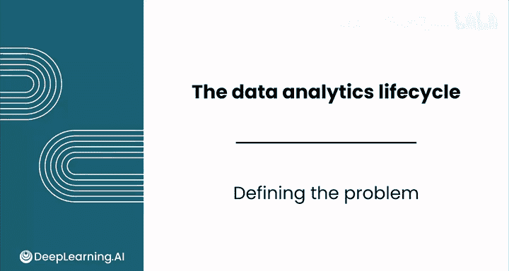
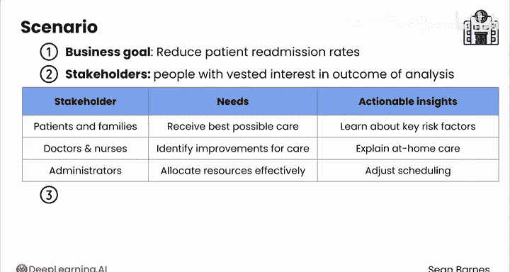

# 吴恩达《数据分析（数据分析基础／应用统计学，1-2课／共5课）｜DeepLearning.AI Data Analytics》中英字幕（claude-4-s - P59：58_问题定义.zh_en - GPT中英字幕课程资源 - BV1SCXrYuEwr

Oftentimes， stakeholders will ask for your help tackling a fuzzily defined problem。

 Part of your role as a data analyst is to clarify the true problem so that you can focus everyone's efforts on the right outcomes。

 a good place to start is by asking the right questions？ What are the business goals。

 What is the company or organization want to achieve while most businesses will to increase sales。

 reduce costs and improve customer satisfaction。 What are some of the more specific objectives that you can focus on。

 One example could be better product recommendations。 Ultimately。

 better recommendations will improve these highlevel outcomes like sales， but it's a more direct。

 measurable result that you can focus on。 Who are the stakeholders and what are their needs。

 Who will be using your results。 What decisions do they need to make。

 What information would be most helpful to them。 What are the key unknowns that need answering。

 For example， Which marketing channels are most effective or what factors are associated with customers canceling their subscriptions。

 Here's an example。 Imagine you're a data analyst working for a。😊。

The hospital has seen an increase in patient remission rates for pneumonia。

 Low remission rates are better， since patients want their problem fixed the first time and repeated visit can put a strain on staff。

 The hospital wants to understand the factors contributing to this issue。

 How would you approach to finding this problem。Start by identifying the business goal， in this case。

 the hospital wants to reduce patient readmission rates。Once you've identified the business goal。

 consider the potential stakeholders and their needs。

 Stakeholder are the people who have a vested interest in the outcome of this analysis。

 The hospital stakeholders include patients and their families， of course， then doctors。

 nurses and the hospital administrators。 Consider each of their needs。

 patients and their families want to know how to receive the best possible care。

 doctors and nurses want to identify potential improvements for patient care。

 Hospital administrators want to allocate resources effectively to keep the hospital afloat。

 Since you've taken the time to understand your stakeholders。

 you can tailor your communication to provide them with the most actionable insights。 For example。

 you may find that 10 additional minutes of atho care education leads to improve patient outcomes。

 patients might find it helpful to learn about key risk factors for readmission that they can mitigate on their own。

 Doctor and nurses can spend a few more minutes explaining at home care。

 and administrators can adjust scheduling to allow for more time spent with patients。

 You'll want to identify。😊，key unknowns。 These are open questions No one has answers for yet。

 Here are some good questions for establishing unknowns In this case。

 What are the most common reasons for readmission among patients with pneumonia。

 Are there any patterns in the demographics， medical history or treatment plans of patients who are readmitted。

 Are there any gaps in at home care that might be contributing to readmissions。

 What interventions could be implemented to reduce readmission rates。

 It might seem like you need to know hospitals inside and out to come up with these kinds of questions。

 It does help， but you're not expected to know everything。

 The key is collaborating with your stakeholders to learn about the challenges they are facing with time you will be able to formulate better questions。

 The more time you spend in health care， the more you'll know the ins and outs of hospitals。

 No matter what， though， you will always benefit from validating your approach with your stakeholders。

 Now that you have your destination in sight。 You can move forward in the next video。

 youll dive into the world of data collection and preprocessing。 I'll see you there。😊。

