# 吴恩达《数据分析（数据分析基础／应用统计学，1-2课／共5课）｜DeepLearning.AI Data Analytics》中英字幕（claude-4-s - P5：4_什么是数据分析.zh_en - GPT中英字幕课程资源 - BV1SCXrYuEwr

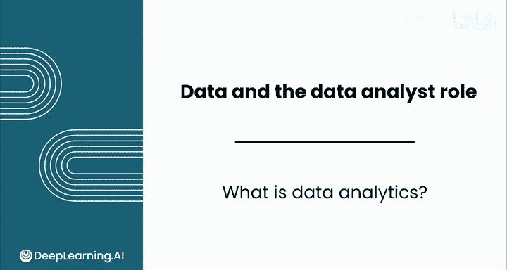

Data analytics is used almost everywhere， making a meaningful impact on our lives in often invisible ways。

 the device we're using to watch this video clothes you're wearing right now。

 even the breakfast you made this morning will likely influence in some way by data analytics At its core。

 data analytics is a diverse set of skills and tools that enable businesses to make better decisions It's all about leveraging data to gain insights and support decision making rather than relying on chance or experience alone Data analytics is a multidisciplinary field that combines math。

 programming and business intuition you're not just doing math for the sake of mathematical understanding like developing a geometric proof or programming for its own sake like developing an algorithm for sorting a list of numbers Data analytics harnesses math and programming together to achieve a specific business goal Data analytics has a lot in common with investigative roles like a scientist。

 detective or journalist a scientist starts with a specific hypothesis。

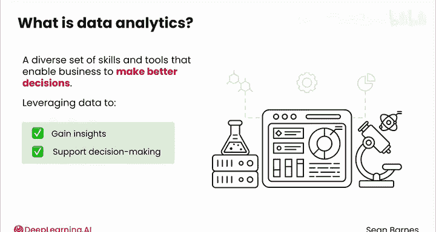

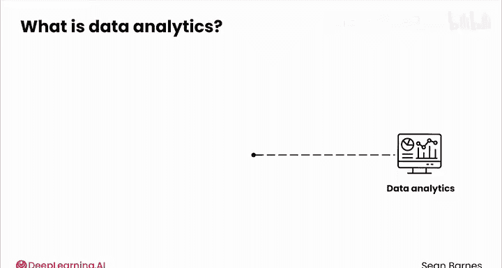

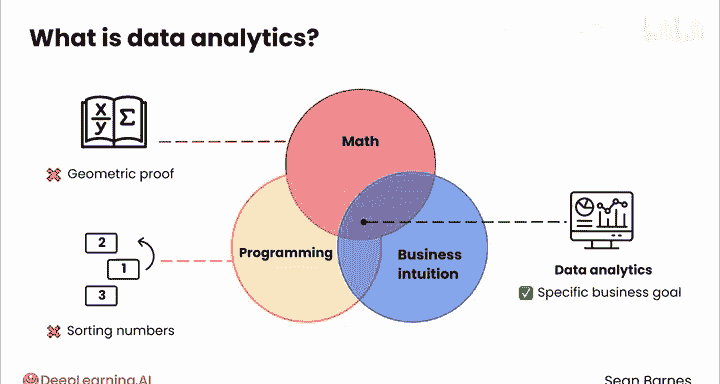

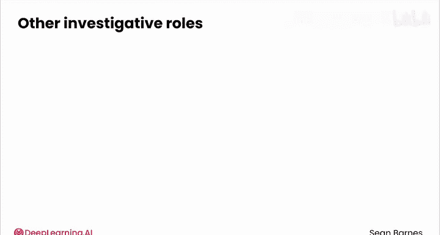

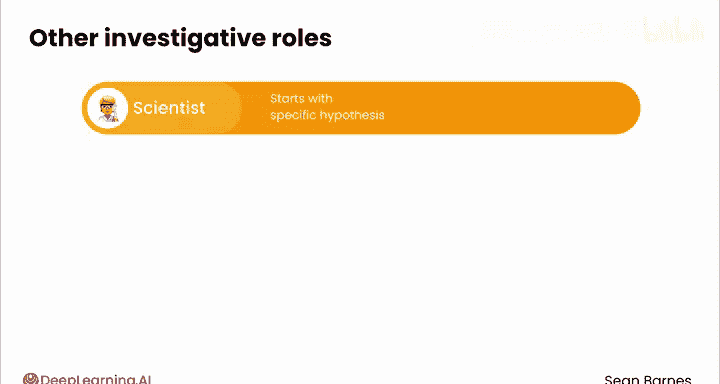

As data to evaluate the hypothesis A detective gathers evidence and pieces it together to understand the crime。

 A journalist synthesizes information and creates a compelling narrative for a particular topic data analytics sounds a lot like data analysis but these concepts differ in three key aspects scope techniques and business integration data analytics has a broader scope。

 including realtime and predictive modeling that goes beyond retrospective analysis data analytics also requires more sophisticated techniques。

 including advanced programming visualization software and big data techniques plus it often involves a more complex iterative process data analytics is typically deeply integrated into business decision making systems rather than used to answer one-off questions it aims to forecast trends and guide decisions as well as interpret past data When a company tracks their budget over time in a spreadsheet that's data analysis when they use sophisticated statistical modeling techniques to analyze。

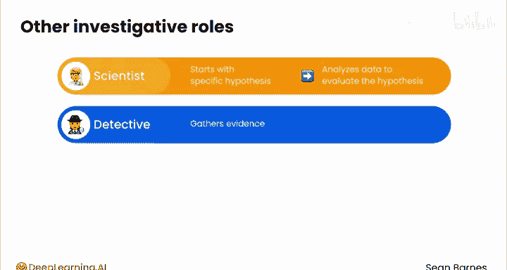

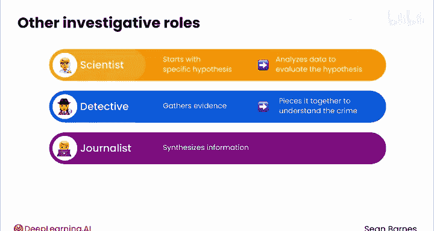

lararge data sets for multiple sources， create visualizations to identify the most promising revenue streams and integrate these insights into a real-time decision making system。

 That's data analytics。 It might seem like data analytics is a brand new feel that's only come about because of the recent acceleration in the tech industry That's part of the story data analysis has actually been around for a while。

 Here's what's new and what's not new。 statisticians scientists and engineers have been analyzing data for a long time。

 and data visualization has been around for millenia。

 The first documented data visualization dates back to 1150 B almost 3000 years ago。

 It's an ancient Egyptian map of goldmins called the Tin papyrus map。

 the ancient Egyptians were pretty savvy with data。

 What is new about data analytics is the explosion of the data itself。

 We're collecting more detailed data than ever before plus computing has evolved in tandem giving us more powerful tools to analyze that data。

 The ancient Egyptians weren't exactly working at this。

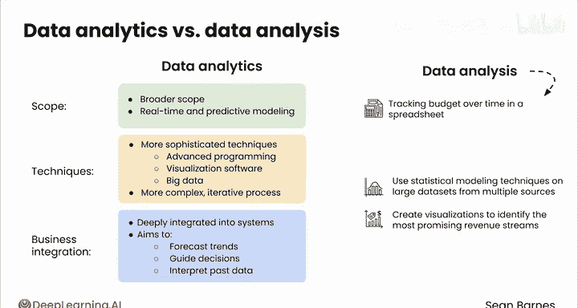

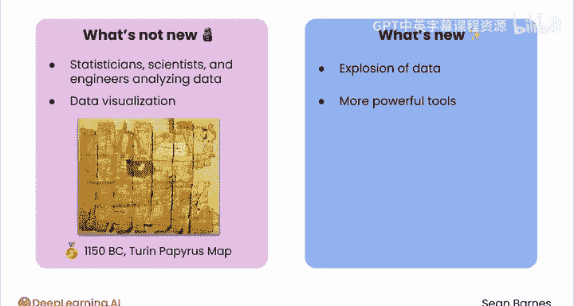

of 96000 Taylor Swift fans packed into a stadium on their mobile devices or 615 million monthly active Spotify users and I doubt they were programming in Python These trends to modern data analytics with its expanded scope more sophisticated techniques and business integration so where can data analytics be useful that scope is nearly infinite if you check out some job postings。

 you'll see data analysts are in demand at tech companies。

 hospitals sports teams manufacturing plans， even conducting research and academic institutions which is where I started in the field while you're searching for job opportunities。

 you'll see postings for business intelligence analyst data scientists and other similar titles use interchangeably with data analysts Trufully there's a lot of overlap。

 but I'll share some of the nuances data scientists often lean more heavily into sophisticated modeling techniques while data analytics is more inclusive of foundational statistical techniques and data visualization。

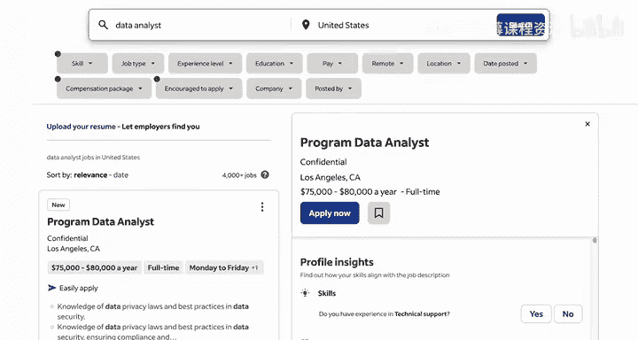

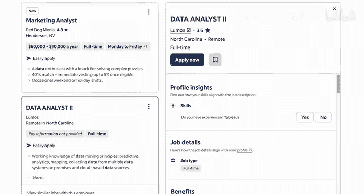

Business intelligence analysts tend to use commercial software like spreadsheets with a lighter emphasis on programming Ultimately these distinctions are somewhat arbitrary。

 the same title may correspond to different tasks at different companies as a data analyst you may find yourself drawn more to certain methods and therefore your work may fall under one or several of these domains data analytics rewards curiosity problem solving skills and the ability to influence others and of course it's really rewarding to see the impact of your work in the real world In this course you'll explore the tools and techniques you need to start leveraging data to drive better decisions Let's get right into a foundational concept evidence-based decision making。

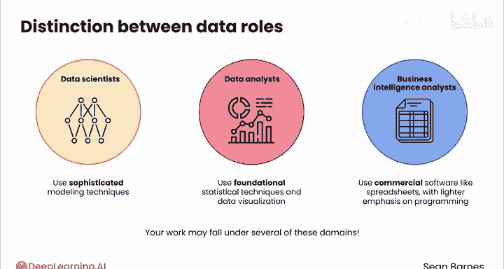