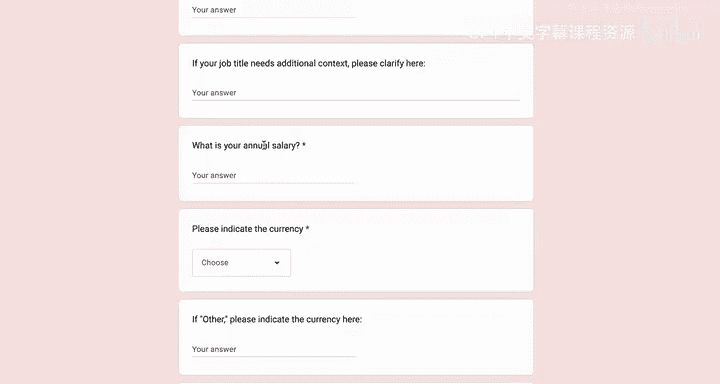

# 吴恩达《数据分析（数据分析基础／应用统计学，1-2课／共5课）｜DeepLearning.AI Data Analytics》中英字幕（claude-4-s - P60：59_数据收集与预处理.zh_en - GPT中英字幕课程资源 - BV1SCXrYuEwr

It's time to roll up your sleeves and get your hands dirty with data。As a data analyst。

 you may have a clear problem to solve， but you'll need the right data to uncover the most actionable insights。

 Let's see how this step works。 Data collection involves identifying sources of information that will help solve your problem。

 This process could involve querying databases， conducting surveys or even scraping data from the web。

 Data preprocessing involves transforming your data for analysis。

 Your goal is to shape the data into a form that's ready for your analytical tools。

 The sophisticated techniques you'll employ as an analyst require the right preparation to yield useful results。

 It's foundational。 Let's start with data collection。

 Pick the right data to solve a problem can be challenging。 Here's how to do it。 First。

 revisit your problem statement。 Ident the primary outcome of interest。 Is it sales， reviews， costs。

 then brainstorm data that puts the primary outcome in context。 For example。

 if your question is about customer retention。 Your primary outcome of interest might be the rate at which customers cancel their service。

😊，With that outcome in context， you can use customer demographics。

 purchase history and user engagement metrics。 Once you know what kind of data you need。

 brainstorm potential sources。 This could include internal databases。

 publicly available data sets or even data you collect yourself through surveys or experience。

 Not all data sources are created equal。 Consider the accessibility of your data Do you have permission to access it。

 and its quality。 Is it accurate and up to date， you might not be able to collect all the data you initially brainstormed。

 prioritize the sources that are most likely to yield valuable insights。

 you'll also want to make sure the data you collect。

 keeps your project within budget and on time if you're unsure about which data sources to prioritize。

 Ask domain experts。 They can identify the types of data that are typically used to answer similar industry questions。

 The raw data you collect will rarely be ready for you to jump into the analysis immediately。

 Preprocessing is the work you do to convert the raw data into data that's ready for analysis。

 Here are some common。First， formating， ensuring data is in a consistent format that is easy to analyze。

Next， cleaning， removing errors， duplicates， and outliers。Then handling missing values。

 filling in gaps or removing incomplete data。Lastly， transformation， converting data types。

 aggregating values， or creating new features。I want to show you a real world example。

 This is a publicly available survey to collect selfreported manager salaries。

 Each person submits their salary information via a Google form for some options such as age range or years of professional experience。

 you can select from a set of options。 but for others such as the job title， industry。

 salary or location， the information is just pretex。

 Here's a spreadsheet of results from that survey， which is regularly published by Ask a manager org。

 These are the results from 2019， which are a bit messier than recent ones。

 Each row or observation is one response。 and each column is one question， like how old are you。

 what industry you work in and so on。 you can tell just by looking at this spreadsheet that some of the information looks inconsistent within a given column。

 For instance， you can see that some salaries have the unit of currency included with the amount。

 and some don't。 You see this one has the dollar sign on the right。

 This one has a dollar sign in the front。

And this one has a space and no currency symbol at all。

 You can also see that there is a lot of variation in how the locations were submitted。

 So in this case， it's the city and the state and the country with slashes instead of commas。

 and in this case， it's just a region of a state。Then you also have rows that don't seem legitimate。

 For example， there are a couple rows here that only have some information。

 a salary of $3 one year or less of professional experience。

 so this does not seem like a legitimate submission Similarlyly for this entry。

 they only report an annual salary of one plus if you wanted to analyze this data by location you'd have to do quite a bit of work to standardize salaries and locations plus removing illegitimate rows Ily。

 you should consider these potential issues upfront and design constraints into the form。

 For example， later versions of this form from Asmanager。

org ask for USstate and give more options for currency preprocessing data can be very satisfying because you see such a dramatic change from messy to beautiful。

 It's the same reason， Powerwa videos are so popular online follow me to the next video to see how you can use this clean and tidy data to conduct useful analyses。

