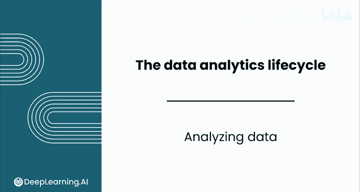
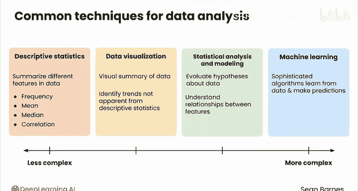
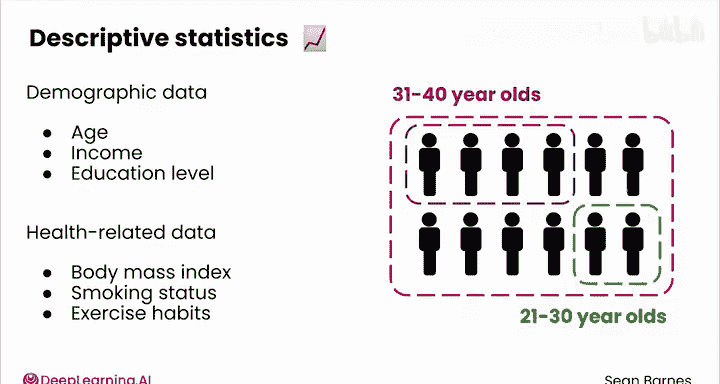
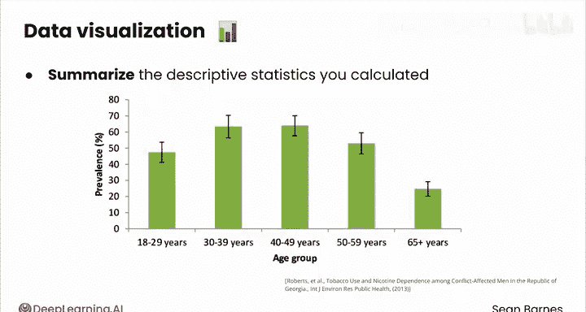
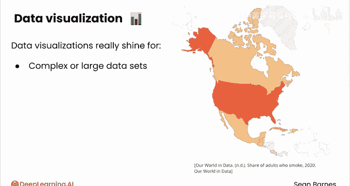
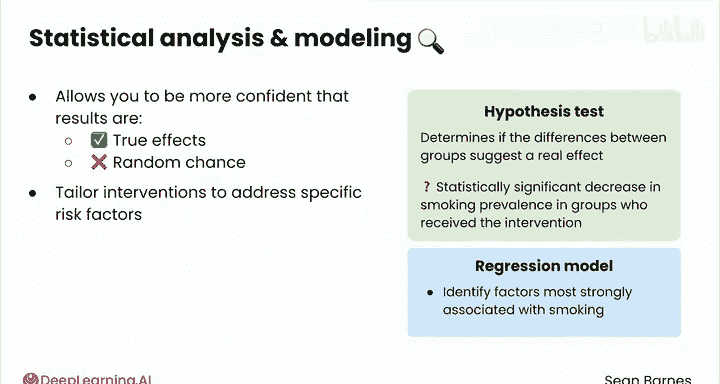
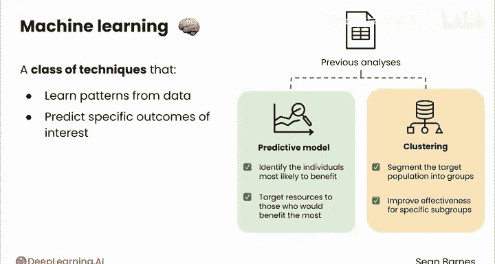
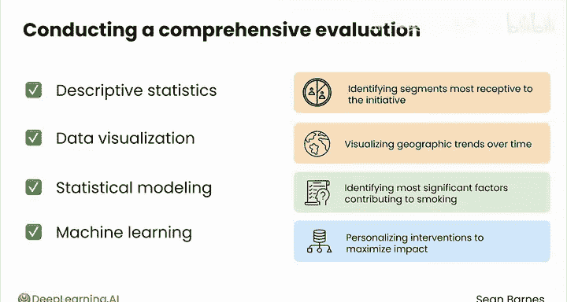

# 吴恩达《数据分析（数据分析基础／应用统计学，1-2课／共5课）｜DeepLearning.AI Data Analytics》中英字幕（claude-4-s - P61：60_数据分析.zh_en - GPT中英字幕课程资源 - BV1SCXrYuEwr

Now that your data is prepped and ready， it's time for the main of event analysis。

 this is where you turn raw data into insights。 depending on the type of data you have and the questions you're trying to answer。

 you can choose from many different analysis。 Descriptive statistics summarize different features in your data using measures like frequency。

 mean median or correlation。 You've used many of the core descriptive techniques so far in this course。

 Data visualization。 a picture is worth100 words。 Oftentimes a visual summary of your data can help you identify trends that are not as apparent from descriptive statistics alone。

 Stat analysis and modeling allow you to evaluate hypotheses about your data or understand relationships between features。

 You'll explore many of these techniques in the next course in the series。

 Mach learning uses sophisticated algorithms to learn from data to make predictions。

 These methods generally increase in complexity， but each can be powerful on its own Descriptive statistics and visualization alone are often well suited to your problem。

 Suppose you are working as a data analyst。😊。

For a public health organization， your current project is to evaluate the effectiveness of an anti-smoking initiative aimed at 21 to 30 year olds。

 Let's take a look at some of the analysis you might perform for this project you can start with descriptive statistics。

 analyzing demographic data such as age， income and education level and health related data such as body mass index。

 smoking status and exercise habits for the target population you can perform segmentation to assess characteristics of the subgroups in your data For example。

 you may calculate the smoking rate for every age group so that you can better understand how the 21 to 30 year old age group compares with others Data visualization can help summarize the descriptive statistics you calculated for example you may want to plot the smoking prevalence across different age groups in a bar chart to enable an easy comparison。

You could also create a line chart to track the trends in smoking prevalence over time。

 Data visualization really shines for complex or large data sets For this project。

 you could create a map showing the geographic distribution of smoking rates for the target population The map allows you to quickly identify hotspots in specific states or regions statistical analysis helps you evaluate specific questions about your data。

 It allows you to be more confident that the results you observed are true effects rather than ones due to random chance。

 You could conduct hypothesis testing， which determines that the differences between groups are meaningful enough to suggest a real effect rather than random variation。

 you could test whether there is a statistically significant decrease in smoking prevalence in groups who receive the intervention。

 You could also develop a regression model to identify the factors that are most strongly associated with smoking Inights from this analysis could help tailor interventions to address specific risk factors for sophisticated modeling。

 you could use machine learning Mach learning is a classic。

that learn patterns from data to predict specific outcomes of interest。

 given what you learn from the previous analyses， you might consider training a predictive model to identify the individuals most likely to benefit from the intervention。

 This model could help target resources to those who would benefit the most。

 you could also use a clustering algorithm to segment the target population。

 into groups with similar characteristics。 This approach might help you improve the effectiveness of the intervention for specific subgroups。

 in contrast with the one-s fits all approach by combining descriptive statistics。

 data visualization statistical modeling and machine learning。

 you could conduct a comprehensive evaluation of the public health intervention program your work enables the organization to make data-dven decisions about future initiatives。

 including identifying segments of the population， most receptive to the antismoking initiative。

 visualizing geographic trends over time， identifying the most significant factors contributing to smoking prevalence。

 personalizing interventions to maximize their impact。

For each project， consider a multifaceted approach。

 try methods from all of these categories to set yourself up for success in the next step。

 Inight finding， follow me to the next video to learn how。

