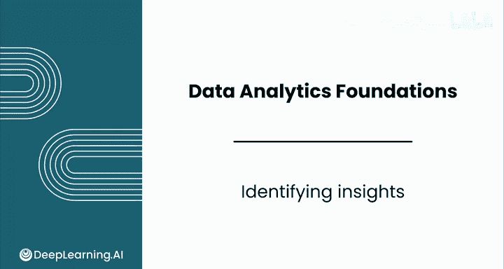
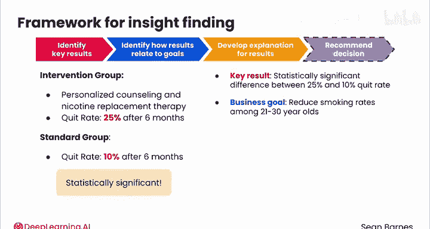

# 吴恩达《数据分析（数据分析基础／应用统计学，1-2课／共5课）｜DeepLearning.AI Data Analytics》中英字幕（claude-4-s - P62：61_洞察识别.zh_en - GPT中英字幕课程资源 - BV1SCXrYuEwr

All analysis is in the service of identifying insights。

 What do the numbers mean and how do they help you make decisions？

Here's a framework that you can use for In finding， first identify key results。

Then identify how the results relate to the business goals， develop an explanation for the result。

 and if applicable， recommend a decision。Let's do a little practice session。

 I'll provide a hypothetical result from your public health project。

 and you take a moment to think about a good interpretation。

 Suppose you conducted a controlled experiment。 Some participants received the intervention。

 Personal counseling sessions and nicotine replacement therapy。

 You found that these participants had a significantly higher quit rate。

 compared to those who only received standard education materials。

 Sa the intervention group had a 25% quit rate after six months。

 compared to a 10% quit rate for the standard group。 This result was statistically significant。

 meaning that you were confident that this finding is a true effect， not just a coincidence。😊。

How would you identify the insight in this result？Let's step through the In finding framework you saw a moment ago。

 First， the key result。 you found a statistically significant difference between the 25% quit rate of the intervention group and the 10% quit rate of the standard group。

 The business goal for this public health organization is to reduce smoking rates among 21 to 30 year olds。

 based on your evidence you can conclude that the provided interventions are better at reducing smoking compared with standard practice。

 Here's your insight。 You can recommend several ways that your organization can take action on this insight。

 You could invest in resources to provide the intervention to all 21 to 30 year olds to smoke。

 then study whether the effects of the intervention are still positive。

 Other options include identifying a subset of people who benefited most from the intervention or promoting awareness about its benefits。

 So there you have it。 We identified the key result connected it to the business goal provided an explanation for the result and identified some potential recommendations for the stakeholders to。

😊。

Consider。You've seen that analysis is about more than crunching numbers。

 it's about translating findings into an insight that can provide evidence for a particular business decision in the next video。

 you'll learn how to communicate those insights effectively and ensure they reach the right audience I'll see you there。

😊。