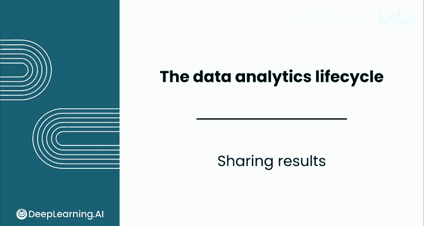
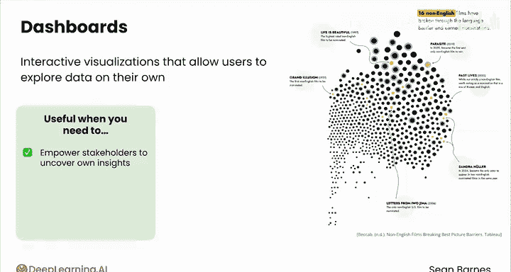
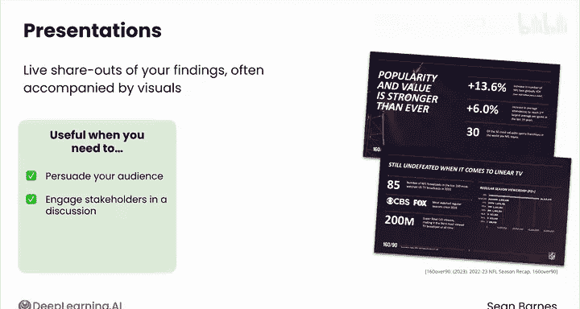
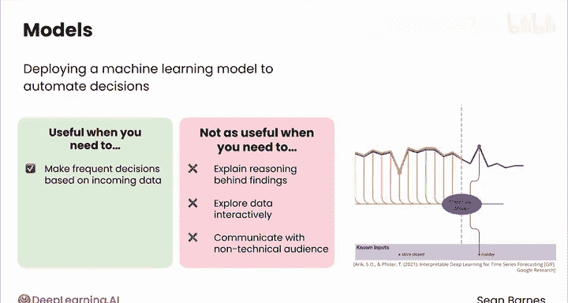
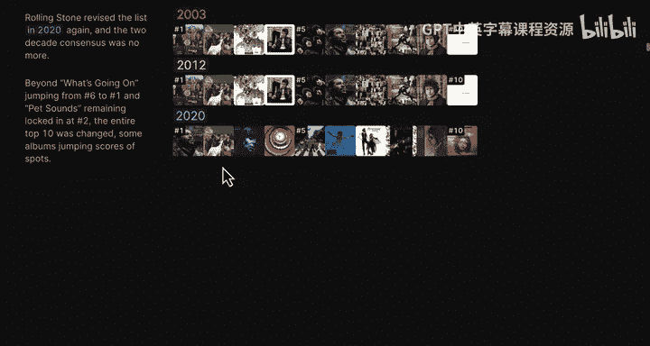
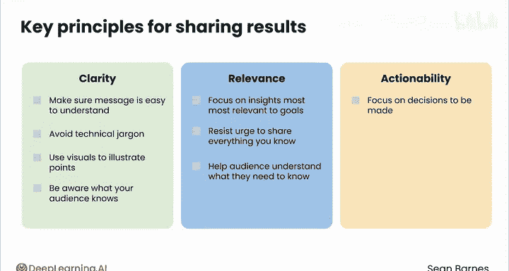

# 吴恩达《数据分析（数据分析基础／应用统计学，1-2课／共5课）｜DeepLearning.AI Data Analytics》中英字幕（claude-4-s - P63：62_成果分享.zh_en - GPT中英字幕课程资源 - BV1SCXrYuEwr

Congratulations， you've completed your analysis and developed a set of insights that you think can help deliver impact。

 Now it's time to share your findings with the world， or at least with the relevant stakeholders。

 when deciding how to share your results。 Consider two primary factors。 First。

 what is the best approach for the insights you need to summarize complexplex data needs visualization。

 If your communicating several insights they should be summarized。

 numbers should be contextualized with meaning， new data can be contrasted with historical data。

 Second， what are your stakeholder needs。 technical knowledge among stakeholders varies。

 Those with a strong technical background will one or no details。

 while those with less technical experience may benefit from a careful walkthrough with reduced jargon stakeholders may have time constraints or prefer particular method of absorbing information。

 They also have vary levels of control over the business decisions being made。

 You should choose an appropriate format to share your results based on these questions。

 One of my favorites is the simple report。 It's underrated。😊。

Forts are written summaries of your findings。 They often include visualizations。

 They are useful when you need to provide a thorough explanation。

 document your methodology or present complex findings to a technical audience。

 They are not as useful when you need to communicate quickly or with the non-technical audience who might not have the time or expertise to read a lengthy report。

 You could also choose a dashboard， and interactive visualization that allows users to explore data on their own。

 These are useful when you want to empower stakeholders to uncover their own insights。

 provide easy access to current information or track performance over time。

 They are not as useful when you need to provide a detailed explanation。

 document methodology or when interactivity isn't useful。

 You'll often find yourself giving presentations live share outs of your findings。

 often accompanied by visuals。 They can be a great opportunity for storytelling and are useful when you need to persuade your audience。

 engage stakeholders in a discussion or present to a large group。

 They are less useful when the audience needs to reengage with the information。😊。

Or when audience members need different depths of explanation。

 you can also consider deploying a machine learning model that can be used to automate decisions；

 they are useful when you need to make frequent decisions based on incoming data。

 they are not as useful when you need to explain the reasoning behind your findings。

 explore data interactively， or communicate with the non-technical audience。

There are many other forms of communication you can experiment with。

 One of my favorites is scrollly telling， which is sort of an interactive version of a report。

 Here's a great one from Pudding Dot cool。 What makes an album the greatest of all time。😊。

you can see the 2003 ranking， which segments albums into a top 10。

 11 through 250 and 251 through 500。You can see the story evolves。

 which creates a really interactive experience where you're also getting insights about all of this great music。

 In this example， you can actually compare the top 10 across three different points in time。

 What new albums entered the top 10 in 2020。😊。

I encourage you to check out Pudding DotCool for more engaging examples。

No matter how you choose to share your results， there are a few key principles to keep in mind。

 First， clarity， make sure your message is easy to understand。

 avoidvo technical jargon and use visuals to illustrate your points。

 be aware about what your audience knows and what they may not know。 Second relevance。

 focus on the insights that are most relevant to your stakeholders goals。 Typ。

 you will know way more about your data than needs to be communicated。

 Re the urge to share everything you know。 Instead。

 help your audience understand what they need to know。 Last， actionability。

 remember to keep your focus on the decision to be made。 if appropriate。

 provide evidencebased recommendations。 by following these principles。

 you can ensure that your work has a real impact on the business。

Sharing your results is beyond crucial。 Try to resist the urge to toss your analysis over the fence and move on to your next project。

 leaving your stakeholders to figure out what it all means on their own。

 commit to developing the most effective story about your insights。

 It helps ensure the final decision is ultimately informed by your hard work and expertise。

