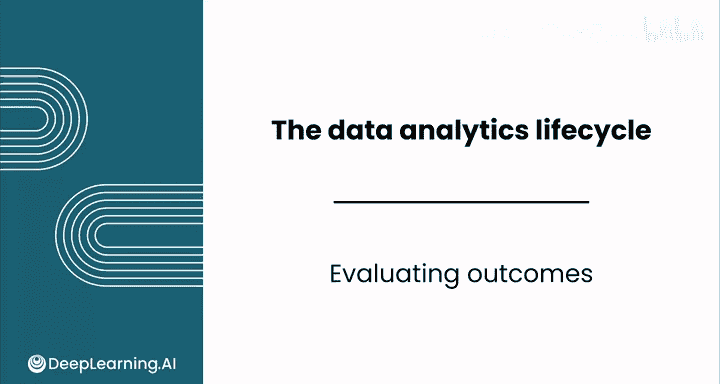
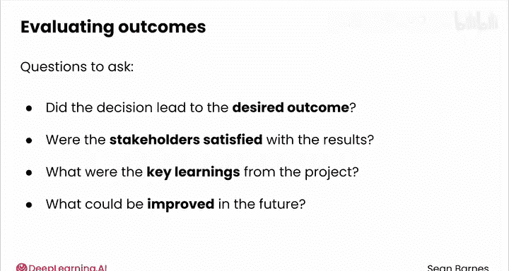
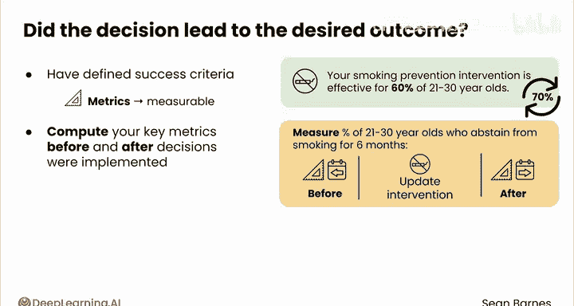
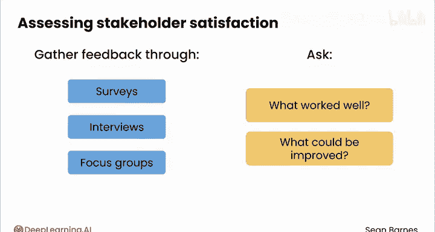
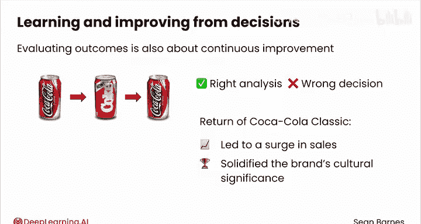

# 吴恩达《数据分析（数据分析基础／应用统计学，1-2课／共5课）｜DeepLearning.AI Data Analytics》中英字幕（claude-4-s - P64：63_效果评估.zh_en - GPT中英字幕课程资源 - BV1SCXrYuEwr

You've reached the final stage of the data analytics lifecycle， evaluating outcomes。

 This is where you assess the impact of your work。 You'll want to ask。

 did the decision lead to the desired outcome where the stakeholders satisfied with the results。

 What were the key learnings from the project。 What could be improved in the future。

 Let's explore some strategies for addressing each question。

 In order to evaluate whether the decision led to the desired outcome。

 you should have defined success criteria Ily， these criteria are directly measurable and for that reason they're often called metrics。

 For example， you might find that your smoking prevention intervention is effective for 60% of 21 to 30 year olds。

 you might update the intervention with the goal of increasing that metric to 70%。

 In order to evaluate outcomes， you should compute your key metrics before and after decisions were implemented。

 The difference in these values measures the impact of the decision。 For example。

 you can measure the percent of 21 to 30 year olds who abstain from smoking for at least six months both before。

And after you update the intervention。 did the percent go up down stay the same If it went up。

 that's evidence that your outcome was positive。 This type of evaluation may require statistically rigorous analysis You should also monitor the relevant metrics over an extended period to assess the sustainability of the positive effects。

 It's possible that the decision improved one metric while another key metric remain the same or even declined。

 For example， it's possible that the boost and quit rates for smoking is only temporary and levels out after one year。

 In order to assess stakeholder satisfaction gather feedback from those stakeholders through surveys。

 interviews or focus groups。 I've even found a quick chat in the elevator to be effective。

 Ask about their perception of the outcomes。 What worked well and what could be improved。

 this qualitative feedback provides valuable insights into the decisions impact。

 Eval outcomes is not just about measuring success or failure。

 It's also about continuous improvement data analyst can sometimes perform a less。

analysislysis or even if they performed the right analysis， maybe the wrong decision was made。

 These outcomes， although not desirable， still offer a great learning opportunity。

 A famous example of learning from a bad decision comes from the story of new Coke。

 In 1985 Coca-cola facing declining market share， replaced its classic formula with a sweeter version called New Coke。

 Despite extensive taste test suggesting consumers preferred the new taste。

 the public reacted with outrage， Proing an almost immediate nostalgia for the original flavor。

 right analysis， raw decision。 This massive backlash forced Cocacola to reintroduce the classic formula as Coca-cola classic just 77 days later。

 While the company faced public ridicule and the short term， they ultimately emerged stronger。

 The return of Coca-cola classic LED to a surge in sales and solidified the brand's cultural significance。

 Even now， Coca-cola ads feature emotional themes like family。

 nostalgia and celebration rather than focusing on the beverage's taste。😊。

Acknowledging and learning from their mistakes， Coca-coa turned a potential disaster into a valuable learning opportunity。

 It serves as a reminder that even well-intentioned data back decisions can have unintended consequences and that the ability to adapt and learn from failure is essential for longterm success by taking the time to reflect on your work you will identify areas where you can improve this self-reflection will make you a highly effective data analyst so that takes us to the end of the data analytics lifecycle by embracing this iterative process you can ensure that your projects are always improving Once you've completed the practice assessment for this lesson I hope you'll join me in the next one。

 which is all about working with stakeholders。😊。