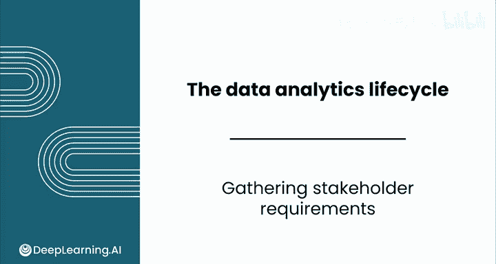
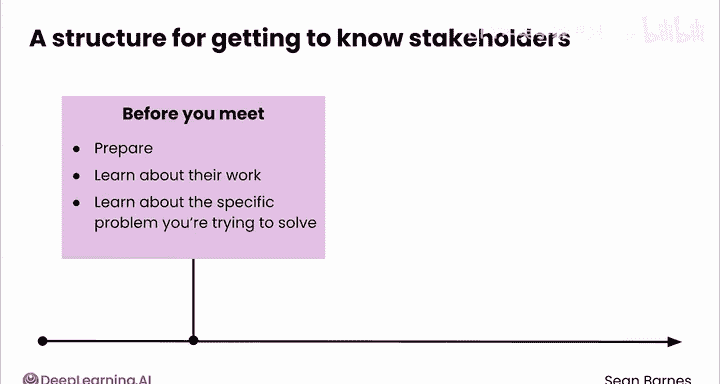
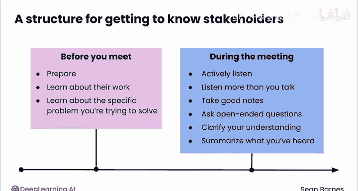
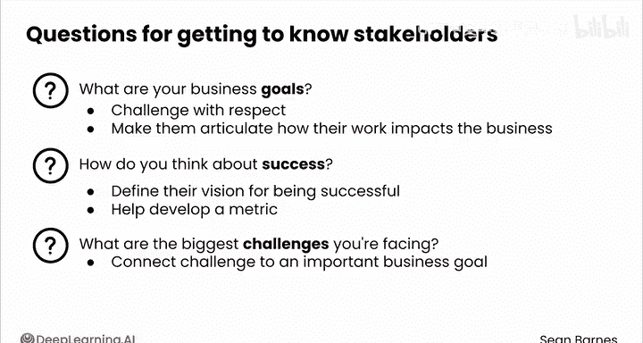
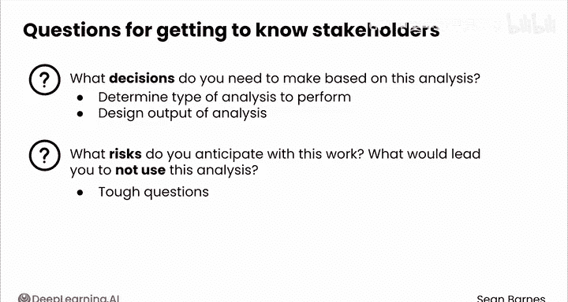

# 吴恩达《数据分析（数据分析基础／应用统计学，1-2课／共5课）｜DeepLearning.AI Data Analytics》中英字幕（claude-4-s - P65：64_收集利益相关者需求.zh_en - GPT中英字幕课程资源 - BV1SCXrYuEwr

When I first joined Netflix， I loved movies and TV shows。

 but knew very little about how all of this content was made。

 learning how to introduce data into this creative world was both exciting and nervewracking。

 The only thing I was certain about was that I needed to immerse myself in the world of studio production。

 I met with my stakeholders working on different aspects of live action production。

 including visual effects and postproduct。 I learned so much from these people about how things work in their world and the challenges they were facing。

 These challenges sparked ideas about how to introduce analytics into their decision making。

 I was only able to develop effective insights for the production team because I spent time understanding their work with time。

 I gained more specialized knowledge called domain knowledge about live action production。

 I started to feel more confident proposing collaborative ideas。

 early successes built up trust in my team and our stakeholders became more knowledgeable about our capabilities。

 It's become a highly productive partnership that continues to deliver results to this day。

 Both stakeholder communication。😊，And domain knowledge go both ways。 You learn about the business。

 and the business learns what you can provide for them。

 My advice to you is to absorb domain knowledge from the source。 The people who are doing the work。

 readings and conferences can supplement your knowledge。

 but there's no substitute for good old fashion quality time。 observeerve， listen。

 ask questions and over time， you'll be able to execute on big opportunities for impact together。

 Let's talk about how to do that。 I have a helpful structure for you。

 Before you meet your stakeholders prepare do what you can to learn about their work and the specific problem you're trying to solve This prep work will help you ask informed questions during the meeting。

 actively listen to what your stakeholders have to say。

 Pay attention to their goals and their pain points。 Listen more than you talk。

 and take good notes because trust me， you'll forget the details later。

 Next is to ask openend questions。 don't just ask for yes or no answers。

 encourage stakeholders to elaborate and provide details。😊。

Instead of asking， do you think the intervention is effective， ask。

 what factors do you think are contributing to the intervention results we're seeing。

 Make sure you clarify your understanding of what stakeholders are saying。

 Ask followup questions At the end of the conversation。

 S what you've heard to ensure you're on the same page。 Most importantly。

 approach the conversations with humility。 These are people who are experts at what they do and they spend a lot of time learning how to do it。

 So start from that assumption。 A the attitude that you're here to save the day。

 Quess are a big part of this process。 That's what helps you learn about the problems you're trying to solve。

 Some of the most relevant questions are。 What are your business goals。

 Sometimes this is a straightforward question， sometimes not challenging your stakeholders with respect。

 or making them articulate how they think their work impacts the business is a great way for you to bring clarity to your work and ultimately add value。

 How do you think about success。 Are the specific metrics you use to evaluate success。

 stakeholders might say they are。

No metrics， but you still would want to have them define what their vision is for being successful。

 You can also use this as an opportunity to help them develop a metric。

 What are the biggest challenges you're facing。 Let's say one of your stakeholders says they are spending too much time focusing on repetitive tasks。

 Ask yourself， can I connect this challenge to an important business goal。 If yes， Great， If not。

 you may need to explore further to find what the true problem is。

 What decisions do you need to make based on this analysis。

 This question will help you determine which type of analysis to perform。

 It may also help you understand how to design the output of your analysis so that it's easy for your stakeholder to identify the right insights。

 What risks do you anticipate with this work， What would lead you to not use this analysis。

 These are tough questions that many people might not ask。 But if you don't。

 you can find yourself in a situation where you wish you had。Ultimately。

 you are responsible for how you spend your time。 So this is your chance to help ensure you use it well。

😊。

Maintaining alignment with your stakeholders is an ongoing process。

 It's not one and done by taking the time to understand your stakeholder needs。

 you ensure that your work alignlies with their expectations。 In the next video。

 you'll explore how to synthesize the information you get from stakeholders into an actionable plan for your analysis。

