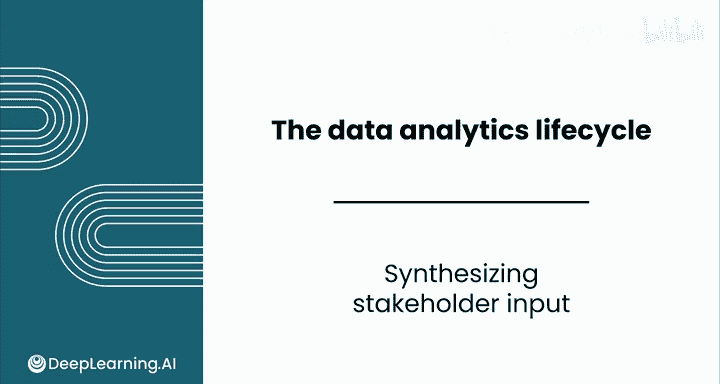
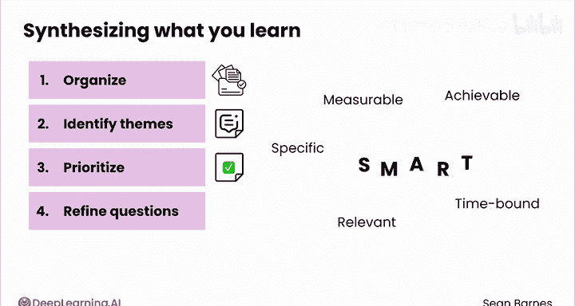
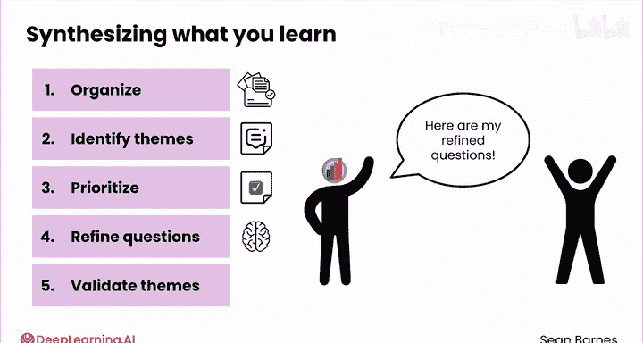
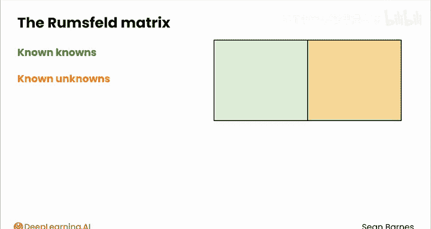
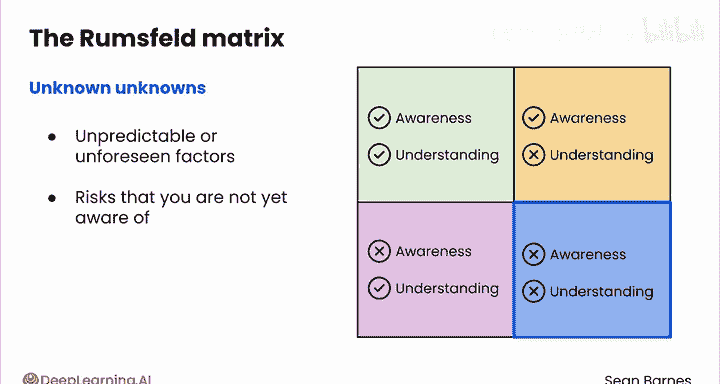
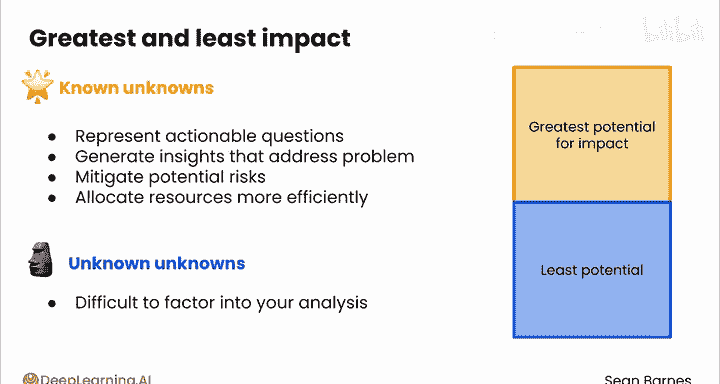
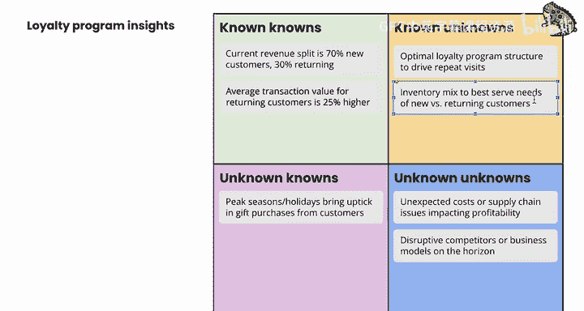

# 吴恩达《数据分析（数据分析基础／应用统计学，1-2课／共5课）｜DeepLearning.AI Data Analytics》中英字幕（claude-4-s - P66：65_整合利益相关者输入.zh_en - GPT中英字幕课程资源 - BV1SCXrYuEwr

So you've gathered a wealth of information from your stakeholders Now。

 how do you make sense of it all， Stholder needs can conflict with each other。

 and key stakeholders sometimes have difficulty articulating what they really need。 Some some way。

 you'll need to figure it out anyway。 Here's a process you can follow to synthesize what you learn from stakeholders。

 First， organize the information you've collected。 Compile notes。

 transcripts and documents into one place。 Then identify themes。 look for recurring ideas。

 What are the main concerns， goals and challenges that stakeholders mentioned。

 Sometimes it's hard to identify themes just by reviewing your notes。

 You can try writing distinct themes on sticky notes and sorting notes into each pile to see what stands out。

 or you can leverage LLms to synthesize themes。 Once you have your themes identified。

 prioritize not all information is created equal。 determine which insights are most relevant to the business goals。

 If you could address just one theme。 Which would it be and why。Based on your synthesis。

 refine your business questions。 make sure they are specific， measurable， achievable， relevant。

 and time bombed。 This is the smart framework。 Finally， validate your themes。

 Sha your refined business questions with stakeholders and get their feedback。

 This ensures you haven't listed anything important。

 It's the equivalent of active listening in a conversation。Essential。

 you're restating what you think the stakeholder said and getting confirmation that you're right。

 One tool you can use to synthesize stakeholder input is the rumsfeld matrix。

 It's a framework that categorizes information into four quadrants based on knowledge and certainty。

 No knowns， known unknowns， unknown knowns and the toughest of all， unknown unknowns。

 The unknown categories may sound a little stressful。

 but this framework can help you prioritize areas for further investigation。

 Let's walk through each of the categories in detail。

 No knowns are areas where you are certain you know something。

 This quadrant contains facts information。😊。

And insights that you and your stakeholders are aware of and understand。

 They are the foundation of your decision making。 known unknowns are areas where you are certain you don't know something。

 This quadrant includes questions or uncertainties that you are aware of but you don't have the answers to yet they are the gaps in your knowledge that you need to address through data collection and analysis。

 unknownknows represent knowledge that you have but don't know that you have it。

 This quadrant includes information that you or your stakeholders possess subconsciously。

 but havet explicitly articulated。 They might be based on intuition。

 experience or anecdotal evidence。 Unknown unknowns means things that you don't know。 you don't know。

 These are effectively blind spots。 Unpredictable or unforeseen factors that can impact your analysis。

 They are risks that you are not aware of yet。 As a data analyst。

 the known unknowns category often holds the greatest potential for impact。

 Here's why known unknowns represent actionable questions that you can answer through data analysis By focusing on these questions。

 you can generate。

iteThat directly address the business problem at hand。

 identifyingdentifying and addressing known unknowns can help you mitigate potential risks associated with your project by prioritizing known unknowns。

 you can allocate your resources such as time， budget and expertise more efficiently。

 focusing on the areas that will yield the most valuable insights。 In most cases。

 you won't want to spend a lot of time on the unknown unknowns。

 It's difficult to factor them into your analysis。

Let's take a look at an example of how to apply the Rumsfeld matrix using the exotic pet store you saw in previous modules。

 Suppose the store is planning to develop a loyalty program to increase repeat customers。

 You've interviewed stakeholders and collected this set of insights here。 Let's categorize them。

 I'm just going to do this in a slide deck here since it's quick。 but you might prefer another tool。

 current revenue split is 70% new customers，30% returning。 This is a fact。

 So let's group it with the known knowns。😊，Unexpected costs or supply chain issues impacting profitability。

 This is an unpredictable factor that can impact your analysis。 So it's an unknown， unknown。

 Op loyalty program structure to drive repeat visits。This is an identified question， so it's a known。

 unknown disruptive competitors or business models on the horizon。

This is an unpredictable factor that can impact your analysis， so it's an unknown， unknown。

Average transaction value for returning customers is 25% higher。This is a fact。

 so it belongs with the known knownuns。Peak seasons。

 holidays bring uptick and gift purchases from new customers。

This is an insight from your sales team that you may not be aware of yet。

 so it's an unknown known inventory mix to best serve needs of new versus returning customers。

This is an identified question。 So it's unknown， unknown。 So there you have it。

 a way to organize the information you've gathered from your stakeholders。

 identifying the optimal loyalty program structure or the best inventory makes to serve the needs of new versus returning customers may be excellent opportunities to deliver impact for the business。

 Remember， synthesizing stakeholder input is not just about summarizing what they said。

 It's about extracting insights。 Connect the dots。 This process will help you formulate actionable business questions。

 Foow me to the next video to see how to extend this thoughtful process of working with stakeholders。

😊。

