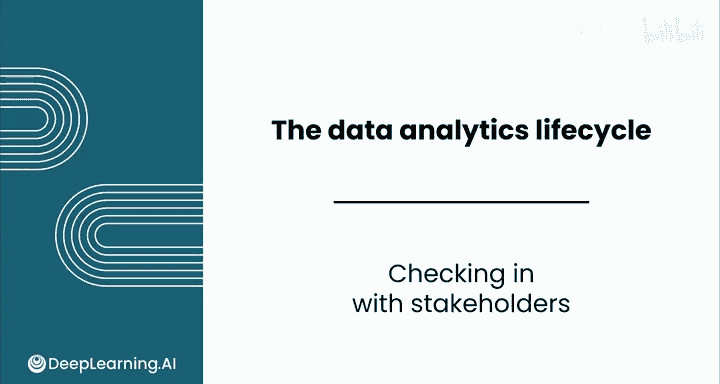
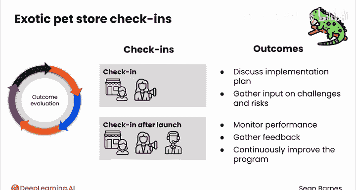

# 吴恩达《数据分析（数据分析基础／应用统计学，1-2课／共5课）｜DeepLearning.AI Data Analytics》中英字幕（claude-4-s - P67：66_利益相关者沟通跟进.zh_en - GPT中英字幕课程资源 - BV1SCXrYuEwr

Once you have completed the first phase in the data analytics lifecycle to find the problem。

 you might be tempted to just power through your data collection， preprocessing and analysis。

 But due to the properties of physics， stakeholders don't just disappear while you're working。

 It's crucial to check in regularly。 Here are a few thoughts on the benefits of checking in。 First。

 checking in with stakeholders ensures alignment。 confirming that you're on the right track。

 alignment is kind of a vague word。 It essentially means you and your stakeholders are on the same page about the project。

 by seeking feedback early on， you can also prevent rework later。 Plus。

 regular communication builds trust and demonstrates that you value stakeholders input。

 Stholder input can also help you navigate roadblocks in your work。

 allowing you to address potential issues more quickly。 Two or more brains are better than one。

 Finally， showing your progress allows you to provide continuous value and demonstrate the impact of your work throughout the project。

 Stholder check ins allow you to make your。😊。

Progress continuously visible versus waiting until the end to share results for each check in with stakeholders。

 you'll want to be prepared with a concise summary of your progress and any specific questions you like to address。

 This approach ensures a focused discussion。 except feedback by actively listening to their thoughts without any defensiveness。

 identify next steps to keep the project moving forward。

 This step creates a collaborative atmosphere， because you are showing that you plan to address their feedback promptly。

 So how do you know how and how often a check in with their stakeholders。 First。

 consider project complexity。 more complex projects might require more frequent check ins。

 Then think about stakeholder availability， consider stakeholder schedules when coordinating check ins。

 try not to overwhelm them with requests for their time。 And lastly。

 think about communication preferences。 Some stakeholders might prefer formal meetings。

 while others might be more comfortable with informal email updates or quick calls。

 Let's revisit our exotic pet store example。😊，To see how this might all work in practice supposeuppose your stakeholders for this scenario are the store owner who is the primary decision maker。

 a marketing manager and the customer service representative team。

 Let's explore how you might leverage stakeholder check-ins at each stage in the lifecycle and the outcomes you should look for During the problem definition phase an initial meeting with the store owner might result in a brainstorm of potential solutions like a loyalty program while gathering information on the store's overall goals。

 target audience and budget constraints Foups with the store owner and marketing manager could result in a refined problem statement focused on increasing customer retention and lifetime value through a loyalty program in the data collection and preprocessing phase a check- in with customer service representatives allows you to gather qualitative feedback on customers including common pain points plus their suggestions for a loyalty program Another check- in with the store owner and marketing manager could focus on identifying available customer data During the analysis and insight finding。

Pse a check in with the store owner and marketing manager allows you to share preliminary findings from customer data analysis such as the potential return on investment for a loyalty program。

 This is also an opportunity to problem solveve around any unexpected challenges In the results sharing phase you'll want to provide a comprehensive presentation of the findings including recommendations for a loyalty program structure。

 potential rewards and communication strategies This is the time to gather feedback on the proposed program During the outcome evaluation phase。

 check in with the store owner and marketing manager to discuss the implementation plan for the loyalty program gather input on potential challenges and risks check in with all stakeholders after launching their program to monitor its performance。

 gather feedback and continuously improve the program by consistently engaging with stakeholders throughout the data analytics lifecycle the pet store can ensure their loyalty program is well informed effectively implemented and ultimately successful in achieving its goal of increasing。

Customer retention and lifetime value you can imagine how supported the store owner。

 marketing manager and customer success team would feel because of these check ins they'd feel like they have a helpful partner as the business undergoes a big change。

Checking in with stakeholders throughout your data analysis project helps ensure you're on the right track with your work by fostering open communication you build trust。

 ultimately ensuring your analysis will lead to actionable insights that drive impactful decisions In the next video you'll see how to get the most out of this process through domain knowledge I'll see there。

