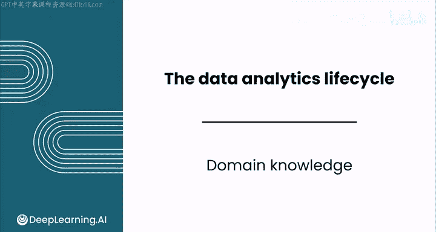
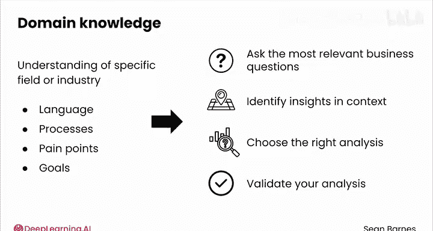

# 吴恩达《数据分析（数据分析基础／应用统计学，1-2课／共5课）｜DeepLearning.AI Data Analytics》中英字幕（claude-4-s - P68：67_领域知识.zh_en - GPT中英字幕课程资源 - BV1SCXrYuEwr

You're able to make the most of stakeholder insights when you're familiar with your industry。

 share a common vocabulary with stakeholders and can predict issues before they happen。

 You can develop this intuition by building your domain knowledge。

 Let's see why and how domain knowledge is the understanding of the specific industry you're working in。

 It's knowing the language， the processes， the pain points and the goals of the business。

 domain knowledge helps you in four key ways。 First。

 it helps you ask the most relevant business questions。

 It's like knowing what to search for on Google。 The right search query leads to the right results。

 domain knowledge also enables you to identify insights and context。

 A number might just be a number to someone else。 but with domain knowledge。

 you know what it represents and how it impacts the business。

 Different industries have different data challenges。

 and domain knowledge guides you to choose the right analysis for the business problem you identified。

 Lastly， domain knowledge can help you validate your analysis。

 ensuring that your insights make sense with。😊，In the context of the problem。

 domain knowledge gives you an edge over those who simply rely on technical skills。

 it allows you to truly connect your work to the business。

That brings us to the end of this lesson on stakeholder communication data analytics requires technical skills。

 but your soft skills will really set you apart。 if you can create an inclusive environment where your stakeholders can be themselves around you。

 you're going to gain trust and identify more opportunities for impact Up next is a practice lab that walks you through a music case study you can practice both your stakeholder communication and your strategic thinking skills using the data analytics lifecycle。

 Once you've completed the practice lab and assessment。

 join me in the next lesson to see how you can use LLms for stakeholder analysis。😊。

