# 吴恩达《数据分析（数据分析基础／应用统计学，1-2课／共5课）｜DeepLearning.AI Data Analytics》中英字幕（claude-4-s - P69：68_演示：使用LLM进行利益相关者分析.zh_en - GPT中英字幕课程资源 - BV1SCXrYuEwr

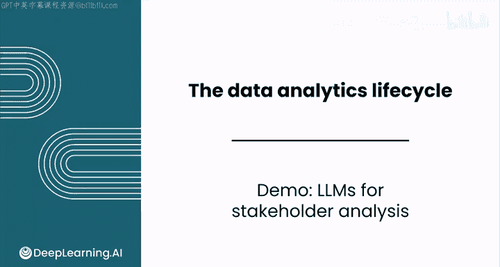

LLMs are a great thought partner for data analyst。 I want you to see how you can use them in practice when defining a problem and when working with stakeholders。

 let's explore an example for each of these use cases。

 Imagine you're working at a tech company whose flagship product is an app that allows users to track their hiking and biking trips。

 You're currently looking into some analysis of a data of all hiking and biking trips users have taken in the past five years Two stakeholders the engineering lead and the vice president of sales have sent you emails expressing their thoughts on the app's future direction your goal is to synthesize their input and develop a proposed approach for how your analysis may contribute to business impact based on what you can read in these emails you recognize that these two stakeholders have different goals Let's explore how you could use an LLM to compare and contrast the key points from both emails Allpro and LLM In this case。

 chatGBT with the initial context about the company as well as the following context describing what the two emails are about then I'll upload。

😊。

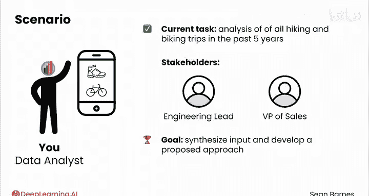

Text from each email， so I'm going to copy in some initial context about the company。

 explain who the stakeholders are， and ask the LLM to summarize each stakeholders's point of view about the app's future direction。

 as well as highlight common ground you can access the text file of the two emails in the download section below。

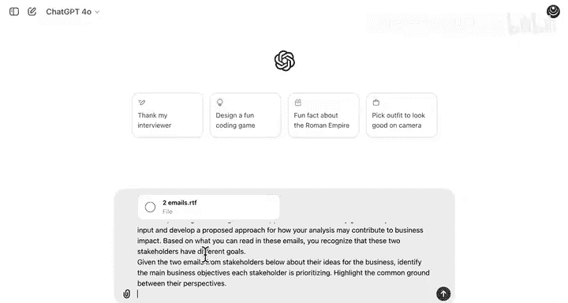

The LOM identifies that the engineering lead's objective is to enhance the user experience by adding new features。

 It also summarizes some ideas on how they might implement some of those changes。

 such as implementing a new leaderboard system for competition suggesting nearby trails based on location and preferences or integrating with wearable devices。

 On the other hand， the vice president of sales。 Sojana is focused on expanding the market presence of the app。

 So a couple ideas that she might be most interested in are partnering with outdoor gear retailers for discounts and promotions or targeting the corporate wellness market with tailored challenges and rewards。

 So across the two stakeholders one seems to be most focused on retaining existing users and one seems more focused on acquiring new members。

 Lastly， there's a section on common ground。 Both stakeholders are looking for data-dven insights to help inform their strategies。

 They also seem to be focused on user engagement， but again。

 one is focused on retention where the other seems to be focused on acquisition。

 Now let's ask a follow-up question to learn more。

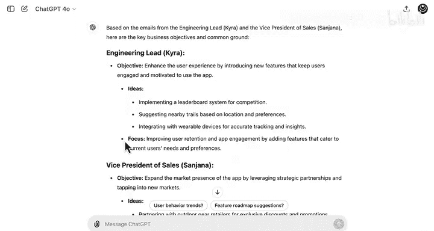

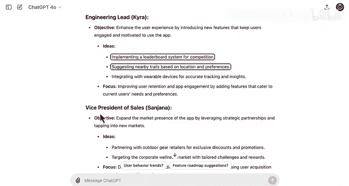

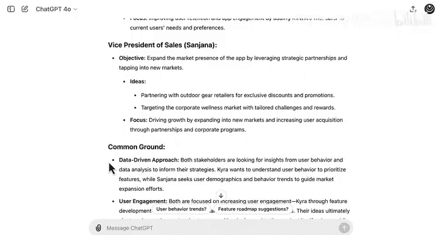

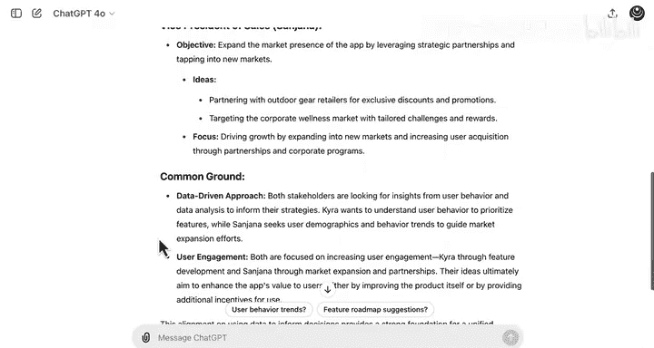

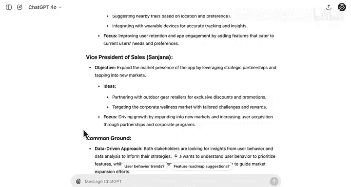

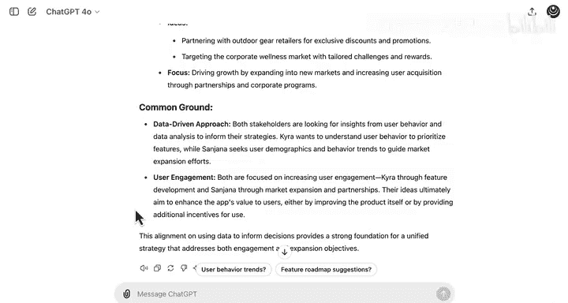

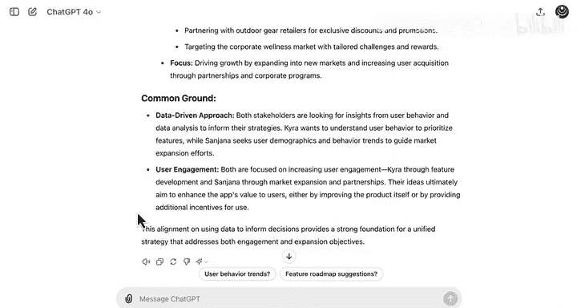

One thing I would like to understand is the kinds of business decisions that might be made based on these priorities。

 Here's a prompt that can help with that。 So I'm going to ask it to generate a list of business decisions that need to be made based on the stakeholders objectives。

 Priitizing decisions that the two would likely agree on。

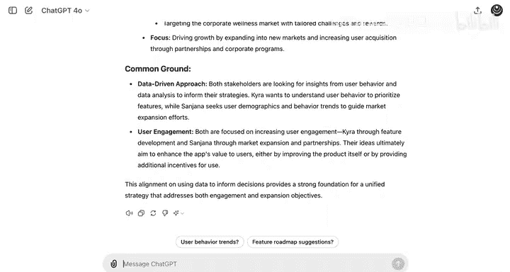

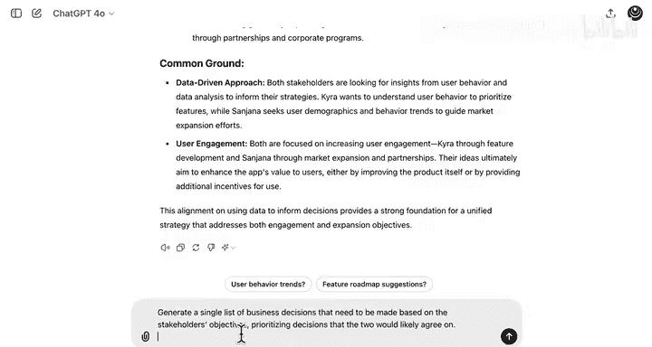

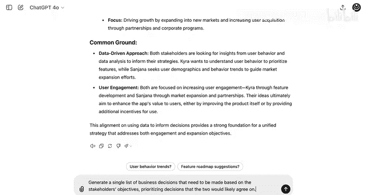

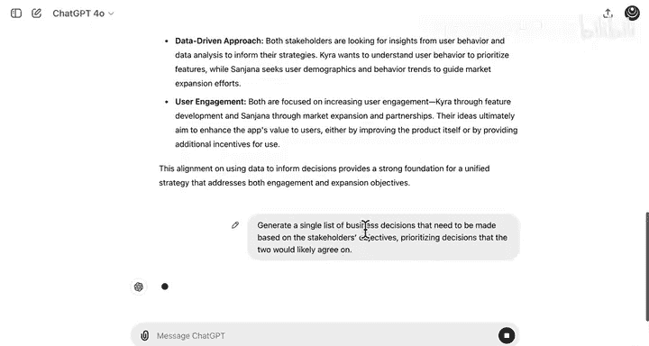

Overall， it gives a list of priorities。Starting with data driven product enhancements。

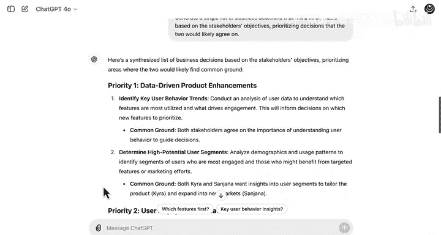

Talking about user engagement initiatives。

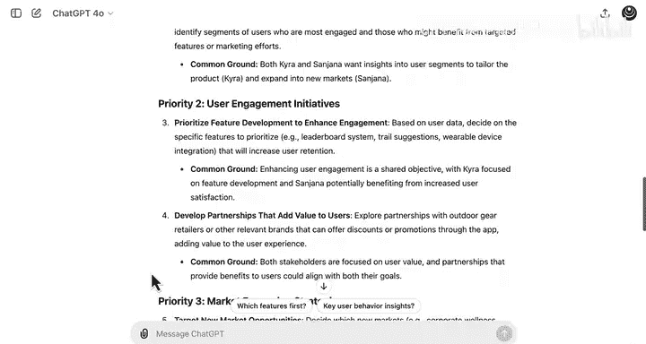

Talking about market expansion priorities， then integration and technology enhancements and finally monitoring and feedback。

 This is an interesting list of priorities at the top。

 the first priority clearly seems to align with both stakeholders and that they both again are interested in data-driven product enhancements but as you work your way down the list it seems clear that some of these priorities are more relevant to one stakeholder than another So overall given the priority of the list。

 you might use this information to focus your efforts on more product or user engagement related initiatives you might consider writing proposals for the top two priorities listed here and then soliciting feedback from your stakeholders to see which ones they align most closely with。

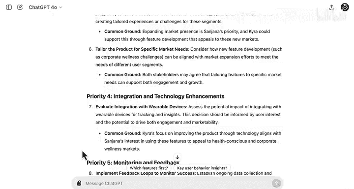

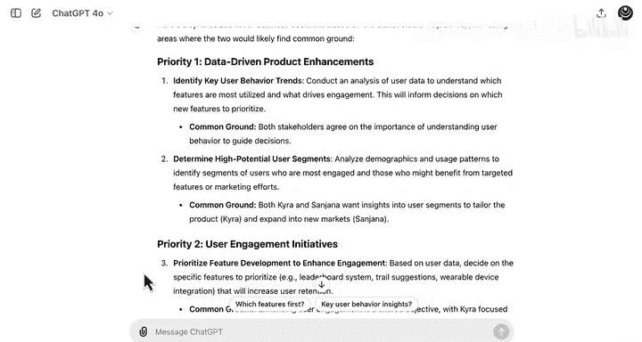

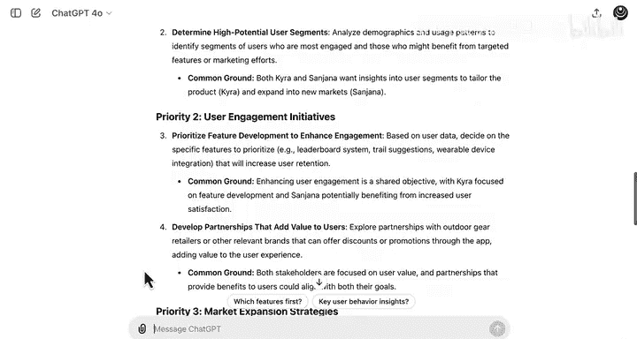

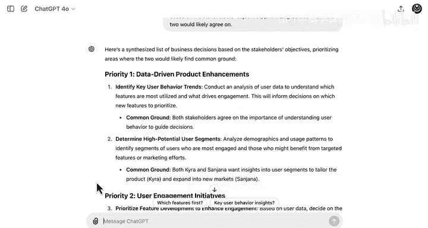

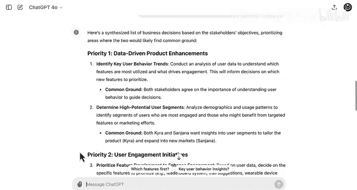

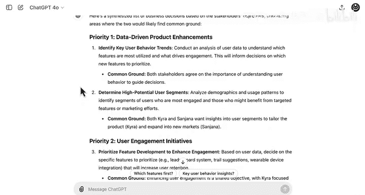

Okay， say you've settled this little dispute and you've decided that the most important business problem is enhancing the user experience。

 The leadership team has met to discuss everyone's goals。

 and you've got your hands on the meeting notes。 A great next step would be to create a Rumsfeld matrix to better understand the problem。

 Let's try this out with an L L M。 create a new conversation generate a prompt here that ask the LL M to create a Rumsfel matrix for me。

 And I'm also going to upload the document of the meeting notes。😊。

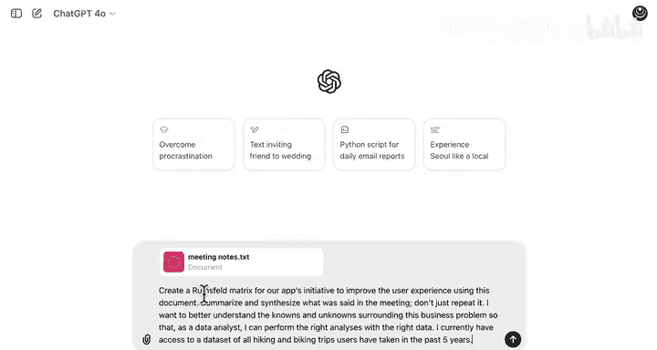

The LM categorizes individual statements from the meaning those into the four quadrants of the matrix。

 So again， we can focus on the known unknowns。 These often provide the most information about potential analysis。

 It talks about the potential impact of acquisition channels on retention。

 It talks about user motivations beyond initial download and overall market trends and competitor insights。

 So these all represent specific potential analysis that you can run。

 You also see a summary about how the LLM believes this information can impact your work as a data analysis。

 In particular， it talks about segmenting users by acquisition channel and exploring unknown user motivations that are clear areas for focused analysis。

 It also talks about how you could leverage this data set to analyze user trips to investigate engagement patterns。

 especially in relationship to feature usage and how these correlate with retention。

 All of these ideas seem to align well with what both the engineering and sales leaders are interested in。

 Okay， Last follow up。 Let's ask the LL M for some。😊。

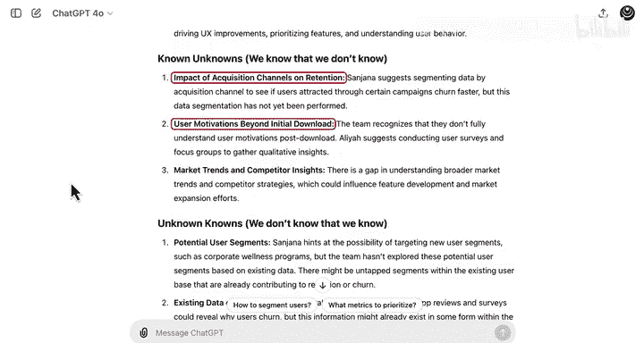

On prioritizing the data analytics work by offering it this final prompt。

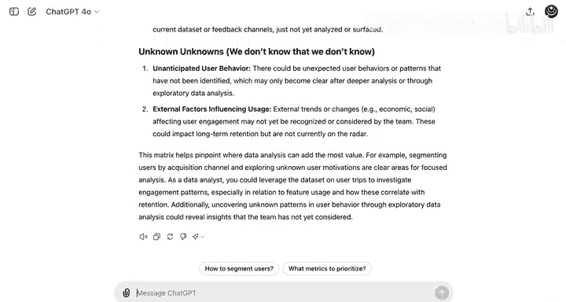

I'm going to ask you it to suggest some analyses based on the data that I have access to。

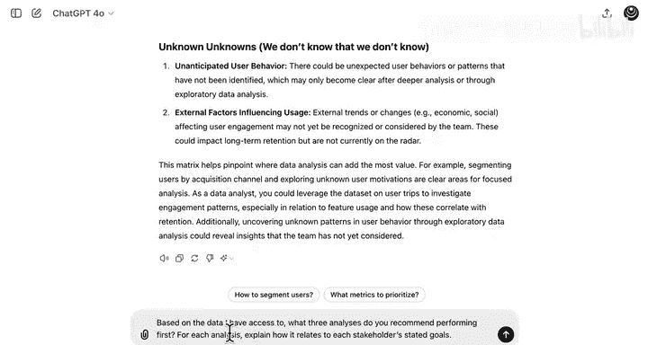

Okay， this looks like a pretty helpful summary。 It offers three potential analyses which align pretty well with the opportunities identified in the known unknowns from the previous step。

 The LLM also identifies the purpose of each analysis and links them to specific stakeholders who would be most interested in the results。

 So in the first example， it suggest trying to identify how different acquisition channels impact user retention and engagement。

 It also gives you a recommended approach for different analyses that you can conduct。

 These are examples of different types of analyses that you've already seen in this course。

 such as segmenting users or comparing metrics to each other。 And lastly。

 it also offers guidance on how these analysis can help guide UX improvements。

 These insights might be most relevant to the engineering lead whos most interested in how to actually implement the changes that you recommend from your analysis。

 Doesn't it feel great to cut out so much reading and writing and to have a second opinion on your work。

 I'm sure you'll find a lot more use cases than just these two as you keep working in data analytics。

 Stay curious about。😊。

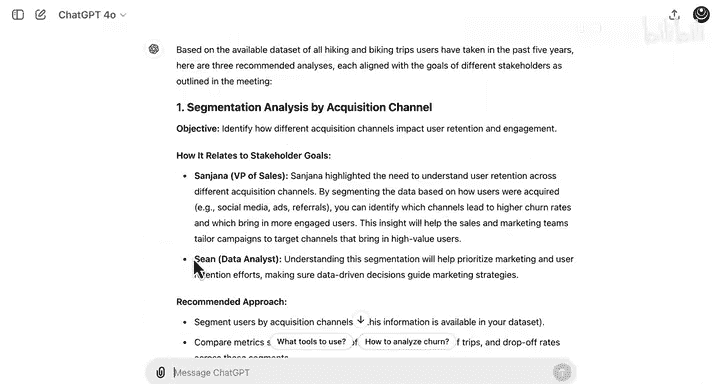

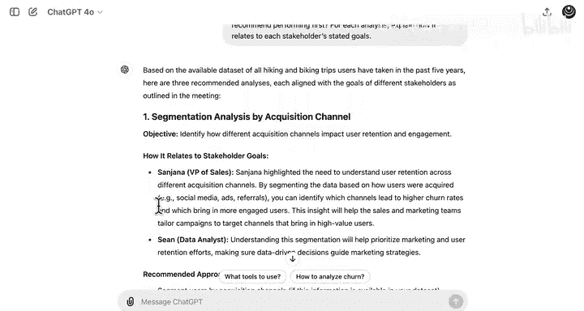

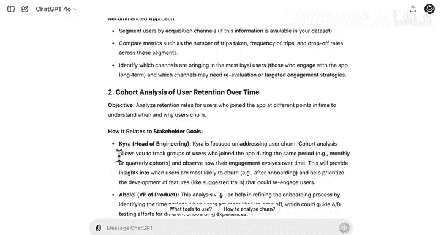

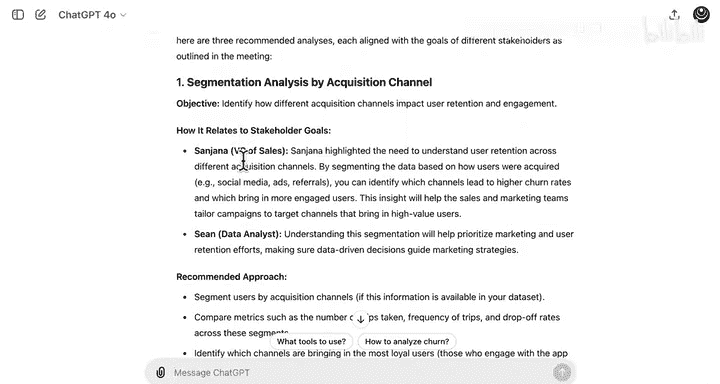

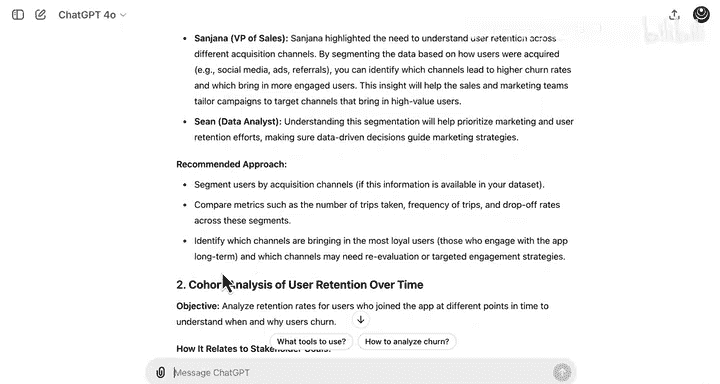

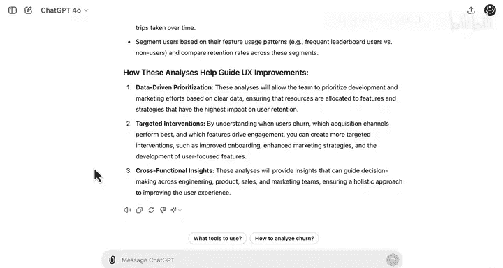

How you can make your life easier you've now reached the end of this module you'll have a few opportunities to test your skills starting with a practice lab about working with LLMs I'm also excited for you to complete the graded lab for this module a case study where you'll see the data analytics lifecycle in practice at a small scale bakery once you complete the graded lab and assessment you'll continue on to the capstone project for this course where you'll implement all the skills you've learned throughout each module you'll explore a data set of customer cancellations for a communications company I know you'll enjoy exploring the factors that lead a person to cancel Once you've completed the graded lab assessment and capstone exercise I'll see you in one final video to talk about your next steps as a data analyst You've got this。

😊。