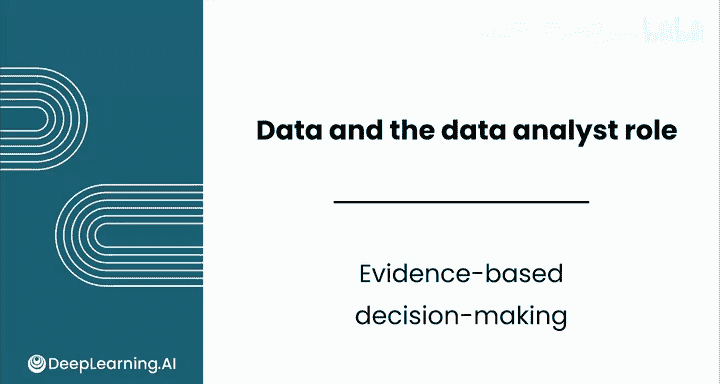
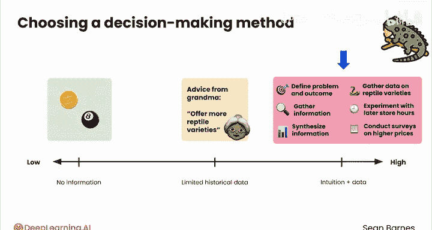

# 吴恩达《数据分析（数据分析基础／应用统计学，1-2课／共5课）｜DeepLearning.AI Data Analytics》中英字幕（claude-4-s - P6：5_基于证据的决策.zh_en - GPT中英字幕课程资源 - BV1SCXrYuEwr

When it comes to making decisions， there are a lot of possible approaches。 You could just wing it。

 flip a coin， ask a friend， maybe even shake the magic eight ball。

 Should I use a magic eight ball to make all my decisions in life？

Sources say yes in contrast to this clearly terrible approach。

 data analytics is all about evidence and consistency In this video。

 we'll talk about decision making by chance by intuition and the way that is most likely to lead to consistent success with both intuition and data There are three basic ways you can make a decision you can leave it to chance go with the gut。

 this is also called decision making by intuition or you can practice evidencebased decision making。

 which is where data analytics comes in these different methods sit on the spectrum of information utilization with chance relying on no information at all evidence-based decision making on the high information side and intuition somewhere in the middle Intuition is informed by your personal experience so it's a valuable asset but there are other important categories of information to consider like data and the informed perspective of others Let's first discuss the idea that information is needed for decision making at all while making informed decision is probably important to you I。

That you don't typically go out formally defining your problems and gathering evidence in your daily life。

 but you may have made decisions similar to these which university should I choose Is it smart for me to move to a new city or stay where I am。

 how should I invest my savings think for a moment about the kinds of information you might gather to answer each of these questions。

 I doubt you'd be flipping a coin for any obese。 You might write out the pros and cons of each college discuss the new city with a friend who lives there or track the performance of different investments to decide which is best。

 The level of effort needed to accumulate evidence is proportional to the impact of the decision in fields such as criminal justice medicine or journalism or decisions can have serious consequences。

 it's not enough to rely on opinion or personal experience alone If you're seeing a doctor for your cold symptoms you don't want her to just randomly guess that it's the flu。

 the higher the stakes the more evidence you need to support your decision。 Meanwhile。

 if you're deciding whether to recommend。mttens instead of gloves to a customer you don't need as much information because the cost of making the wrong decision is low。

 no one's health is at stake。 Just their chance at finger coziness。

 Sometimes a gut decision is warranted， sometimes what looks like the flu is in fact the flu intuition isn't useless In fact。

 one way of thinking about it is that you're essentially relying on limited historical data points but some intuitions are more valuable than others。

 do you trust the gut instinct of a doctor who's treated five patients for the flu or one who's treated 500 or 5000 the most effective approach is when intuition is combined with data That's why we say evidence-based decision making Since both data and to some degree intuition can be a part of your evidence Intuition helps you make quick lows stakes decisions and to avoid situations where you're searching through a massive amount of data without any idea of what you might find。

 but you also don't want to rely on your gut all the time。

 Let's look at an example sayy you want to increase your revenue at your small base。

An exotic pet store If you were able to do this。 you might be able to open a new store in your city。

 improve your employee benefits or offer a greater variety of fish。

 You have a couple of options you're looking at for increasing revenue adding more reptiles staying open for two extra hours per day or raising prices on animal feed but how do you choose the best one What information can you use to make your choice This is a high stakes decision one option is to leave it to fate grab the old magic a ball and give it a shake or flip a threesided coin you're essentially making the decision with no extra information but there are consequences here and I bet you can do better than that What would an intuition-based decision look like Well maybe grandma has been running this exotic pet shop since 1987 and she remembers times like these and she's absolutely certain that offering more reptile varieties is the way to go This intuition uses a little more information than the magic a ball since it's informed by some limited historical context but can you do even better than that？

Let's go the evidencebased route， which involves clearly defining the problem and the desired outcome。

 gathering relevant information and synthesizing that information to identify the best decision。

 It's all about using the right information to make the right decision and hopefully achieve the right outcome gather the data on reptile varieties experiment with keeping the store open longer and conduct surveys to see if higher prices。

 bother your customers。 Maybe you can try the reptile variety approach first based on grandma's intuition and if that doesn't pan out。

 investigate the other two options。 Sometimes you can make the wrong decision and still get the right outcome or vice versa There's a little luck in every decision the goal of evidencebased decision making is to maximize your chances of getting the right outcome by accumulating the best evidence It's funny to think about grandma steering her reptile business through a recession back at 87 but a lot of businesses make decisions this way based on intuitions like it feels right or I've seen this done before or。

LLMs are so popular right now。 Let's use one。 Is that the best way to make decisions。

Definitely not as a data analyst， you'll add real value to a business and honestly have the most fun when you transform this type of thinking into evidence-based decision making。

 join me in the next video to explore a history of data analytics。

 which is a fascinating way to start acquiring some of the key mindsets of data analytics。

