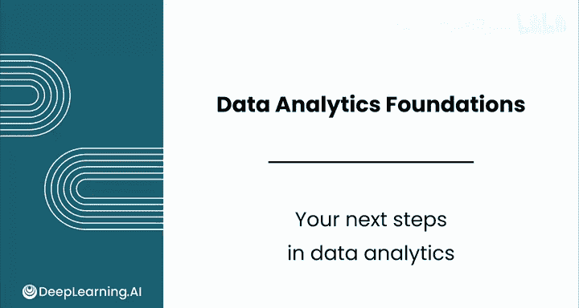

# 吴恩达《数据分析（数据分析基础／应用统计学，1-2课／共5课）｜DeepLearning.AI Data Analytics》中英字幕（claude-4-s - P70：69_数据分析的下一步.zh_en - GPT中英字幕课程资源 - BV1SCXrYuEwr

Congratulations on completing the capstone and this course。

 you've made the first crucial step into data analytics。

 and I'm excited to see what you accomplish next。You've come a long way since Grandma's exotic pet store from mastering spreadsheet formulas to creating beautiful visualizations。

 you're prepared for work in data analytics。And there's a lot more to learn。

One of my favorite aspects of this work is how much I learn every day， even after years on the job。

 so I hope you'll join me in the next course in this series， Applied Statistics for Data Analytics。

You'll implement core statistical methods， including simulation， confidence intervals。

 and hypothesis testing。By the end of this next course。

 you will feel confident applying these techniques in a professional role。

 congratulations again on completing this course， and I'll see you in the next one。

 Staistics for Data Analytics。