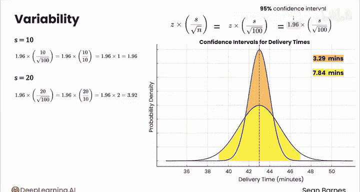
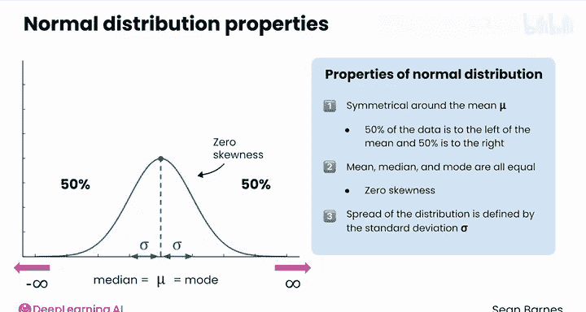
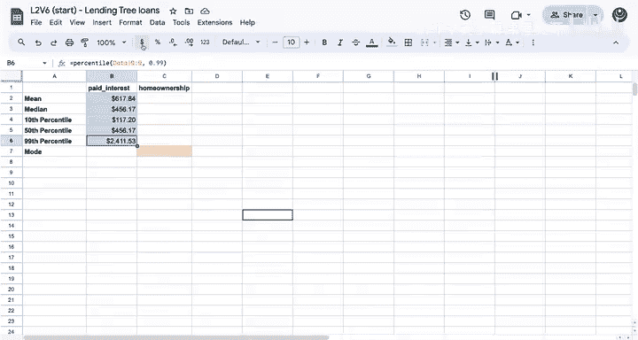
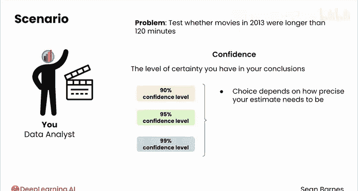

# 吴恩达《数据分析（数据分析基础／应用统计学，1-2课／共5课）｜DeepLearning.AI Data Analytics》中英字幕（claude-4-s - P71：0_欢迎学习本课程.zh_en - GPT中英字幕课程资源 - BV1SCXrYuEwr

Welcome to the second course in data analyticstics， App Statistics for Data analyticslytics。

If you took the earlier data analytics Foundation course。

 you learn how to analyze and visualize and communicateable data with particular focus on spreadsheet schools In this course。

 you learn about the foundational statistical techniques that underlie rigorous analytics statistics was actually one of my undergraduate majors when I went to school some years back and some people I know might think of statistics as a bunch of dry math but I find it highly applicable in business and in making daytoday decisions for example。

 if you are considering taking a new vitamin supplements。

 you might read in the news or look up some studies about whether it works and if these studies mentioned a Pvalue or some other numbers how should should interpret those numbers and how do you think about whether or not to trust the conclusions of that study and therefore to take the supplement or not So the application of statistics and I'm thrilled to welcome back once again your instructor Sean Vas to present these materials。

Thank you Andrew I'm a huge believer in statistics as well I think it's one of the most useful types of mathematics that you can learn I see data as a window into the truth theres some way the world is and your job as data analyst is to use that data to better understand the world essentially by looking through that window。

😊，There's always some amount of uncertainty in your analysis just because the world is full of immense complexity and statistics helps you reason about that and hear uncertainty The world is uncertain。

 meaning we just don't always know what is the deep underlying truth out there in the world is the school better than that school is living here better or worse and living there the lot of important decisions。

 important facts that we just don't know and sometimes the world gives us little bits of data that gives us hints of the underlying truth and statistics as discipline gives us fantastic tools to approach this rigor to try to make sound judgments about this underlying truth that then helps us to make you know sometimes small personal decisions and sometimes really consequential decisions sometimes we try to make the world seem really simple but in reality it can actually be fairly complex This course is all about the core statistical techniques that will help you make reason。

Decisions in the context of uncertainty。You'll start with quantifying and visualizing variability in samples which are a subset of the group you're interested in then you'll use sample distributions to better understand the full population of interest in the later modules。

 you'll employ the two workhors of inferential statistics confidence interval and hypothesis testing to estimate different aspects of your population of interest So Andrew。

 what do you think about the role that generative AI has to play in the role of statistics I think today unfortunately geneative AI left as its own devices is not nearly as good a data analytics as one of us could be if you copy paste a spreadsheet into large language model maybe can actually write a little bit of code to do some basic analyses but to have the context understand how to maneuver for that I find GenI to be sometimes a useful thought partner or brainstorming partner such as do I do this of hypothesis test or that form hypothesis says it's actually pretty useful as a brainstorming partner but。

Best practices to how they use it as a thought upon their coding companion advisor along the way to actually think through the critical business problem。

 I think that it doesn't solve everything but it is actually a wonderful tool that's making the job of data analysis easier。

Ultimately you are the expert and the generative AI tools are there to help you be even better at the work that you do In this course。

 you'll complete handson projects on forest fire prevention， music playlist creation。

 heart disease prevention and more you'll use statistics to quantify the uncertainty and risk involved in each case in the generative AI labs。

 you'll get tips and tricks for prompting and practice deciding whether a large language model or another tool like a spreadsheet is best for solving a particular task。

 If you're comfortable with spreadsheet software， including calculating descriptive statistics and creating charts as well as the basics of LLM prompting I'm confident you'll do well and enjoy this course。

😊，So if you taken in the data analytics Foundations course you're in the perfect position to succeed and have a lot of fun。

 you know， in healthcare， they say stat to mean ASAP as soon as possible。

 I think there's so much exciting material here， that's go stat to the next video。

