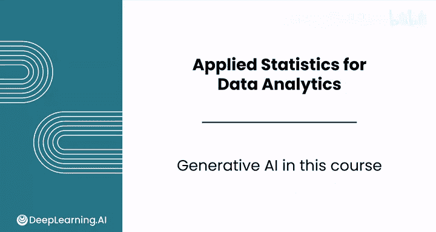
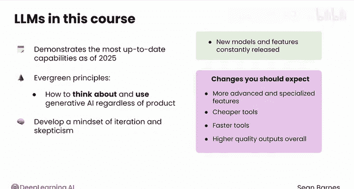
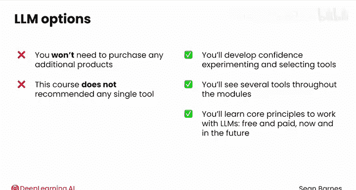

# 吴恩达《数据分析（数据分析基础／应用统计学，1-2课／共5课）｜DeepLearning.AI Data Analytics》中英字幕（claude-4-s - P72：1_本课程中的生成式AI.zh_en - GPT中英字幕课程资源 - BV1SCXrYuEwr

One of the key elements of this course is learning to use generative AI in particular。

 large language models like ChayB， Clade， Gemini and so on。

 effectiveffective use of these LLMs will help you streamline your work。

 and stand out In this course， you'll learn how to use large language models or LLMs to troubleshoot spreadsheet errors。

 create custom conditional formatting， design and run simulations。

 interpret inferential statistics and run statistical analysis for you。

 You'll also explore LLM's key limitations， learning when to select the LLM for a particular task and when to use something else like a spreadsheet。

 LLMs are ever evolving and present challenges for both teaching and learning。

 I wanted to take a moment to share our team's philosophy about generative AI in this course。

First， this course demonstrates the most upto date capabilities as of 2025。

 and we expect changes in the coming months and years。

 This course is designed to teach evergreen principles。

 how to think about and use generative AI in your work。 regardless of which specific product you use。

 You will develop a mindset of iteration and skepticism。

 new modelss and features are constantly being released。

 and here are some of the changes you should expect in the near future。 First。

 Gen AI tools with more advanced and specialized features。

 like the ability to use apps for you expect cheaper tools and faster tools and higher quality outputs overall。

 it's challenging to keep up with the rapid progress in this field。 but don't worry， in this course。

 you'll develop the metacognitive skills you need to harness those advancements in your work。

 This course also demonstrates some paid features of LL。

 but you will need to purchase any additional products to complete the assignments。

 It's important for you to see the available options， including paid options so。😊。

You develop confidence experimenting and selecting the best tools in your work as a data analyst this course does not recommend any single tool you'll see several throughout the modules and remember that the core principles you'll learn will prepare you to work with LLMs both free and paid now and in the future。

You'll encounter your first LLM demo and hands on lab in the third lesson of this module。 For now。

 join me in the next video to see all the exciting topics in this module。 I'll see there。😊。

