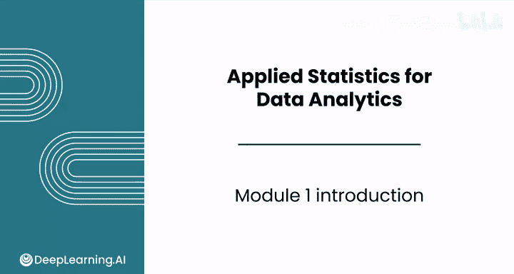
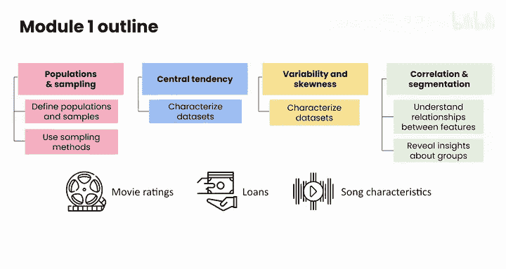

# 吴恩达《数据分析（数据分析基础／应用统计学，1-2课／共5课）｜DeepLearning.AI Data Analytics》中英字幕（claude-4-s - P73：2_模块1 简介.zh_en - GPT中英字幕课程资源 - BV1SCXrYuEwr

Welcome to the first module of applied statistics for data analytics throughoutout this course。

 you will learn the fundamental statistical concepts。

 analyses and visualizations that serve as the foundation for data analytics career In this module。

 you'll explore the essential building blocks of statistics that enable rigorous analysis you'll learn how to define populations。

 samples and sampling methods， character data sets using measures of central tendency。

 variability and skewness use correlation to understand relationships between features and employ segmentation to reveal insights about different groups within your data you'll apply these concepts to real- world scenarios Ana movie ratings。

 identifying the most profitable loans and analyzing song characteristics you'll also get hands-on practice with spreadsheet tools  building on the skills you already learn in data analytics foundations to make your analysis more effective whether you're new to statistics or looking to refresh your skills。

 This module will equip you with powerful techniques to extract meaningful insights from your data By the end you will feel more。

😊。

Confident and capable implementing statistical analysis in your career as a data analyst。

Join me in the next video to get started。