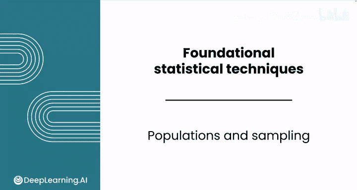
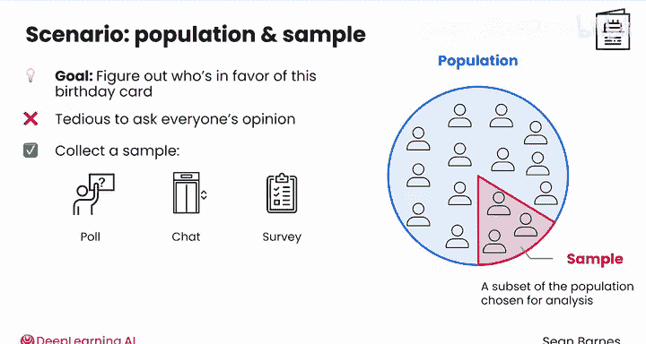
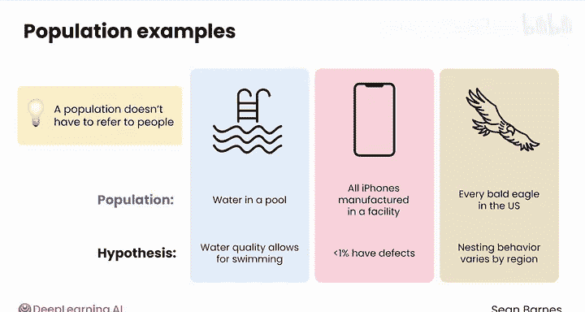
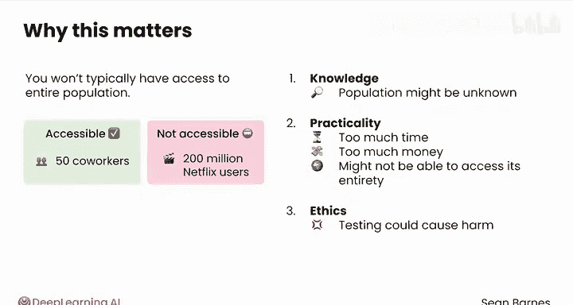
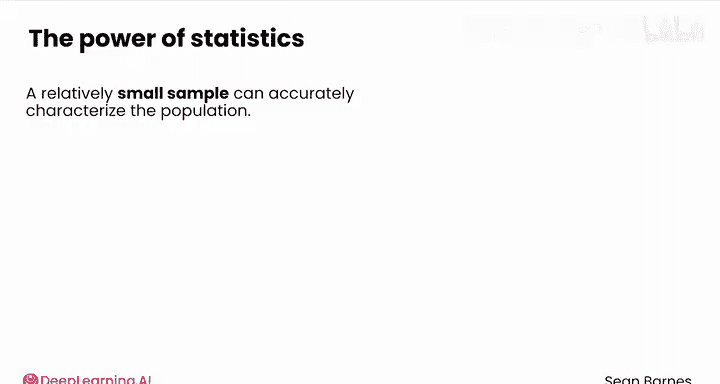
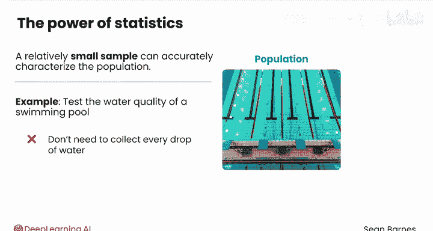
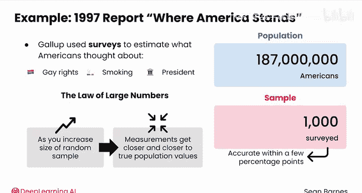

# 吴恩达《数据分析（数据分析基础／应用统计学，1-2课／共5课）｜DeepLearning.AI Data Analytics》中英字幕（claude-4-s - P74：3_总体与抽样.zh_en - GPT中英字幕课程资源 - BV1SCXrYuEwr

Say you're working at a small company of 50 people。

 and you want to start a fun new birthday tradition。

 Have everyone at the company set an electronic birthday card。😊。

You have a hypothesis that a majority of your coworker workers would be on board。

 But how do you find out if that's true， You could go at the magic ape ball。 Just kidding。

You probably ask a couple of coworkers right， you're trying to figure out if your hypothesis about everyone is right by asking just a few people。

In other words， you're taking a sample of a population， these two definitions， population and sample。

 underlie almost every analysis you'll carry out as a data analyst。

Let's define these concepts more precisely。 A population is the set of all individuals or observations that you have a hypothesis about。

 and a sample is a subset of that population that has been chosen for analysis in the birthday card example。

 you hypothesize that the majority of your coworkers will support sending a signed Ecart。

 So the population is everyone working at your company， That's who this new tradition will affect。

 Can you think of some people who are not included in this population。

The company's clients or your family would be good examples of people who are in this population。

 Their opinion ultimately won't affect the decision。

 So you want to figure out who's in favor of this birthday card idea and who's against it。

 It would be tedious to ask everyone their opinion1 by one in person。 instead。

 you could collect a sample， a sample is a subset of the population you've chosen for analysis。

 There are many ways you could sample this population。 a meeting poll elevator chat， a survey。

 Each of these samples is just a slice of the population。

 Just a few cos say you end up asking 10 people。 and nine of them love the idea。

 That's a pretty good sign it could work。 note that a population doesn't have to refer to people。

 The population might be the water in a swimming pool。

 if your hypothesis is that the water quality allows for swimming or all the iPhones manufactured in a particular facility。

 if your hypothesis is that less than 1% have production defects。 or every bald eagle in the US。

 If your hypothesis is that their nesting behavior varies by region。 This distinction between。

Population and sample matters because you won't typically have access to your entire population For 50 coworkers。

 you might be able to get a response from all of them， but surveying every Netflix user。

 there are over 200 million of them。 Most populations can't or shouldn't be fully captured。

 and for three key reasons， First， knowledge。 The population might just be unknown。 For example。

 in a political poll， you can survey socalled likely voters。

 but you ultimately don't know who will actually go out and vote。 Second， practicality。

 reaching the entire population could take too much time or money。

 and you might not be able to access its entirety。 For example。

 you might want to test every iPhone produced in a factory。

 but that may add an hour to the production of each phone。 Finally， ethics。 For example。

 if you want to know if a certain fruit is toxic to dogs。 Well， testing that idea could cause harm。

 The good news is， through the power of statistics。

 even a relatively small sample if collected properly can accurately characterize the population。

 For example。😊。

Say you want to test the water quality of a swimming pool。

 You don't need to collect every drop of water。 Even for an Olympic sized swimming pool。

500 millili is more than enough about the size of a water bottle。 In 1997。

 the polling company Gallup released a report called where America stands。

 Gallup used surveys to estimate what all 187 million Americans thought about hundreds of issues like gay rights。

 Smoking and the president， How many people do you think they surveyed to get an accurate answer for all 187 million Americans。

1000。 That's all。 This surprising effectiveness is due to the power of random sampling and statistical theory。

 particularly a concept known as the law of large numbers。

 This law states that as you increase the size of your random sample。

 your measurements from that sample tend to get closer and closer to the true values you would get。

 if you can measure the entire population。 But the law's large numbers has diminishing returns。

 going from 100 to 200 people gives you a big boost in accuracy。

 But going from 2000 to 2100 barely makes a difference。 When done correctly。

 a sample of 1000 people can provide results accurate to within a few percentage points of the true values。

 Think of the population as the truth。 The way the world really is。😊。

Of your 50 coworkers， a certain number of them are in favor of sending birthday cards。

 Your sample is a window into that truth。 You asked 10 coworkers and 9 are in favor。

 It's a glimpse at what everyone might be thinking， but it's not the whole truth。

 Join me in the next video to see how to identify the population you want to study。

