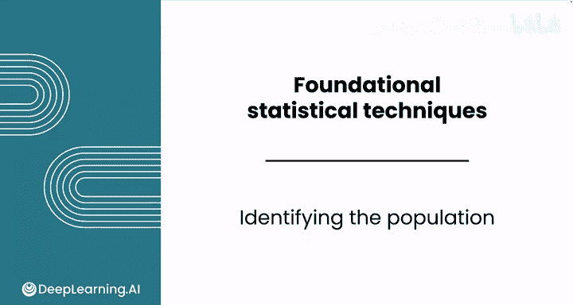
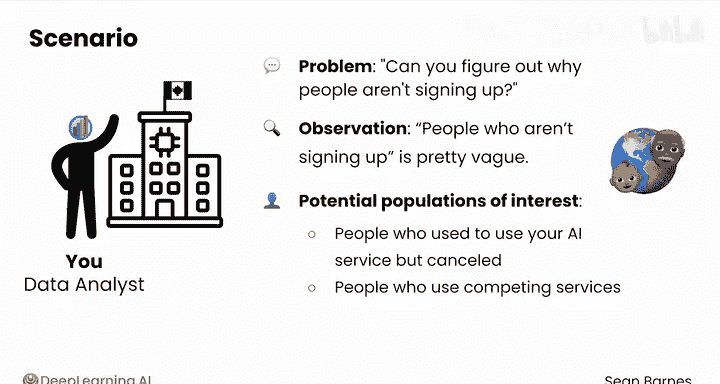
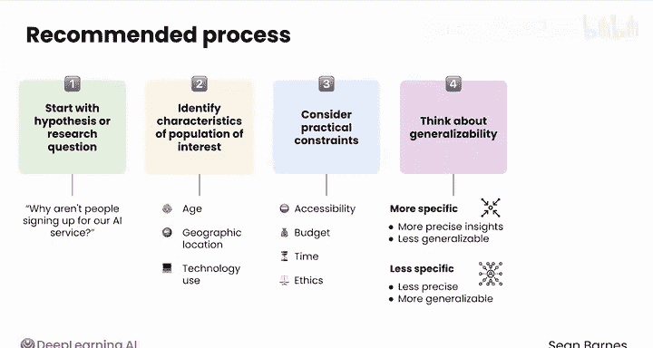

# 吴恩达《数据分析（数据分析基础／应用统计学，1-2课／共5课）｜DeepLearning.AI Data Analytics》中英字幕（claude-4-s - P75：4_识别总体.zh_en - GPT中英字幕课程资源 - BV1SCXrYuEwr

Before you collect the sample， you'll need to know what you're trying to take a sample of。

 That may sound abstract。 but the idea is that analyzing different populations can give you different insights。

 Let's explore an example。 Supp you're a data analyst at a company developing AI services in Canada。

 Your boss comes to you with a problem。 She says we need to increase our user base。

 Can you figure out why people aren't signing up。 Of course， you'll say， yeah。

 I can do that on looking deeper into the problem， though。

 you observe that people who aren't signing up is pretty vague。

 Everyone who doesn't use your service is a massive group that's hundreds of millions of people from all over the globe from babies to grandparents。

 or maybe you're interested in people who used to use your AI service but canceled。

 or perhaps you want to focus on people who use competing services。

 St each of these populations would lead to very different insights。 If you focus on former users。

 you might learn about retention。 if you look at competitors' users instead。

 you might better understand what features you're missing。 Here's a process， you can use to。😊。

down your relevant population。 Start with your hypothesis or research question。 In this case。

 it might be， why aren't people signing up for our AI service。

 then identify the key characteristics that define your population of interest for an AI service。

 this might include factors like age Are we interested in all ages or just certain demographics。

 geographic location are we looking globally or just in certain markets and technology use are we only interested in people who already use other AI services。

 Next， consider practical constraints。 while you might ideally want to collect data across the full population that's probably not feasible you might need to limit your population based on accessibility budget time or ethical constraints。

 then think about generalizability， that means how broad do you want your conclusions to be the more specific your population the more precise your insights might be but the less generalizable they'll be to other groups。

 a less specific population leads to less precise but more generalizable。

ResultsFinally， consult with stakeholders。 make sure your defined population aligns with the business goals。

 This step comes last so you can present a concrete idea for review by following this process。

 you and your stakeholders might define the population as Internet using adults age 18 to 49 in Canada who currently use at least one AI service but not ours。

 This clearly defined population can guide everything from your sampling method to how you interpret your results。

 Now you've seen how to identify your population。 but as you've learned。

 you're unlikely to have access to the full extent of data。

 There are many ways to go about sampling your population。

 Join me in the next video to take a look at the gold standard。 Probabilistic methods。😊。

