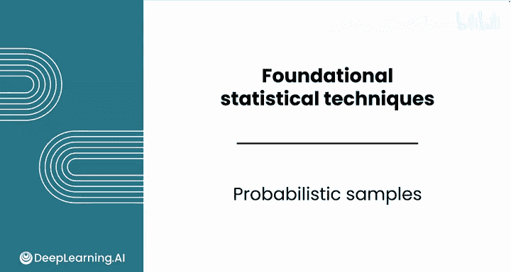
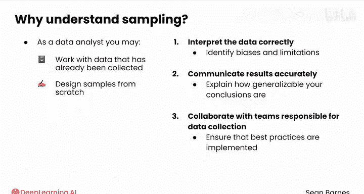
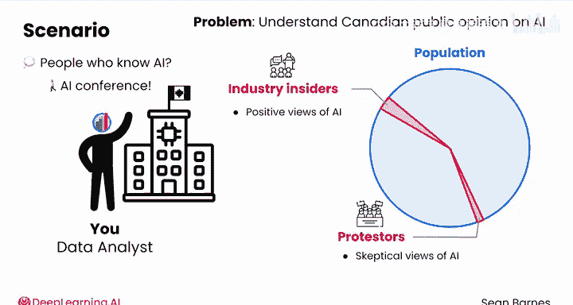
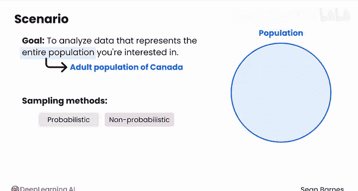
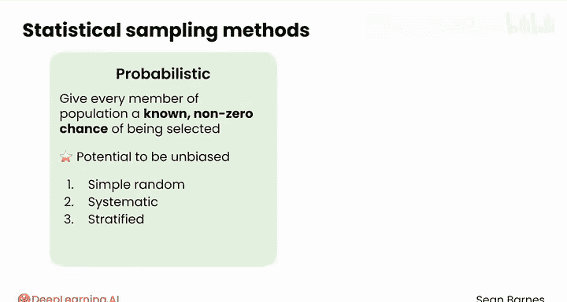
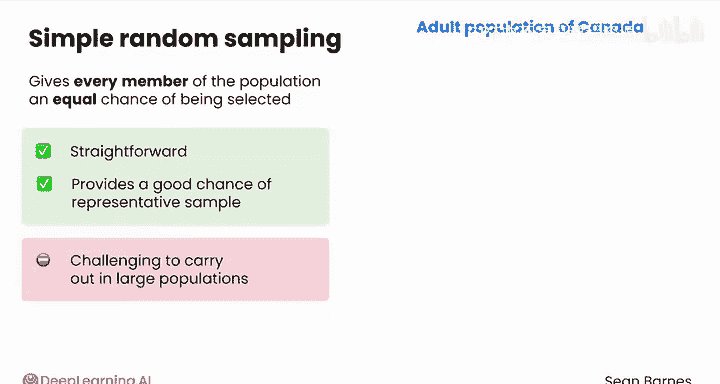
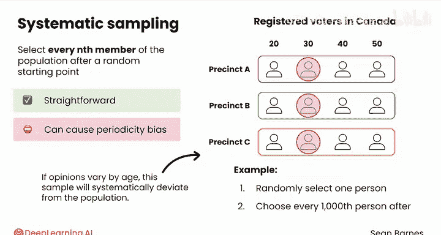
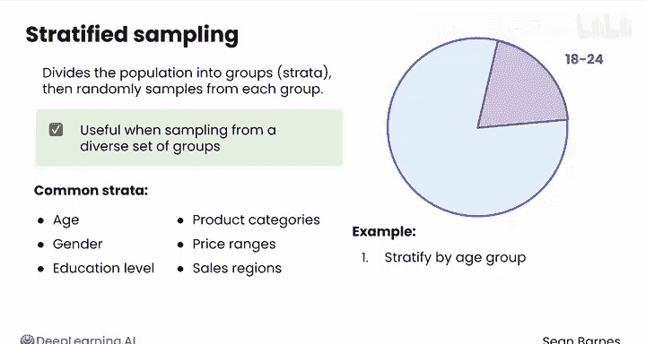
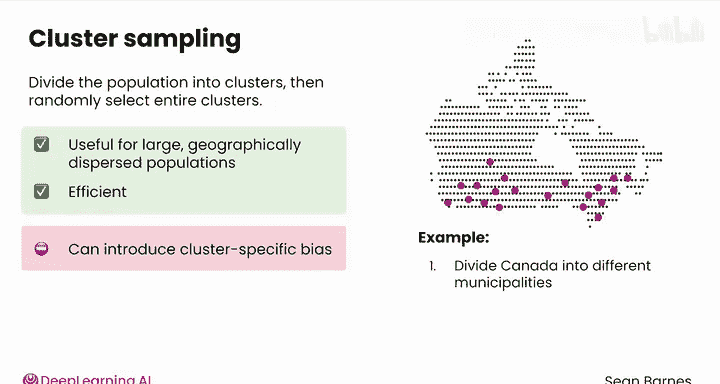

# 吴恩达《数据分析（数据分析基础／应用统计学，1-2课／共5课）｜DeepLearning.AI Data Analytics》中英字幕（claude-4-s - P76：5_概率抽样.zh_en - GPT中英字幕课程资源 - BV1SCXrYuEwr

Sampling is a critical skill for data analysts over the next few videos。

 you'll explore the trade offs involved in sampling， as well as the biases it can introduce。

As a data analyst， depending on the size of your team。

 you may work with data that has already been collected or you may have to design a sample from scratch regardless it's crucial for you to understand the principles of sampling for a few key reasons First understanding sampling allows you to interpret the data correctly identifying potential biases and limitations in the data it also allows you to communicate your results accurately in particular you will be able to explain how generalizable your conclusions are。

 meaning how accurately they reflect the population you will also be able to collaborate with teams responsible for data collection ensuring that best practices are implemented let's explore sampling through an example suppose you've been working at the Canadian AI company for a while and your CEO comes to you with a new problem she wants to understand Canadian public opinion on AI to guide the company's roadmap how would you go about collecting that data your first thought might be finding people who know what AI is so you head to an AI conference where you find a lot of enthusiastic industry insiders。

You interview 100 attendees and 95 of them express overwhelmingly positive views things seem promising。

 but as you're leaving the conference， you notice a group of protesters outside their signs display slogans about the potential negative impacts of AI you interview 50 of them and nearly all expressed skeptical views of AI you've recorded two very different perspectives but do either of these groups accurately represent overall public opinion on AI。

 Probably not。 These are both samples， but they're not very good ones。

 as a data analyst your goal is to analyze data that represents the entire population you're interested in In this case the adult population of Canada。

 not just the vocal supporters and opponents statisticsistic has a lot to say on how to do that so let's talk about some specific sampling methods which fall into two categories。

 Probabilistic and non-probabilistic。 Let's look at the probabilistic ones first Probabilistic sampling methods give every member of the population a known non-zero chance of being selected for the sample these methods have the potential to be unbiased。

Which means that your sample is truly representative of the population。

 That's what you're aiming for。 The four most important probabilistic samples are simple random。

 systematic， stratified and cluster simple random sampling gives every member of the population an equal chance of being selected Its straightforward and provides a good chance of having a representative sample but it can be challenging to carry out in large populations in the AI opinion example of a simple random sample could look like assigning every adult Canadian a number from one to around 30 million the total population of Canada then randomly selecting1 thousand of those numbers you can then call it each person whose number was chosen to ask them their opinion about AI It sounds tough right not every Canadian has a phone number and it might be expensive to place many phone calls this way in systematic sampling you select every8 member of the population after a random starting point for example you might have a list of all registered voters in Canada randomly select one person。

Men choose every thousandth person after them on the list This method is straightforward。

 but it can cause periodicity bias if there's a pattern in your list。 For example。

 if voters were sorted by precinct， then age within that precinct it would be possible to sample only people with similar ages If opinions on AI vary by age this sample will systematically deviate from the population Next up stratified sampling this method divideise the population into groups or strata based on shared characteristics then randomly samples from within each group It's useful when you want to make sure to sample from a diverse set of groups Common strata include age。

 gender and education level for people or product categories。

 price ranges and sales regions for products in the AI example you could stratify by age group 18 to 24 25 to 29 and so on and pull 10 people from each age group Finally you have cluster sampling which is useful for large geographically dispersed populations you divide the population into clusters。

Often geographically， then randomly select entire clusters it's efficient but can introduce cluster specific biases In the AI example。

 you could divide Canada into different municipalities。

 then select 1 of them for your sample you'll send a team to interview randomly selected people within each municipality you can see how it might be easier to send teams out to just 10 areas versus randomly sampling every Canadian adult each of whom could live in the furthest corner of the country。

These four methods form the core of probabilistic sampling。

 helping to select the sample that's representative of the population you're trying to understand Now。

 follow me to the next video to learn about non probabilistic sampling methods。

