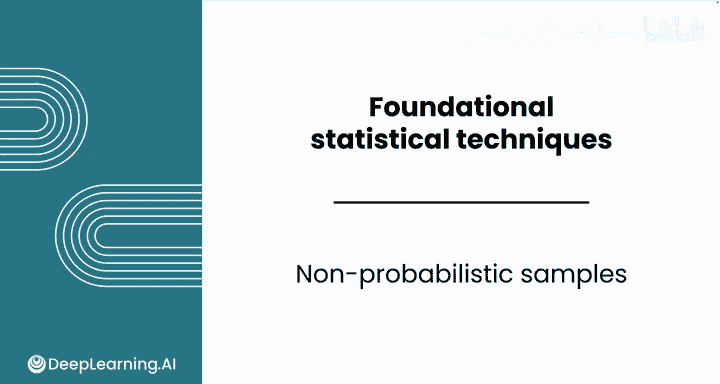
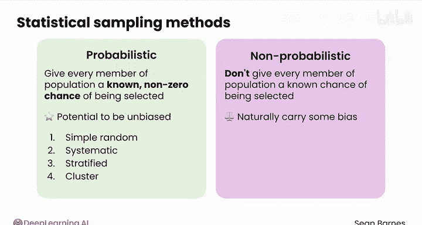
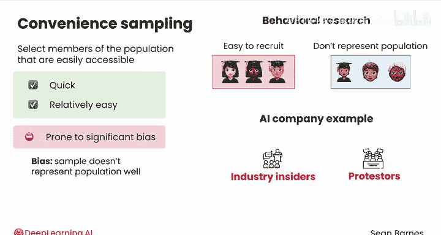
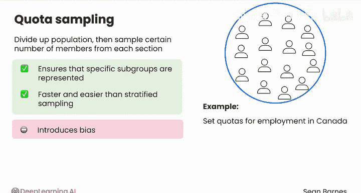
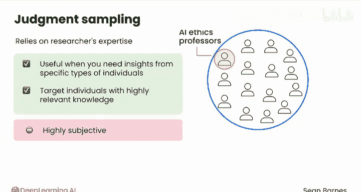
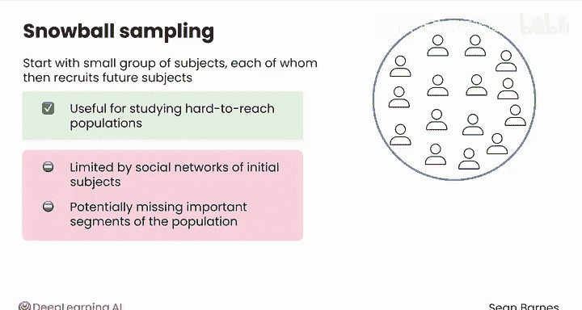

# 吴恩达《数据分析（数据分析基础／应用统计学，1-2课／共5课）｜DeepLearning.AI Data Analytics》中英字幕（claude-4-s - P77：6_非概率抽样.zh_en - GPT中英字幕课程资源 - BV1SCXrYuEwr

When budget， time， or workforce constraints make probabilistic samples infeasible。

 you can use a non probabilistic sample。

Not this guy。Non probabilistic samples are generally less rigorous。

 but often more practical to carry out。Nonprobabilistic sampling methods don't give every member of the population a known chance of being selected。

 These methods often arise from practical constraints and naturally carry some bias。

 The core non-probabilistic methods you should know about as a data analyst are convenience quota judgment and snowball samples。

 Let's get to it in convenient sampling you select members of the population that are easily accessible on the upside it's quick and relatively easy to do However。

 it's prone to significant bias biasas just means that your sample doesn't represent the population while you'll learn more about it in the next video a commonly cited example of convenient sampling is behavioral research because many researchers work at universities they can easily recruit students to complete an experiment but these students don't represent the overall population very well They're often younger than the average person。

 for example， in the AI company example from the previous video surveying just the attendees and protesters at one conference is a convenient sample just one location。

😊。

No randomness quota sampling divides up the population based on certain characteristics。

 then samples a certain number of the members from each section。

 you can think of it as the non-probabilistic version of stratified sampling。

 it is often used to ensure that specific subgroups are represented， like convenient sampling。

 its faster and easier than stratified sampling， but introduces bias。In the AI example。

 you might cite quotas to match the employment demographics of Canada where the employment rate is 87%。

 so you might interview 87 people who are employed and 13 who are not but without random sampling。

 interviewers may inadvertently skew the results based on who they choose the question Then you have judgmental sampling。

 which relies on the researchers' expertise to select the sample。

 it can be useful when you need insights from specific types of individuals The benefit is that you can target individuals with highly relevant knowledge。

 The downside it's highly subjective for the AI company using judgmental sampling might mean specifically choosing to interview AI ethics professors。

 tech journalists and policymakers based on the belief that their opinions are particularly valuable。

 Finally， take a look at snowball sampling， you start with a small group of subjects。

 each of whom then recruits future subjects from among their friends， family and coworker-ers。

 Your sample size grows like a rolling snowball。 This method is particularly useful for studying hard to reach populations for example。

Undocumented immigrants may be difficult to source for an interview。

 but you can start with a few contacts who then refer others from their community The big drawback is that your sample is limited to the social networks of your initial subjects。

 potentially missing important segments of the population In the AI example。

 Snowball sampling might be used to study the opinions of people who've opted out of using AI tools you can start with a few such individuals and ask them to refer others who share their habits。

You've heard the term bias a few times now。 It's one of the biggest issues with sampling。

 In the next video， you'll explore several common types of bias and how to mitigate them。

 I'll see there。