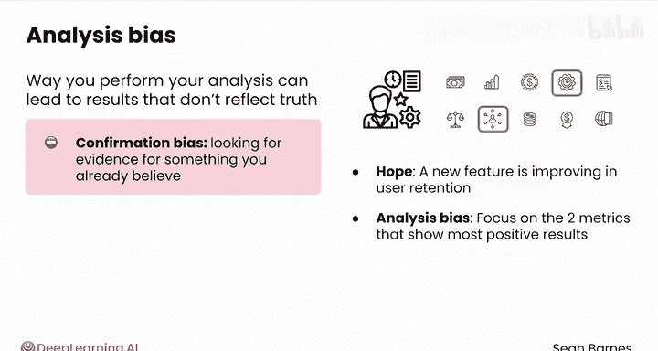

# 吴恩达《数据分析（数据分析基础／应用统计学，1-2课／共5课）｜DeepLearning.AI Data Analytics》中英字幕（claude-4-s - P78：7_偏差类型.zh_en - GPT中英字幕课程资源 - BV1SCXrYuEwr

Bs in sampling happens when your sample doesn't represent your population of interest very well。

 similar to how bias can negatively affect interactions between people。

 bias and sampling can lead to poor decision making。 Let's see how it happens。

Here's a formal definition for bias and sampling a systematic difference between the sample and the population that creates an inaccurate depiction of reality。

 systematic is important here。 It means that the problem occurs in a predictable。

 likely preventable way。 For example， if you're interviewing randomly selected Canadians about their opinion on AI and one person happens to respond more positively than the average person。

 that's just a normal random occurrence。 you expect some variation and opinion。 By contrast。

 if you head to a conference filled with AI researchers。

 you have reason to believe that most of these people will view AI more favorably than the average Canadian。

 that's a systematic bias。 biasas is often the result of deviating from probabilistic sampling methods。

 let's take a look at the most important types of bias。 Sam， measurement response and analysis。

 Sam bias crops up when a researcher is deciding how to sample the population。

 measurement and response bias occur when data is collected。

 and analysis bias occurs during insight finding。 Let's start the sampling bias。😊，Quite common。

 and it happens when a sample doesn't accurately represent the population of interest。

 This is the kind of bias that a researcher would run into if they interviewed people at an AI conference plus the protesters outside。

 It's unlikely those two extreme groups adequately represent the views of most Canadians。

 A common form of sampling bias is called selection bias。

 It happens when a sample is selected in a non-ran way。

 causing a mismatch between the sample and the population of interests。 As a result。

 some groups in the population are under or overrepresented in the AI conference example。

 strong proponents and harsh critics are overrepresented。

 while people who aren't very familiar with AI are underrepresented to avoid selection bias。

 use probabilistic sampling methods， avoid over or undersampling any particular group。

 you should also be transparent about the limitations your sample may have。

 If you know your sample introduced selection bias。

 explainplain how that bias affects your conclusions。

 Another common type of sampling bias is non-response bias。 It's common in samples of people。Ex。

 smartphone apps may ask a user to rate their app after using it for a while。

 but users can dismiss the notification rather than actually rating the app By consequence。

 the people that do leave a review arent a random sample。

 they often have a positive view of the app since they're willing to accept the prompt and invest time in the review to counteract non-response bias consider sending followups or even including small incentives for participation。

 Next up， two key types of measurement bias The first one instrument bias comes from having faulty equipment or a poorly designed ser for example in 2020 Fitbit replace some of its smartwatches free of charge due to an issue with their heart rate sensor。

 but instrument bias can also be as simple as asking you agree that pineapple belongs on pizza which is a leading question make sure you're using good quality tools and well-worded surveys and take multiple measurements if you can Another type of measurement bias is observer bias It occurs when the person doing the measuring lets their own expectations effect what they see for example。

Say your company is rolling out dark mode for one of its apps。 If you， as a data analyst。

 expect this feature to be well reviewed。 then when you're interviewing a sample of users。

 you might unconsciously focus on their positive feedback。

 try having multiple people take the measurement if possible。

 Another type of bias is response bias which is often observed in samples of people。Essential。

 people may not be completely forthcoming when answering questions So questions like how much money do you make or when was the last time you dipped your French fri and mayonnaise might elicit on truthful responses even on an anonymous survey Mitigating this type of bias isn't easy。

 you can try emphasizing how important honest answers are or designing your questions to be as objective as possible。

 Finally， let's consider analysis bias， you sampled your population and collected your data but the potential for bias isn't over。

 if you're not careful the way you perform your analysis can lead to result that don't reflect the truth。

 The biggest pitfall is confirmation bias Looking for evidence for something you already believe rather than looking at all。

😊，E objectively， for example， a product manager might hope that a new feature is improving user retention。

 They may be under some pressure to show that the feature was worth developing。

 They might analyze 10 metrics， but choose to focus on the two that show the most positive results。

 It's okay to have a hypothesis or a goal， of course。

 but stay open minded and let the data tell its own story。

 Even if it's not the one you are hoping to hear biasas is often unavoidable。

 and most samples will contain some degree of it。

However， by following best practices， in most cases， you can mitigate its effects。

 that takes you to the end of this lesson。 Great work so far。

 you've learned the core concepts of population and sampling。

 which underlie all of statistics After the practice assessment for this lesson。

 joinin me in the next one to learn how to characterize samples through measures of central tendency。

 variabilityability and skewness。 I'll see there。😊。

