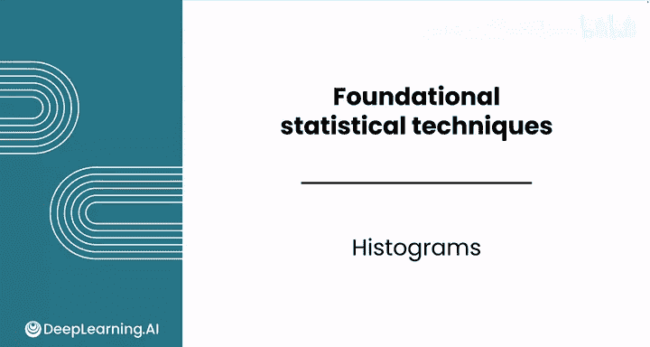
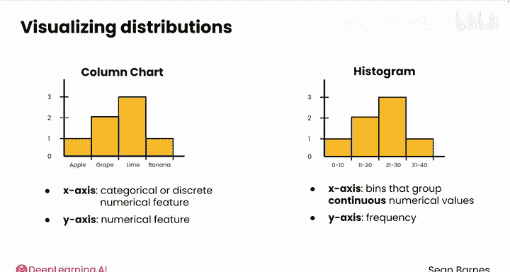
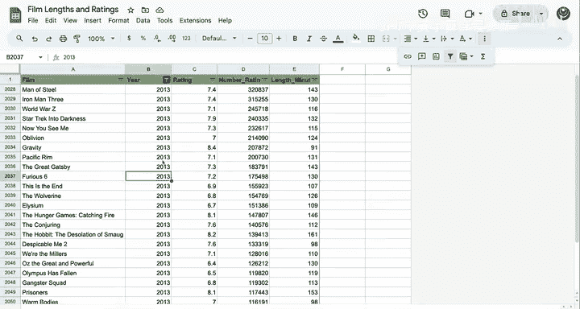
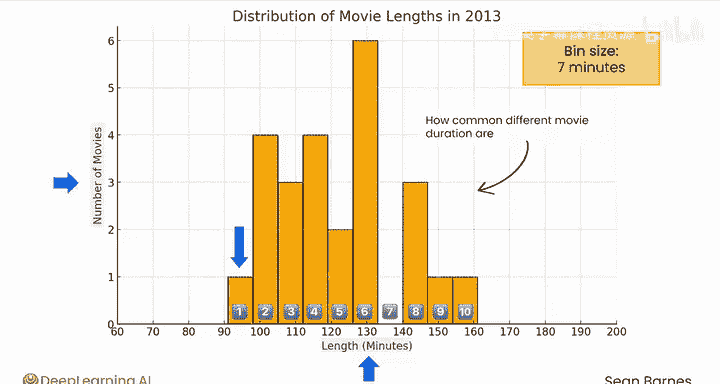
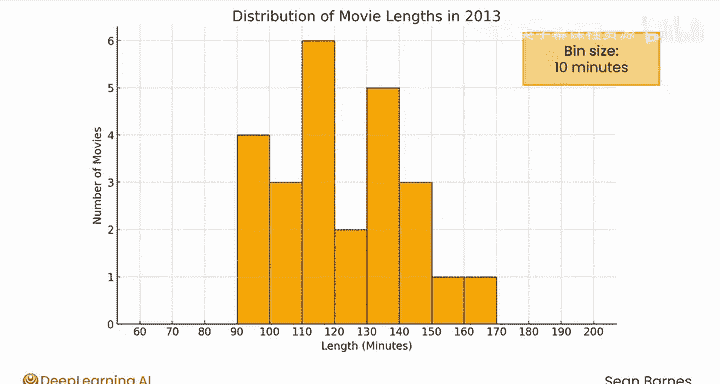
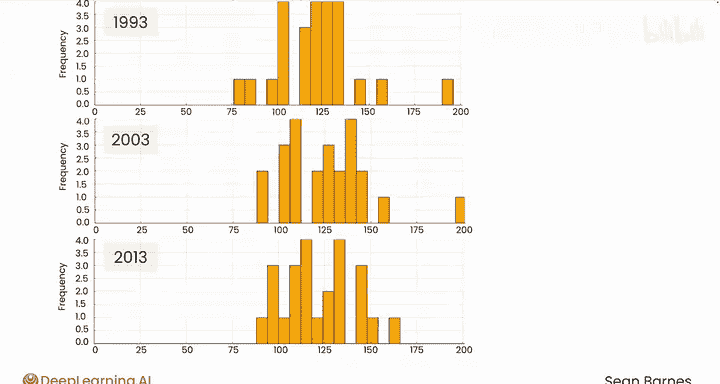

# 吴恩达《数据分析（数据分析基础／应用统计学，1-2课／共5课）｜DeepLearning.AI Data Analytics》中英字幕（claude-4-s - P79：8_直方图.zh_en - GPT中英字幕课程资源 - BV1SCXrYuEwr

Once you've collected a sample， it's often useful to start your analysis by visualizing its distribution。

 A distribution tells you how often different values occur in a population or in your sample。

 Descriptive statistics is all about characterizing the distribution of your data。

 One useful visualization for distributions is the histogram a histogram aggregates numerical data into bins and visualizes the frequency of the values within those bins。

 The purpose of the bins is to make it easier to see the overall distribution by showing how common ranges of values are。

 Histograms are a special version of a column chart In a column chart。

 you are trying to compare a numerical feature across different categories So you display the categorical or discrete numerical feature on the X axis and the numerical feature on the y axis In a histogram。

 you're interested in visualizing the frequency of different values in a continuous numerical feature on the X axis it plots bins that group the continuous numerical variables into categories with the frequency on the Y axis frequency means the number。

😊。

Observations in the data that fall into a particular bin。

 You may also see the proportion of observations plotted on the Y axis rather than the raw frequency。

 Let's work with some real data together。 Do you feel like movies have been getting longer maybe it's just my attention span but I've heard the hypothesis several times recently say you wanted to figure out how long movies typically are and if they've been getting longer over time。

 you sample the 25 most popular movies from 2013 What can you do to describe this distribution of movie durations。

 So here's the data of movie durations of the top 25 most popular movies in the year 2013 If you'd like to explore the data yourself。

 you can find the spreadsheet in the downloads tab accompanying the video The columns in the data are the name of the movie the year it was released all 2013 the rating out of 10。

 This is from the international movie database or IMDB the number of IMDB ratings and the duration of the movie My personal fave here was Ironman3 you learned a moment ago that a distribution represents how often values in the sample data。

You have a sample of movies here So what values should you examine to answer the question Those would be the durations of the movies。

 Here's a histogram that visualizes how common the different movie durations are on the X axis is the duration of the movie in minutes and the y axis shows the number of movies with that duration Note that duration is a continuous numerical feature which has been grouped into sevenmin bins giving this histogram 10 bins any movie with the length between 91 and 98 minutes is represented by this column here's the same data but this time in a histogram with bins of 10 minutes which are a bit easier to interpret though the overall picture of the data is similar these bin sizes make it easier to say something like around half of the movies are less than two hours Note that too few bins can overly simplify the data and too many bins can make it difficult to identify any overall patterns A from bin size keep in mind your principles for good data visualization Cl labels appropriate scales。

 good use of color descriptive title。

Make sure your font size is legible for your audience。

 Multiipple histograms can also be plotted next to each other to compare distributions。

 Here are the distribution of movies in 1993 at the top。 then 2003， then 2013 on the bottom。

 These all use the same bin size to make comparison easier。

 What can you say about the change in durations over time。

It's a bit hard to say perhaps there was a small shift to the right。

 they look pretty consistent overall， check out those 200 mini movies though。

Can you guess what they are In 1993， That was Schinler's list。 And in 2003。

 it was the Lord of the Rings returnturner the King。

 Histograms helped visualize the distribution of a continuous numerical feature。

 Follow me to the next video to see how to create them in a spreadsheet。😊。

