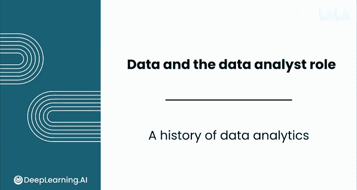
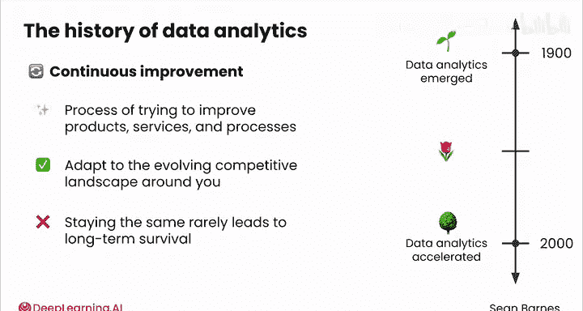
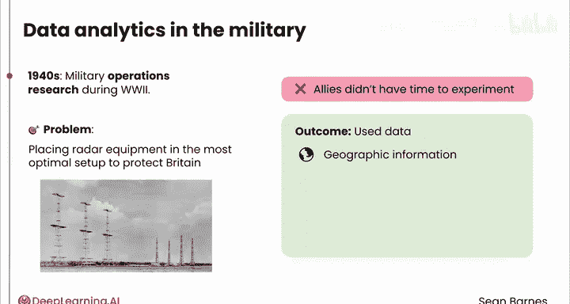
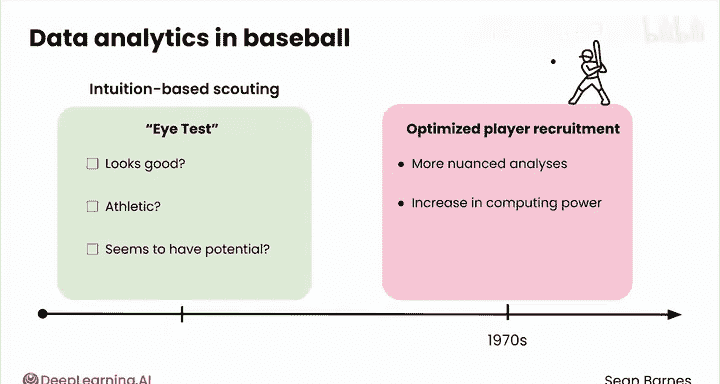
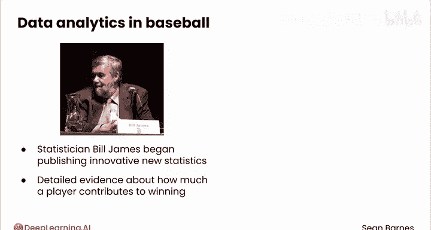
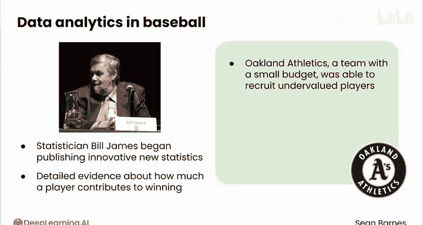
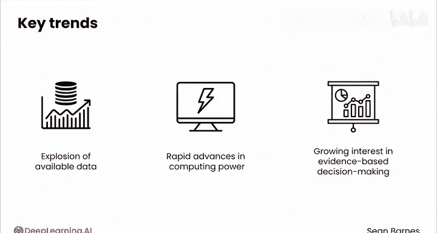
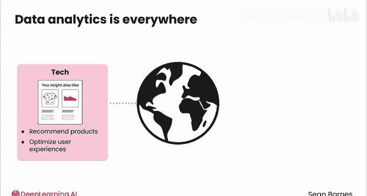
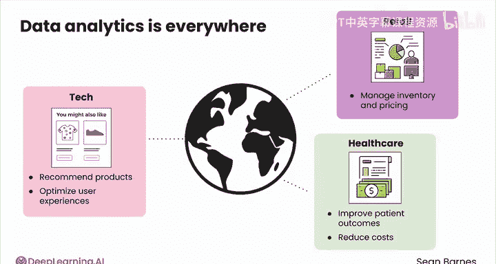

# 吴恩达《数据分析（数据分析基础／应用统计学，1-2课／共5课）｜DeepLearning.AI Data Analytics》中英字幕（claude-4-s - P7：6_数据分析发展史.zh_en - GPT中英字幕课程资源 - BV1SCXrYuEwr

The recent history of data analytics is just as fascinating as the ancient Egyptian's use of data visualization。

 from the military to baseball to the tech sector， this video will help you understand why data analysts are so in demand。

 We'll look at two key trends that translate into data analytics mindsets。

 continuous improvement and data drivenri evidence。

Modern data analytics emerged almost 100 years ago and really accelerated at the turn of the century At its core。

 the history of data analytics is grounded in the concept of continuous improvement。

 which is an ongoing process of trying to improve your products。

 services and business processes As a company you have to adapt to the evolving competitive landscape around you just like an evolution staying the same rarely leads to long-term survival modernern data analytics has its roots and military operations research during World War I around the early 1940s。

 moving， feeding and equipping an entire army is a massive operation。

 and each decision could have substantial consequences。

 one of the first documented operational resource problems involved placing radar equipment in the most optimal setup to protect Britain against German air raids The allies could have used trial and error to place the equipment。

 but they didn't have time to run experiments because air raids were already happening by using data such as geographic information enemy。

craft flight patterns， radar range and Sstr。 The team developed an optimal strategy for placing the radar equipment to detect enemy aircraft。

 This placement is considered a major factor in the allied victory at the Battle of Britain while it might not look exactly like modern day analytics they certainly weren't working with big data or powerful computers it still a form of data-driven decision making that has strongly influenced the field of data analytics today American baseball was another historical hotbed of data-dven innovation prior to the 1970s top players were typically chosen using a heavily intuitionbased approach Most scouts looking for players at the time relied on the so-called eye test Basically they just watched the players Did they look good were the athletic did they seem to have potential scoutouts use some basic statistics too but their subjective judgment dominated decision making This method was intended to build winning teams while also preserving the aesthetics of the sport then in the 1970s three factors gradually optimized。

playlayer recruitment， more nuanced analyses an increase in available computing power and a lessened emphasis on intuition statistician Bill James began publishing innovative new statistics instead of just tracking point scored called runs in baseball these statistics provided more detailed evidence about how much a player contributes to winning overall that could mean helping their teammate score or even preventing the opposing team from scoring using these statistics。

 the Oakland athletics， a team with a small budget was able to recruit undervalued players that is great players who were less expensive this strategy helped them gain a competitive advantage over some of the richest teams their players didn't look like your typical players but their players won more often that's the power of data analytics The baseball story coincided with a few key trends an explosion of available data rapid advances in computing power and a growing interest in evidence-based decision- making across industries If a baseball team could use data to compete with rivals that had much bigger budget。

What could this mean for businesses in other industries today data analytics is everywhere tech companies use it to recommend products and optimize user experiences Reers use it to manage inventory and pricing healthcare care providers use it to improve patient outcomes and reduce costs the list goes on the ubiquity of data analytics drives demand for experts in this role around the world in the US data analytics jobs are expected to grow 25% by the year 2030 Every business can benefit from using datadriven evidence to fuel continuous improvement Jo me in the next video to see some of the most exciting applications of data analytics in modern times。

