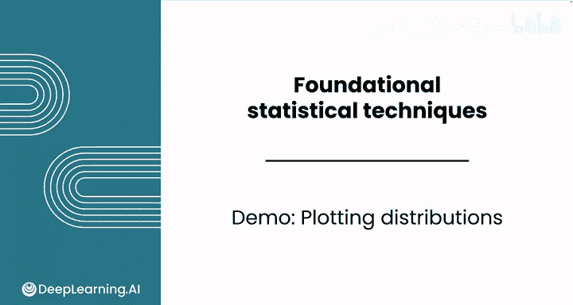
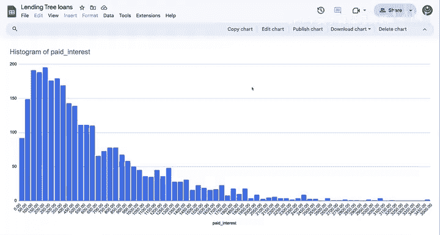
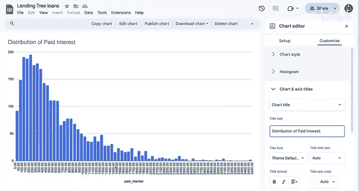
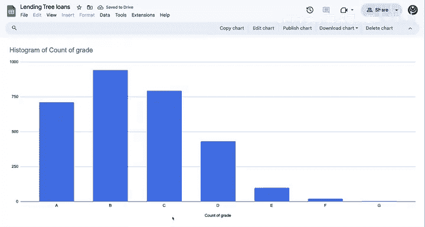
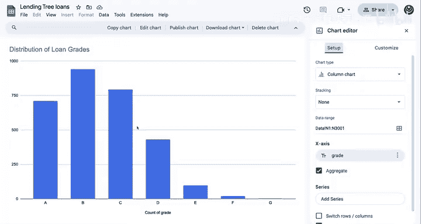

# 吴恩达《数据分析（数据分析基础／应用统计学，1-2课／共5课）｜DeepLearning.AI Data Analytics》中英字幕（claude-4-s - P80：9_演示：绘制分布图.zh_en - GPT中英字幕课程资源 - BV1SCXrYuEwr

Now that you learn how to interpret histograms， Let's take a look at how to plot distributions using both histograms and column charts。

 the demos in this module use a subset of the lending treee loan dataset set。

 The dataset set includes thousands of loans made through the lending tree platform。

 which allows individuals to lend to other individuals。 Each row represents a particular loan。

 and each column includes features about the person who took out the loan。

 like their job title and annual income， As well as information about the loan like the amount。

 Remember， if you'd like to follow along with the demo。

 you can find the spreadsheet and the solution in the downloads tab。

 Imagine that you are thinking of becoming a lender on this platform before committing to anything。

 You want to better understand the risks involved。 You can perform a statistical analysis on the existing loans to try to identify the level of risk of each loan and which factors seem to affect risk As a potential lender。

 you might be interested in the paid interest column and column P。

 This feature essentially represents the amount of money the lender has made。😊。

So far and the lo， let's create a histogram to visualize the distribution of this feature。

The chart defaults to showing a histogram。 So you don't have to change it to another chart type。

 What if you want to customize the bar width in order to do that。

 you will select the customized tab and then histogram。

 The bucket size is where you can change the settings for the width of the columns in the histogram bucket just means Ben in order to change the bucket size。

 select the drop down and then select 50。 The bucket size got smaller so you have more granularity and the data that's being visualized in this chart。

 You might want to move this chart to its own sheet。

 You might want to customize this chart a little bit further so that you can develop a clear data visualization。

Distribution of paid interest。 Most loans have a paid interest amount somewhere between $50 and $600。

 but you see a lot more examples out here in the tail of higher paid interest on different loans。

For discrete features， you need to use a column chart rather than a histogram。

 You already learn this visualization and data analytics foundations。

 Let's see how a column chart can show you the overall distribution of your data。

 One categorical feature present in this data set is the loan and grade。

 The grade is the quality score given to each loan based on the borrower's credit history and some other factors。

 It's useful to you as a potential lender to better understand the distribution of good and bad loans on the platform。

 So now let's create a new chart to summarize this distribution。😊。

The default chart here doesn't really make sense， you would expect to see the grade as X axis labels and then some count of each of those categories。

 but that's not what you see， so you need to change the chart type。Select a column chart。

 notice that the grades on the X axis are not in order。

 making it hard to visualize the distribution so you can go back into your sheet and then add a filter。

And then sort the grade column from A to Z。 Now you can see that the X axis labels have appropriately sorted。

 Now you can move this chart to its own sheet。 Then you can rename the sheet so you can keep track of where you've created your charts。

 Now， again， you can customize this chart by updating the title。

Distribution of loan grades。Now let's go back to the chart setup。

You may notice this aggregate option has been checked。 This is on by default。

 and what it does is count the frequency of each grade in the data set。

 rather than trying to display each value individually。 Okay， great。

 Now you can see many loans are in the higher grades。 A， B and C。

 That may motivate you as an investor。 but it's worth investigating those terms more。

 Great work on histograms。 Join me in the next video to learn how to complement this visualization approach by calculating descriptive statistics。

😊。

