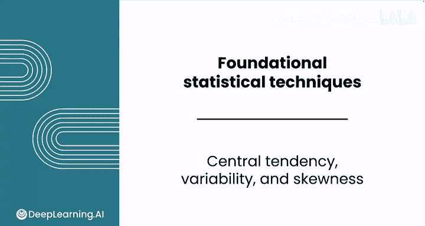
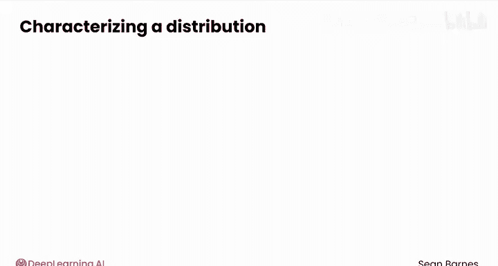
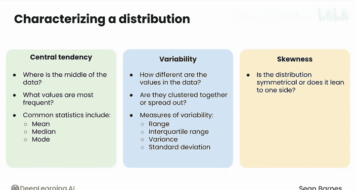
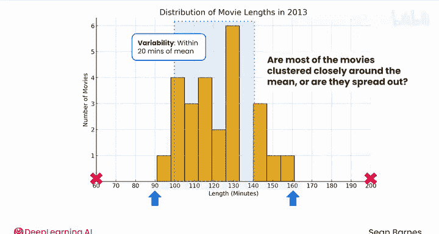
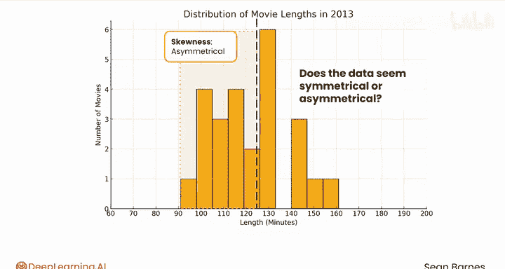

# 吴恩达《数据分析（数据分析基础／应用统计学，1-2课／共5课）｜DeepLearning.AI Data Analytics》中英字幕（claude-4-s - P81：10_集中趋势、离散度与偏态.zh_en - GPT中英字幕课程资源 - BV1SCXrYuEwr

Once youve visualize the data in your sample， you'll want to describe it。

But how let's check out some of the most useful statistics for explaining your sample。

 You can characterize the distribution through measures of central tendency。

 variability and skewness。 Here are the questions。 Each type of descriptive statistic answers for central tendency。

 Where is the middle of the data。 What values are most frequent。

 Common statistics include mean or average median and mode for variability。

 How different are the values in the data。 Are they clustered together or spread out。

 There are many measures of variability including range， Intercorrtile range。

 variance and standard deviation for skewness is the distribution symmetrical。

 or does it lean to one side。 Skewness characterizes the direction and extent of any asymmetry in the data。

 You can compare the mean and median to approximate skewness or calculated directly in a spreadsheet。

 You've learned many other useful descriptive statistics in data analytics foundations。

 So don't forget about them。 These include men， max and frequency。😊。

Let's return to the movie durations data In an earlier video you saw this histogram of the durations for now。

 let's explore the central tendency， variability and skewness of this data by I。

 then you'll see how to calculate these measures。For the mean。

 imagine you are trying to balance this distribution on the tip of your finger。

You're finding the center of mass of the data。 Where would you place the tip of your finger along the X axis to balance the chart。

 The center of mass looks to be somewhere around 1 and 20 or1 30 minutes。 What about variability。

 Look at how spread out the movie durations are on the X axis。

 or most of the movies clustered closely around the mean or are they spread out。

 If the mean is around 120。 Most of the durations are within 20 minutes to the left and right of the mean。

 That's one sixth of the average duration。 So they're relatively close together。

 There are any movies in this sample that are 60 minutes or 200 minutes long。😊。

How about skewness？Does this data seem symmetrical or asymmetrical。

 If you draw a line down the center here at the mean， you can see some asymmetry。

 There seem to be more movies on the left side with shorter durations。 However。

 the skewness is an extreme。

Now that you have an intuition about these different statistics。

 follow me to the next video to see how to calculate central tendency。

