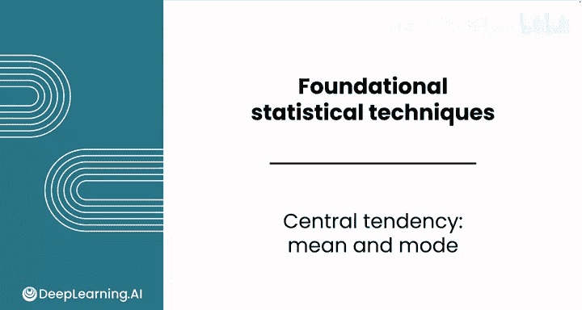
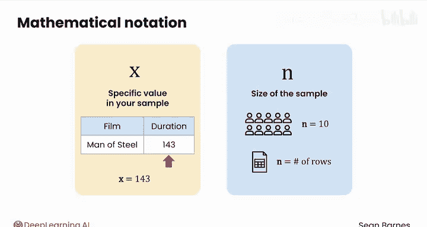
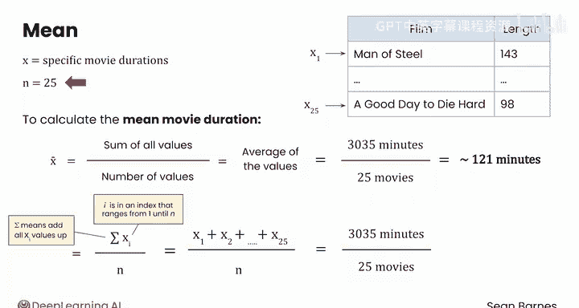
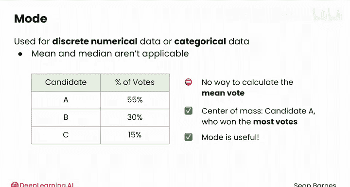

# 吴恩达《数据分析（数据分析基础／应用统计学，1-2课／共5课）｜DeepLearning.AI Data Analytics》中英字幕（claude-4-s - P82：11_集中趋势：均值与众数.zh_en - GPT中英字幕课程资源 - BV1SCXrYuEwr

You have a few different tools to measure central tendency， mean， median and mode。

 When should you use each one。 Let's look at how to calculate and interpret these measures。

 starting with the mean and mode。 First， you'll need a little bit of notation。

 Statisticians use mathematical notation to represent how the same calculation applies to all circumstances。

 It's common to use lowercase X to represent a specific value you found in your sample like a specific movie duration。

 you'll see x used in many upcoming formulas。 You'll also see lowercase N used to represent the size of the sample。

 So， for example， if you interview 10 people n equals 10 in a sample data set that you might have in a spreadsheet。

 n is the number of rows or observations。 With these two terms now defined。

 we can now build up the formulas used to calculate these measures。

 Let's return to the movie duration example。 you may already be familiar with how to calculate the mean。

 but you'll see it formalized using mathematical notation here。 For this example。

 X represent specific movie durations。 note that the。😊。

Number of possible values for X is quite large， Since movies can have many different durations。

 even if you round to the nearest minute， the sample size of the data N is 25。

 since you're working with the top 25 most popular movies from 2013。

 Let's walk through how to calculate the mean movie duration of your sample。

 The sample mean is written as X box。 The mean is calculated by summing up all of the values in the sample and dividing by the number of values or the sample size。

 This calculation is an average of the values， which is why you may hear mean and average sometimes used interchangeably。

 Intuitively， what's happening is that you're distributing the total sum of all values equally among the number of values in the sample。

 So in total， all of these movies are 3035 minutes。 and there are 25 of them。

 If these movies were all the same duration。 each one would be about 121 minutes。

Using the notation you saw earlier， the mean would be the sum of all of the values X I。

 where I is an index that ranges from one the first data point in the sample all the way until n。

 the last data point in the sample。 So X1 would correspond to the duration of man of steel。

 which was 143 minutes and X 25 would correspond to the duration of a good day to die hard。

 which was 98 minutes。 Remember， n is the sample size of the data。 In this case 25。

 Don't be scared of this big Greek letter sigma。 It just means to add all of these X values up。

 And lastly， divide the sum by the sample size of N。 Here's what that looks like all written out。

 You have x1 plus x2 all the way to x 25。 Since you have 25 movies in your sample。

 The sum of all of these individual movie durations gives you the 3035 total minutes that you've already seen。

 then you'll divide by the sample size of 25 to get the final result of 121。4 minutes。

 another common measure of centrality is the mode。😊。

The most common value in the sample data in the case of the movie durations in 2013。

 you'd actually have two modes。3 movies were 98 minutes long， and three movies were 130 minutes long。

 It's not the most useful measure for this type of data。

 mode is much more commonly used for discrete numerical data or categorical data where the mean and media aren't really applicable。

 Voing results are a great example if there are three candidates， A， B and C， with 55%。

30% and 15% of the votes respectively， There isn't a way to calculate the mean vote。

 What would you say is the center of mass of this data。 In this case。

 it would be candidate A because they earn the most votes in the election。

 So the mode being candidate A is quite useful for describing this data。

 Now you've seen how to use mean and mode appropriately。

 but there's one more useful measure of central tendency。

Follow me to the next video to calculate the median。

