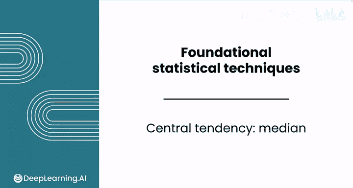
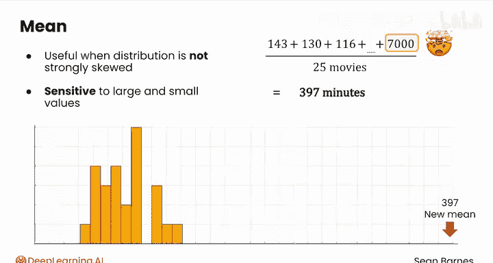
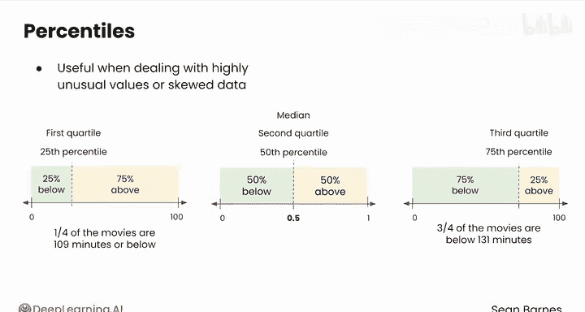

# 吴恩达《数据分析（数据分析基础／应用统计学，1-2课／共5课）｜DeepLearning.AI Data Analytics》中英字幕（claude-4-s - P83：12_集中趋势：中位数.zh_en - GPT中英字幕课程资源 - BV1SCXrYuEwr

The median has a more complicated formal definition compared with the mean and mode。 For now。

 let's just get an intuition at how it works。

While the mean is especially useful when your distribution is not strongly skewed。

 It's quite sensitive to very large and very small values。

 say the last movie was actually the longest movie ever made。 and it was 7000 minutes long。

 This very rare case would change the mean to 397 minutes。

 That's not the most useful way to think about the middle of the data。

 Looking at the histogram again。 None of the observations are anywhere near that mark。

 This scenario is exactly when the median can be helpful。

 median is calculated by selecting the value in the center of the data set。

 One way to calculate is to line up all the values X from your sample in ascending order。

 Then cross them out in pairs。 One on the left， one on the right， one on the left， one on the right。

 And eventually， you'll come to the middle。 Since there are 25 values in the movie duration data set。

 There's one value left， and that's1 hundred19。 Of course。

 computers are able to efficiently find the middle value。

 So you won't be crossing these values out by hand。

 The median is helpful when your sample is skewed or contains outliers。

 Outliers are extreme values in。😊。

Data imagine adding the longest movie ever， the one that's 7000 minutes back into the dataset。

 Now you have 26 movies。 So and is even repeat the process to calculate the median。

 and you can see that 7000 minutes gets thrown out right away。 In the end。

 there are two remaining values119 and 124 to find the median take the average of these two numbers by adding 119 and 124 together。

 Then dividing the result by two。 This gives you a median of 121。5。

 That's pretty close to the original median of 119。 compareare that 2。

5 minute difference to the 276 minute difference between the original and new means。

 The median represents the center of this modified sample data much better。

 The median is closely tied to the notion of percentiles percentiles are a powerful way to understand how values in your data are distributed。

 The median you just calculated is actually the 50th percentile。

 It's the value that's right in the middle with 50% of the data below it。50% above it。

Like Google Sheets，How do you select the number between 0 and1 to calculate a percentile。

 so in that case， 0。5 would be the 50th percentile。

But you're not limited to just the 50th percentile。 the media。

 you can calculate any percentile from 0， the minimum to 100， the maximum。 For example。

 the 25th percentile， also known as the first quartile is the value below which 25% of your data falls。

 In this case，1 hundred and9 minutes。 So a quarter of the movies in this sample were 19 minutes or below the second quartile is the media of 119 as you just saw50% above 50% below the 75th percentile or third quartile is the value below which 75% of your data falls。

 In this case，1 hundred31。 So  threequarter of the movies are below 131 minutes。

 percentiles are particularly useful when dealing with highly unusual values or skewed data。

 Remember the 7000 minute movie， It might dramatically affect the mean but it has minimal impact on most percentiles。

 The 90th percentile， for instance， tells us about the longer movies in the sample without being swayed by this extreme value。

 Now you've seen how to select and calculate。

Measures of central tendency， which are some of the most crucial descriptive statistics you can use to summarize a sample。

Follow me to the next video to calculate these measures on the spreadsheet。

