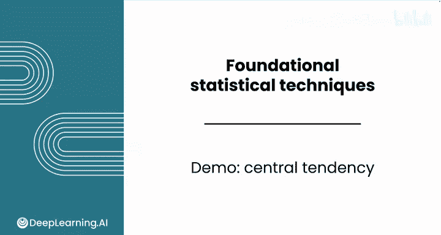
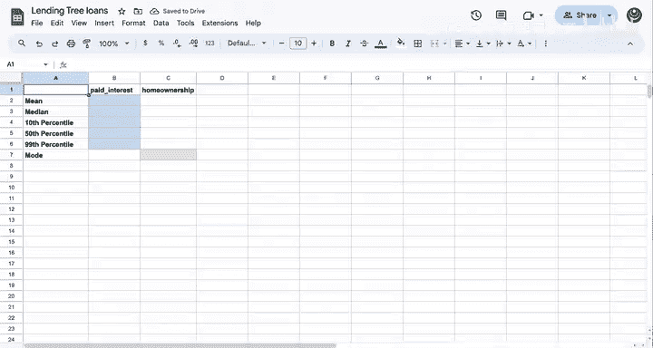
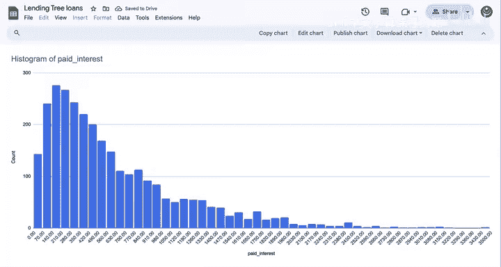
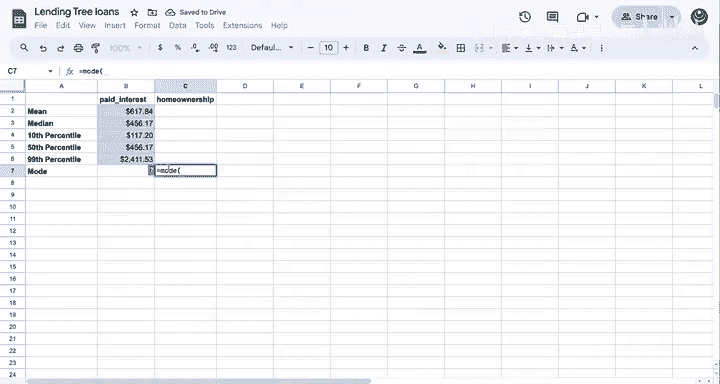

# 吴恩达《数据分析（数据分析基础／应用统计学，1-2课／共5课）｜DeepLearning.AI Data Analytics》中英字幕（claude-4-s - P84：13_演示：集中趋势.zh_en - GPT中英字幕课程资源 - BV1SCXrYuEwr

Let's see how you can use a spreadsheet to calculate central tendency in order to answer a business question。

 If you need a refresher on spreadsheet functions， I encourage you to revisit the data analytics Foundations course。

 where you can learn all the functions you'll see in this demo。

 This spreadsheet picks up where you left off with the lending tree loan data。

 recall that you previously created a histogram for the paid interest feature。😊。

Essentially， how much profit had accrued on the loan。

Let's complement the histogram with some descriptive statistics to help you get an idea of how much money you can be making from the interest and loans。

 and don't forget if you'd like to follow along with this demo。

 you can find the spreadsheet and the solution in the downloads tab。

You have a new sheet here to keep your statistics separate。 A good starting point is always the mean。

 The point of these descriptive statistics is to calculate some specific measures that help summarize that distribution to calculate the mean of the paid interest。

 You can use the average function。 Remember to start each formula with equals。 Open parentheses。

 refer back to the original data and then select the paid interest column。On average。

 about $617 was paid out on each loan。Next， you can calculate the median。

 you could enter the formula for median and again select the paid interest column。

The median paid interest is lower than the mean。The fact that the mean is higher than the median suggests there might be some higher paid interest values in the data Next。

 you might want to calculate some percentiles to identify some additional reference points in the distribution to calculate the 10 percentile。

 you'll use the percentile function。Select the paid interest column。

And then you need to enter the percentile， the percentiles need to be represented in a number between 0 and1。

 So for the 10 percentile， you'll enter 0。1。The result is around $117 to calculate the 50th percentile。

 you'll use the same approach except change the percentile parameter。

Notice that the result is the same as the median。 The median is the 50th percentile in the data。

 Finally， imagine you're a lender and you're interested in what the highest paid interest might be on a particular loan。

 you might want to calculate the 99th percentile。One of the highest paid interest amounts on a loan is over $2400。

 This is the top 1% in the overall distribution。 Suppose you're interested in understanding the collateral behind the loans by examining homeownership。

 Let's take a look back at the data in column D， you can see the original homeowner share column。

 which includes categories of rent own and mortgage。

 It turns out you can't really find the median of this feature or the average。

 you'd like to find the mode of this variable。 The mode function only uses numbers。

 So you can use this homeownership numeric column， which has one for rent2 for mortgage and three for own。

 You can use the mode function to calculate the most common category。

Here you get a mode of 2， which again corresponds to having a mortgage。

 so most people taking out a loan have a mortgage， so this helps you get a better picture of where the people taking out loans are in life and the kind of collateral they might have。

By calculating central tendency for the paid interest。

 you're starting to understand the center of mass of the sample data。

 which gives you a sense of roughly what payout you can expect on average once you've completed the practice assessment and the practice lab for this lesson。

 join me in the next one to learn more about variability and skewness in your data。

