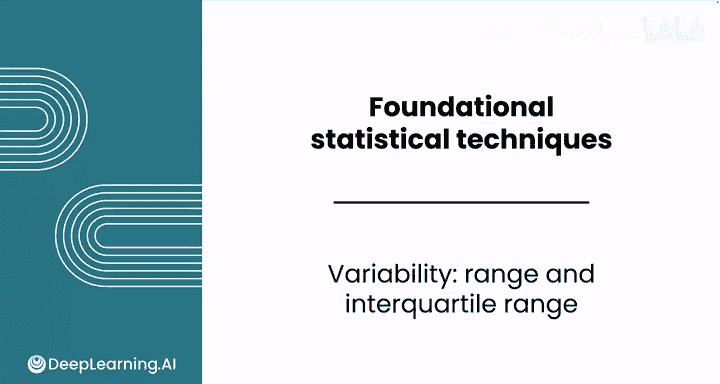
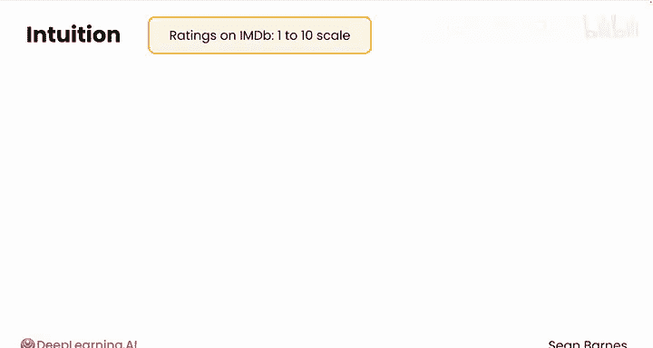
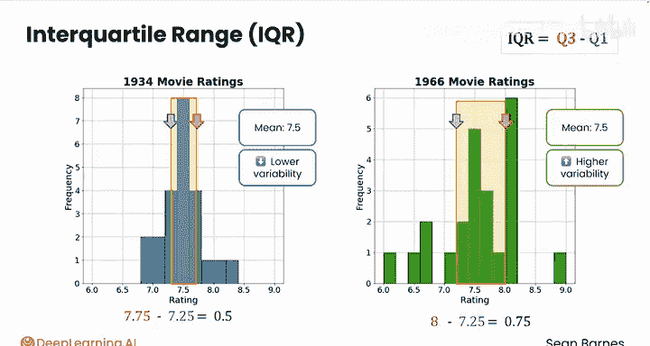

# 吴恩达《数据分析（数据分析基础／应用统计学，1-2课／共5课）｜DeepLearning.AI Data Analytics》中英字幕（claude-4-s - P85：14_离散度：极差与四分位距.zh_en - GPT中英字幕课程资源 - BV1SCXrYuEwr

In the 2020 Tokyo Olympics， elite swimmer Margaret McNeill won the women's 100 M Butfly event by just 0。

05 seconds。 In fact， all eight swimmers in the finals achieve times within one and a half seconds of each other。

😊。

That's a very， very small difference。 Contrast that with your local high school swim tros。

 you might see the fastest swimmer finishing in just 70 seconds。

 while others take 200 seconds or more， the range is much broader because the skill levels are more varied。

 This measure of spread across the data is not as variability。

 A measure of how tightly or loosely the data points cluster around the mean。😊。

Let's start with some intuition。 You saw earlier that the movie dataset also includes ratings so you can compare how movies have been rated on the international movie database or IMDB。

 which is on a 1 to 10 scale， let's zoom in on two years。

 1934 and 1966 Take a look at these two histograms What can you tell about the central tendency of these two years It turns out that on average。

 movies in 1934 and 1966， both had the same mean rating of 7。5。

 a quick note one outlier has been removed from each year， so there are only 24 movies here。

 even though these two years had the same mean score， the distributions look quite different。

 what major difference can you spot。

Well， the distribution in 1934 looks tightly clustered around the mean of 7。

5 while the distribution for 1966 is much more spread out。

 the values are more different from each other。 In other words。

 1966 has higher variability while 1934 has lower variability Let's look at the different tools you have available for calculating variability First up range range is simply the max minus the min It answers the question what is the largest distance between any two values。

 It's the simple yet useful measure of variability In 1934， the highest rated movie was an 8。

3 with the lowest of 6。9 making the range of 8。36。9 a difference of 1。

4 contrast that year when 1966 which had a max rating of 9。0 and a minimum rating of 6。

1 making the range 2。9 more than twice as large calculating the range is a quick way to see how spread out the ratings are and whether a year had consistent or inconsistently rated movies in this case。

It looks like 1934 had more consistent ratings compared with 1966 a similar measure of variability you can use in conjunction with the median is the intercorrtile range or IQR It's calculated by subtracting the first quarttel from the third quartile remember the first quartile defines the lowest 25% of the data and the third quartile defines the upper 25% of the data got difference means that the IQR contains the middle 50% of the data For 1934 the first quarttel is 7。

25 and the third quartile is 7。75 making the IQR 0。5 for 1966 the first quartile is also 7。

25 and the third quartile is 8 making the IQR 0。75 or 50% wider so you can see IQR follows a similar pattern to the range higher for 1966 compared with 1934 Ref the greater variability in the data。

You've seen two common measures of variability， range and intercorrtell range。In the next video。

 you'll learn about two more measures of variability， variance and standard deviation。

