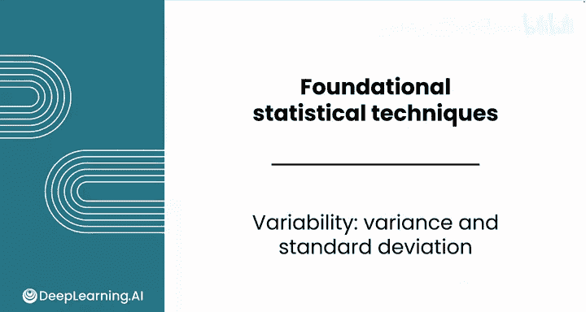
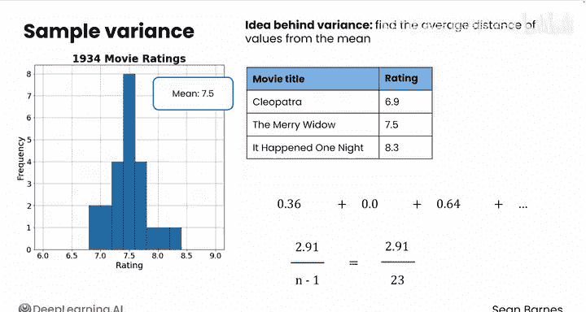
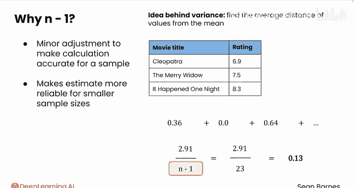
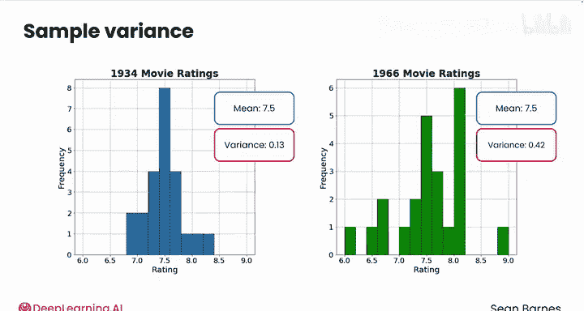
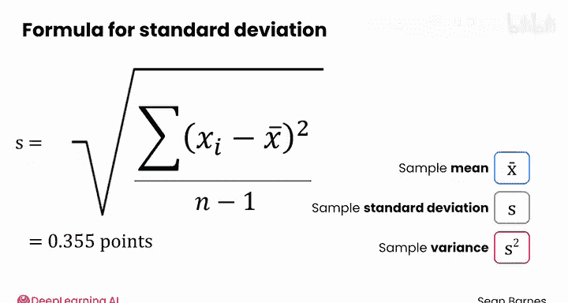
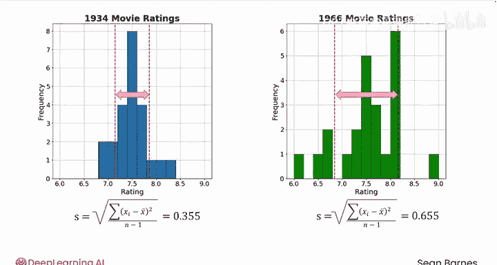

# 吴恩达《数据分析（数据分析基础／应用统计学，1-2课／共5课）｜DeepLearning.AI Data Analytics》中英字幕（claude-4-s - P86：15_离散度：方差与标准差.zh_en - GPT中英字幕课程资源 - BV1SCXrYuEwr

Now let's explore variants variance is a more complex calculation than range and IQR。

 and is the foundation of many other statistics， including this standard deviation。

Remember that the whole point of calculating variability is to quantify how spread out the values are。

 You can step through the calculation for variant using the movie ratings from 1934。

 The idea behind variance is to find the average squared distance of the individual values from the mean the process for calculating it involves looking at each value in your sample In this case each movie rating finding the difference between that value in the mean squareing that difference and then repeat that for all of the values Then you sum all of these square differences and divide by one less than your sample size we'll discuss the one less point in more detail shortly the square differences are also sometimes called square deviations with deviation just meaning how different each value is from the mean In the case of the 1934 movies。

 you can start with Cleopatra the lowest rated movie start with the movie's rating 6。

9 subtract the mean of 7。5 from it giving you negative 0。6 then square that 0。

36 Great pause there Now you need to do the same。For each other movie， so for example。

 the me widow with the rating of 7。5， subtract the mean from that and you get zero squared is still zero。

How about it happened one night， which received a rating of 8。3， Subtract the mean from 8。3。

 and you get 0。8 squared is 0。64。 and you'll do this for each of the values。 Here's how it looks。

 noticeice how each of these values is either 0 or positive。

 That's one purpose of the squaring operation。 to make sure that when you add these values all up。

 You don't have positive and negative values canceling each other out。

 Another effect of squareing is that it emphasizes larger deviations。

 So observations that are far away from the mean contribute much more significantly to the overall variance。

 Your final step is to divide the total of these square differences by the sample size n-1。

 which in this case is 23。 The result you get is 0。13。 A quick note here。

 you might be wondering why you don't divide by just n and calculate the average sum of square deviations。

 That's great intuition。 However， n-1 is a minor adjustment that housemaker calculation more accurate when working with。

😊。

Sample rather than the entire population by using n-1。

 you're applying a small correction that makes your estimate more reliable。

 especially for smaller sample sizes。 Notice that n-1 is a little smaller。

 which makes your estimate for the variance a little higher。

 This helps your estimate account for a little bit more uncertainty in the statistic compareare the variance you just calculated with the variance for 1966。

 which is 0。42 almost 3 times higher， so this calculation is confirming your intuition that the movie ratings in 1966 we're much more spread out Now that you've calculated it through。

 let's formalize the definition for sample variance。

 Each value in your sample is x sub I and you're subtracting the sample mean X bar from that。

Square this up。Now， do you remember the notation for summing up all these individual values。

 that would be sigma， the big E looking symbol， and finally divide by n minus1 Now one issue with interpreting variance is that because you squared the differences between the mean and each value。

 the variance is not in the same units as your data Right now。

 your variance is in the units point squared Award， however， if you just take the square root。

 you'll get back to having a calculation in points In this case， 0。355。

This square root of the variance is called the standard deviation。

The sample standard deviation is written as S。 so you already saw x bar for the sample mean Now you have s for the sample standard deviation sample variance is written S squared since it's the standard deviation squared。

 Let's compare with the standard deviation for movie ratings for 1966 which is 0。

655 we have the same interpretation as before the 1966 has a higher standard deviation Now you can visualize these statistics on the histograms from before the dashed red lines each indicate the mean minus1 standard deviation on the left and the mean plus one standard deviation on the right。

 the difference on the left is much more narrow while the difference on the right is wider it looks like the values in the 1966 histogram are almost pulling those dash lines outward which mathematically is exactly what happens In practice。

 youll see both standard deviation and variance Since variance is used to derive multiple other calculations in standard deviation is commonly used to characterize your distributions。

Great work on calculating these measures of variability。

 Join me in the next video to better understand the third key measure of your distribution， Skewness。

😊，I'll see there。