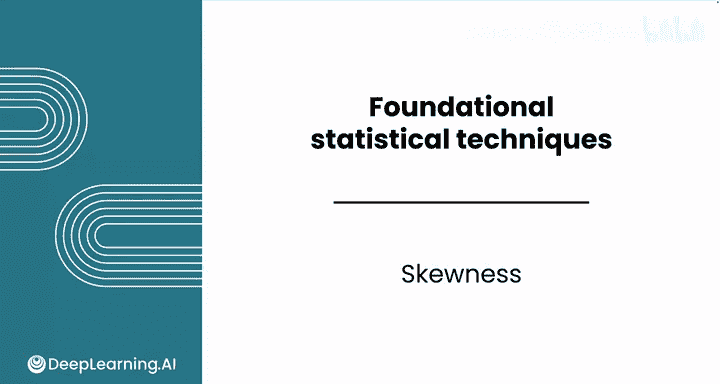
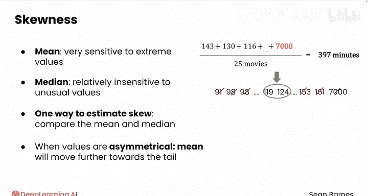
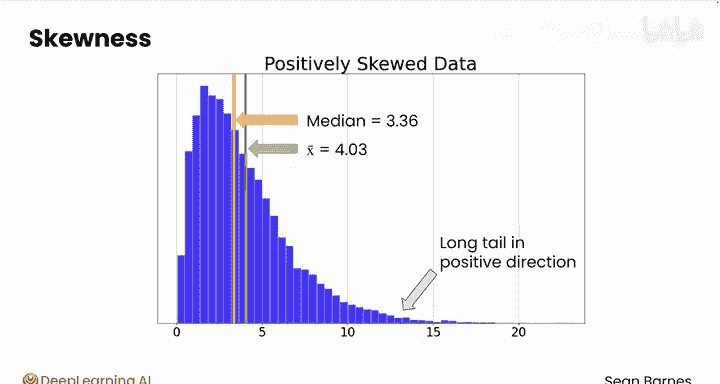
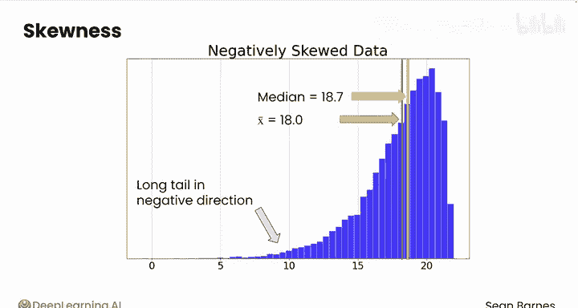
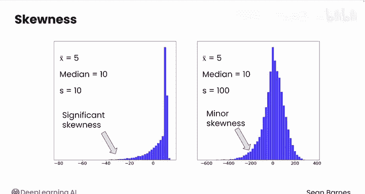
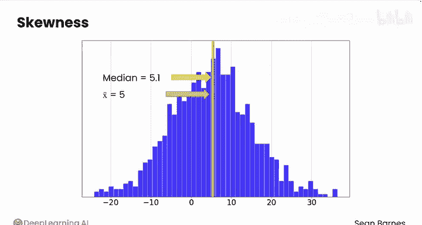
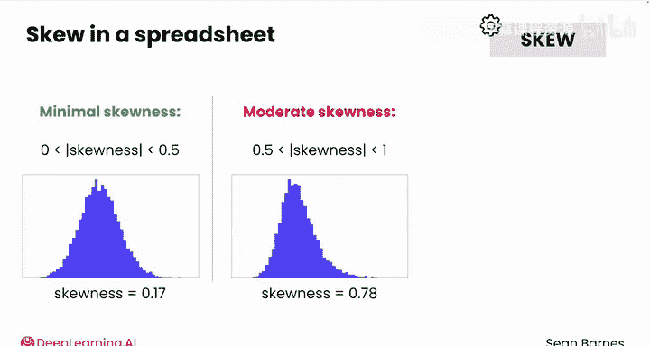

# 吴恩达《数据分析（数据分析基础／应用统计学，1-2课／共5课）｜DeepLearning.AI Data Analytics》中英字幕（claude-4-s - P87：16_偏态.zh_en - GPT中英字幕课程资源 - BV1SCXrYuEwr

Unlike mean， median， variance and standard deviation， skecheness isn't regularly calculated manually。

 It has a rather complicated formula。

No， going。It's quite a useful concept though， let me show you a quick shorthand for estimating it。

Earlier， you saw how the mean is very sensitive to extreme values。

That's because the mean distributes the total of all values over the sample size。

 You also saw that the median is relatively insensitive to these types of unusual values。

 So one way to estimate skew is to compare the mean and median。 when the values are asymmetrical。

 The mean will move much further towards the long tail of unusual values compared with the median。

 Here's what that looks like in a histogram。 If the mean is greater than the median。

 the data is skewed towards the right。 This is also called positive skew。

 You can remember this because the long tail of values goes up in the positive direction。 Meanwhile。

 here's a different distribution。 Here， the mean is less than the median indicating a negative skew。

 you can see how the mean was pulled more strongly towards the left towards the tail that goes out negatively from the center of the data。

 The larger this difference is。 the more skewed your data is。

 because the mean will continue to be pulled further and further away from the median。

 The magnitude of this difference should be put in context with your standard deviation。 For example。

 say you have a mean of 5， a median of 10。😊。

A standard deviation of 10。 The large difference between the mean and median compared with the standard deviation suggests significant skewness。

 Now， take the same mean in median， but the standard deviation is 100。

 The difference is not as impactful， but skewness is still present。 What if your data isn't sked。

 Here's a histogram of data that is not skew。 In this case。

 the mean and median will be roughly equal since the mean hasn't been influenced significantly by asymmetry in the data。

 Quick test。

Say I have a mean of 18， a median of 10， and a standard deviation of 15。

 Would you say this data is skewed positive， skewed negative， or not skewed。Hit。

 consider the direction that the mean is being pulled。This data is positively skewed。

 Since the mean is larger than the median。 that difference suggests that there is a long tail on the right or positive side of the distribution。

 the difference of 8 compared with the standard deviation of 15 suggests a considerable degree of positive skewness。

 When calculating skew in a spreadsheet， youll use the skew function， which returns a number。

 So you will need to know how to interpret it。 More positive values indicate more positive skew。

 More negative values indicate negative skew， and values close to 0 indicate minimal skewness。

 absolute values of skewness， less than 0。5 indicate minimal skewness。 Skewness between 0。

5 and1 is moderately skewed and skewness greater than one is highly skewed。😊。

Now you're familiar with how to calculate and understand the key measures of central ten。

 variability， and skewness， but how can these be used in data analytics？

Follow me to the next video to better understand how to select each measure based on the business question you're trying to answer。

