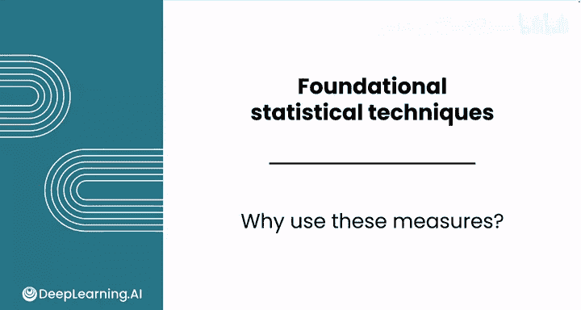
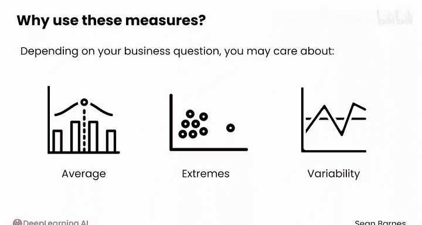
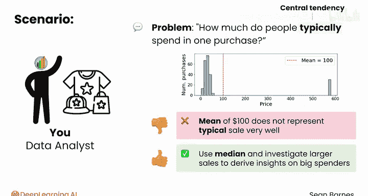
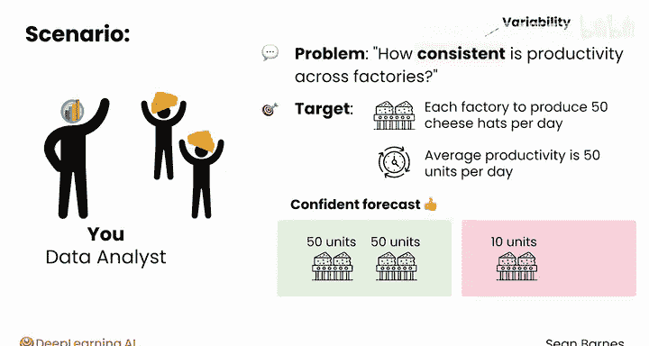
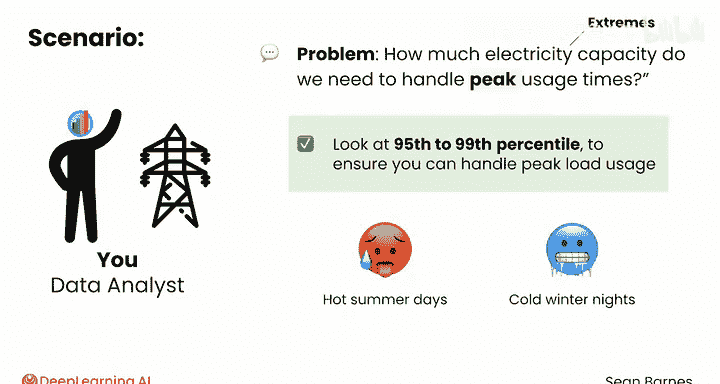

# 吴恩达《数据分析（数据分析基础／应用统计学，1-2课／共5课）｜DeepLearning.AI Data Analytics》中英字幕（claude-4-s - P88：17_为何使用这些指标.zh_en - GPT中英字幕课程资源 - BV1SCXrYuEwr

So why are these three measures of central tenancy， variability and skewness so important。

 depending on your business question， you may care more about different aspects of your distribution。

 Sometimes you care most about the average person， sometimes about the extremes and sometimes the variability。

 Let's look at a few examples of business questions and how descriptive statistics can help you answer them。

 a personalized mergech company might wonder how much do people typically spend in one purchase。

 In this case， you're interested in central ten。 Basically， where's the middle。

 you have to be mindful of how you characterize the typical purchase amount。

 The average could be misleading if you have a sked distribution。 For example。

 if your mean purchase is100 dollars， but you have lots of small purchases and a few very large ones。

 that mean of 100 dollars doesn't represent your typical sale very well。 In this case。

 you might want to use the median and maybe investigate those large sales further to see if you can derive insights into your big spenders。

 Now say you're working for a cheese hat manufacturer and they want you to figure out how consistent is productivity。

Across factories。 In this case， variability is quite valuable。

 Sa your target is for each factory to produce 50 cheese hats per day。

 and the average productivity is 50 units per day。 It looks good on the surface。

 but a mean value with no variance means something very different than a mean value with a lot of variance。

 If each factory produces almost exactly 50 cheese hats on average per day。

 you can be pretty confident in your production forecasts。

 but if a factory produces 10 units in one day and 75 on another。

 you'll come to a different conclusion。 it's possible to reach up to 75 cheese hats per day and you may want to implement the practices used on these high productivity days company wide。

 Lastly， consider an electricity company that may investigate how much electricity capacity do we need to handle peak usage times for this question。

 you're not just interested in the average electricity usage， but also the extremes。

 you'd want to look at the highest usage times。 Perhaps the 95th or 99th percentile to ensure you can handle peak loads without blackouts。

 This analysis is especially important。😊。

For utilities planning for hot summer days or cold winter nights when usage spikes Okay， cool。

 you've seen how to match up these different measures with the insights they best support。

Follow me to the next video to see how to conduct these analyses in a spreadsheet environment。

