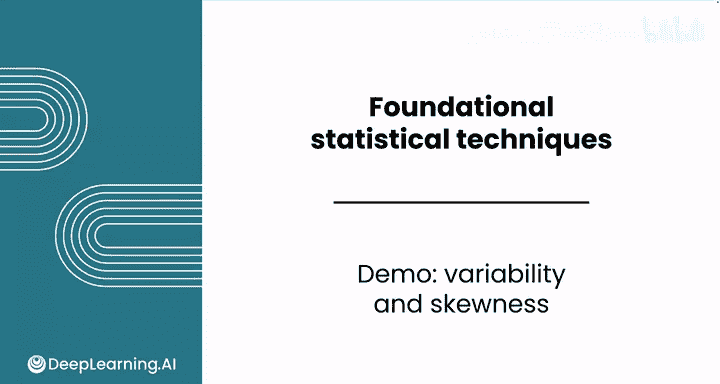
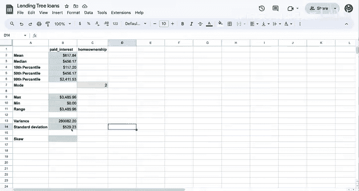
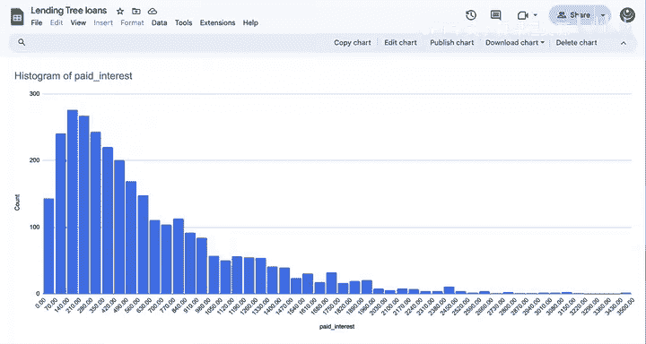
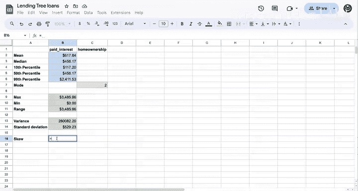

# 吴恩达《数据分析（数据分析基础／应用统计学，1-2课／共5课）｜DeepLearning.AI Data Analytics》中英字幕（claude-4-s - P89：18_演示：离散度与偏态.zh_en - GPT中英字幕课程资源 - BV1SCXrYuEwr

Now let's see how you can use the spreadsheet to calculate measures of variability and skewness in the Le tree data。

These measures complement your previous exploration。As a reminder。

 you were previously working with data about different loans to analyze potential investment opportunities。

 Remember that if you'd like to follow along with the demo。

 you can find the spreadsheet and the solution in the downloads tab。

 let's take another look at the paid interest feature You know that the mean value is around $617 and the median is around $456。

 but that doesn't tell you much about the variability in the data。

 So while you may be interested in seeing the average payout。

 you're probably also interested in understanding the variability too how common is it to make less than the average or more than the average I the amount of interest paid spread out over hundreds of dollars or is it tightly clustered around the Me。

 you can start with the range which tells you the difference between the maximum and minimum payments。

 This will help you understand the difference between the largest and smallest possible payouts。

 So in the first cell， you would use the max function。Here， the maximum paid interest is around $3。

500， then you can calculate the minimum interest paid。Which is $0。

 So you probably don't need a formula to calculate the range， but let's do it anyway。

 just to be complete。The range of paid interest in the data is around $3500。

 so that's a pretty wide amount of variability。 you may also notice that the maximum paid interest is quite a bit larger。

 almost $1000 more than the 99th percentile so in the highest percentiles of the data you may observe these large jumps The range tells you the maximum possible distance between values。

 but you have more tools available to you variance accounts for all of the data points not just these two extremes。

 so to calculate the variance you can use the variance function。The result you get is around 280，000。

 remember the variance is in units of dollars squared。

 so this is not a cell that you should format to dollars， but you can reduce the decimal places。

You can convert to standard deviation to make it more interpretable。

You can just calculate using the square root function。 Now。

 the standard deviation is in units of dollars， so you can format out this cell as currency。

 You may not always want to calculate the variance first。 It's one extra step。

 so you might want to calculate the standard deviation using the direct formula。

You get the same result， based on the histogram you saw earlier。

 what would you say is the skew of this feature？Based on the histogram。

 you could conclude that this data is positively skewed， you can also compare the mean and the media。

 the mean is greater than the median， so this indicates positive skewewness， but how much is there。

 so down below you can calculate skew so that you can more specifically evaluate it for this distribution。

The skew is around 1。55。 so if we recall any skew value greater than1 is strongly skewed。

 so in this case you have a strong positive skew which reflects the behavior that you see in the distribution。

Even just by calculating central tendency， variability and skewness。

 you learn a lot about the potential interest payout in the next video。

 you'll wrap up the discussion of distributions by interpreting another common visualization。

 the box plot。