# 吴恩达《数据分析（数据分析基础／应用统计学，1-2课／共5课）｜DeepLearning.AI Data Analytics》中英字幕（claude-4-s - P8：7_现代行业应用案例.zh_en - GPT中英字幕课程资源 - BV1SCXrYuEwr

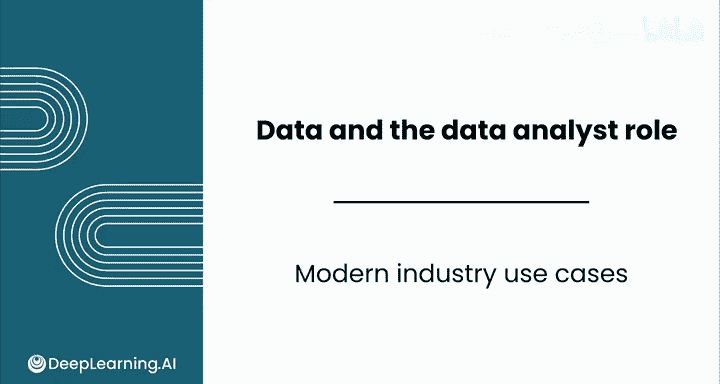

Whether you're passionate about sports， government， fashion， or something else entirely。

 there's a place for your expertise as a data analyst in that field。

 Let's take a tour through some of these applications。

 Moernday streaming companies collect incredibly detailed data about every action taken by every user on their platform clicks Watch times searches pause and rewind actions This information helps them recommend content。

 their challenge is less about getting information and more about wrangling such a massive amount of it somehowhow all that data about who's clicking where and who's watching what needs to be translated into decisions like who should be recommend reality shows to how do we make people like Season 8 of Game of Thronees and those decisions are impactful YouTube famously revealed in 2018 that 70% of what people watch comes from recommendations contrasttra that approach with old school TV ratings Network used to rely on data collected by thirdpart companies like Nielsen to understand different。

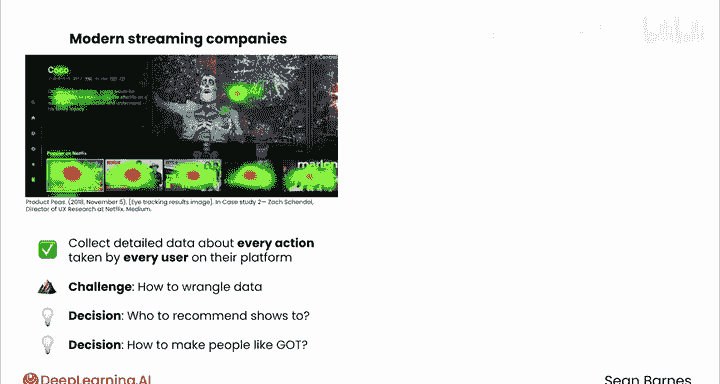

Audiences Nielsen measured people's TV watching habits by installing physical monitoring devices in a sample of households to record what they were watching While useful。

 this measurement system led to challenges like recording the habits of predominantly older TV watchers and collecting incorrect data from households with multiple TVs。

 Entertain is just one application of data analytics， though in sports。

 the analytics revolution that started with baseball has spread to basketball。

 both footballs and beyond Let's take a look at basketball。

 which I'll admit I do follow Here's what the court looks like from above the goal also called the basket is located here。

 one key decision a player has to make is when to try scoring。

 This is also called a shot in basketball。 Getting the ball into the basket awards two points if the players shoots from inside this line and three points if they were outside。

 the past few decades have seen a dramatic shift in where players shoot from on the left。

 you can see the most frequent locations of shots taken in 1997。

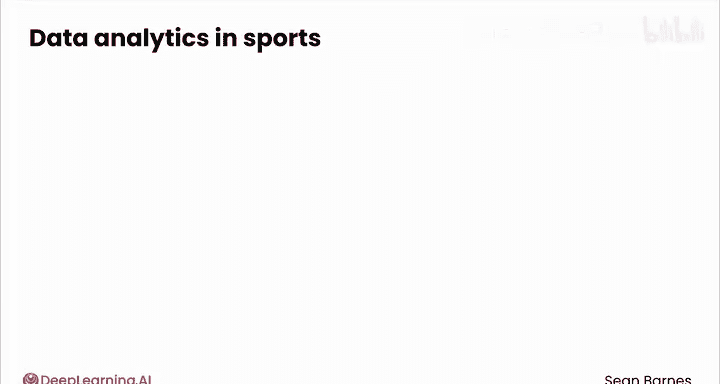

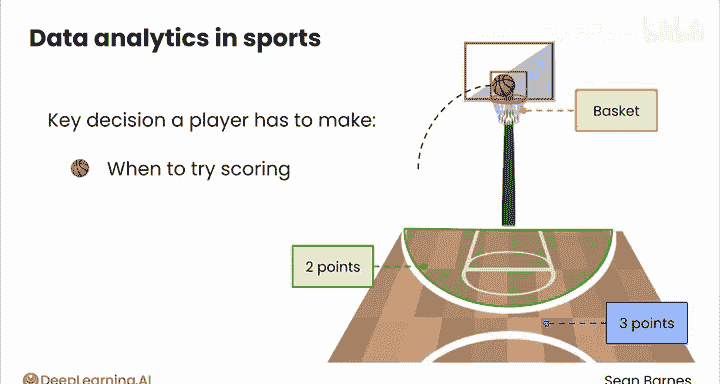

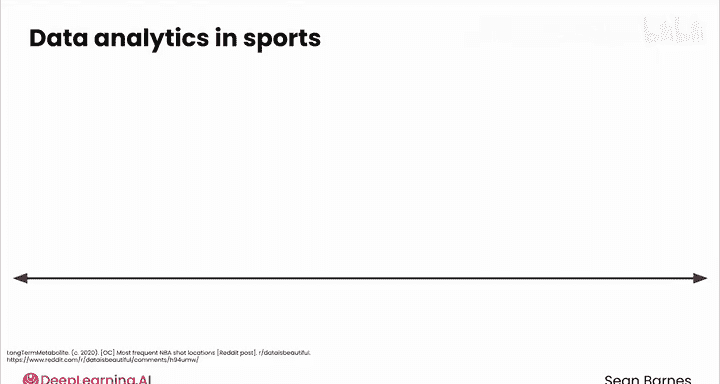

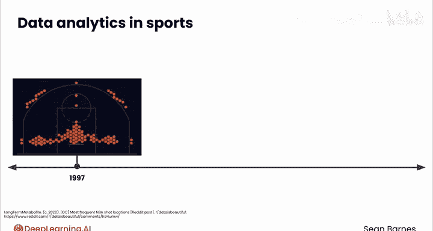

On the right， shots taken in 2019， the pattern completely changed as teams embraced data analytics。

 maximizing shots from locations with the highest expected points per shot Players have learned to take the easiest shots of each point value。

 so a lot of three point shots that hug the line and two point shots as close to the basket as possible for example。

 a shot from here is worth two points， but by taking one step back to here the shot is essentially just as hard and worth 50% more why not go for it。

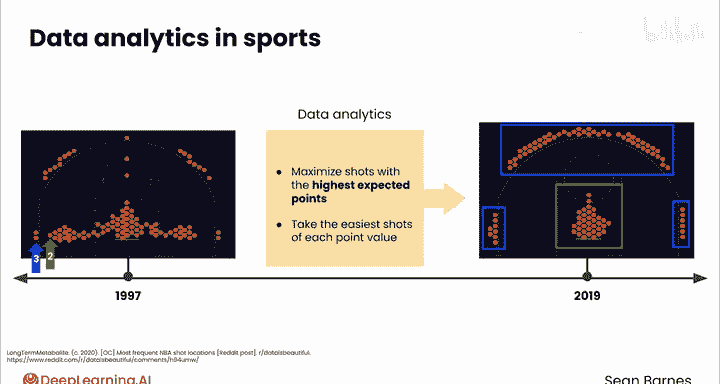

Let's look at product design Helloresh as an example collect several categories of data to inform its recommendations such as customer data like demographics。

 location and taste profile recipe data like ingredients。

 availability and even images of the recipes and the recipe text itself and transaction data like oral history feedback and browsing behavior All this information can be used to make decisions about which products to recommend when to offer discounts and how to choose new recipes in fields like education and government there's a growing emphasis on using data to make better decisions。

 For example， these institutions may use analytics to improve access to information The University of St。

 Andrews recently published an article explaining how it uses interaction heat maps to improve user experience on its website Here's a heat map of user clicks on their university subjects page The red hotspots show where users were clicking the most followed by yellow then green then blue。

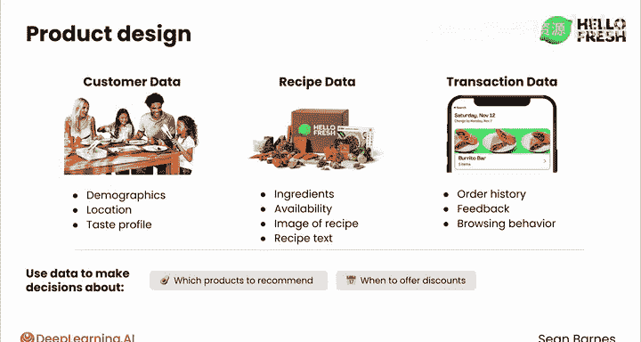

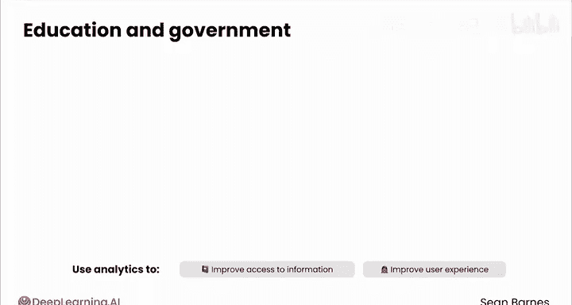

Data from the heatat map showed that lots of users are clicking on popular subjects like history and psychology。

 as well as places like the search bar analyzing the data， though。

 the university found that some users were attempting to click non-inactive elements and that lower parts of the page had a sharp dropoff in activity These insights drove website changes like clarifying which elements are clickable as well as reprioritizing information towards the top of each page。

 Not every company needs to constantly reinvent its core product。

 Some like Cocacoa and U have built incredibly successful businesses by focusing on doing one core thing really well Coca-cola by producing sweet caffeinated beverages and U by reliably delivering packages。

 they might use data analytics to optimize logistics or marketing。

 but the core product remains largely the same。 if the package makes it to the right destination quickly what more does the customer really want。

 The point is data can help a business improve and whatever way matches its。

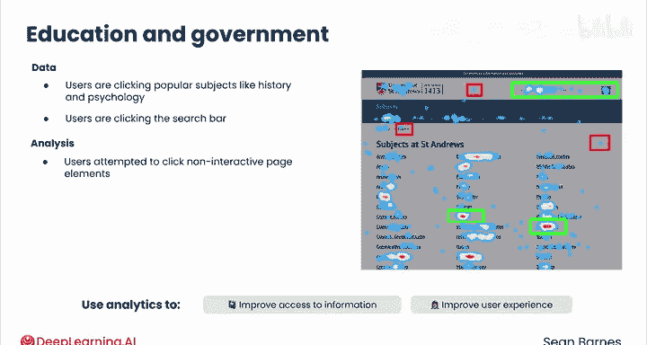

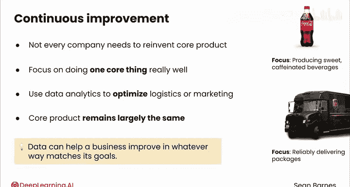

。As a data analyst， you have the opportunity to help organizations in any industry leverage data to make better decisions your skills are in such high demand because they are valuable across so many applications。

 great work completing the first lesson of this course Once you've checked out the upcoming Read item and practice assessment。

 join me in the next lesson to discuss the lifeblood of data analytics The data itself you'll learn what data is where it comes from and the many different forms it can take I'll see there。

