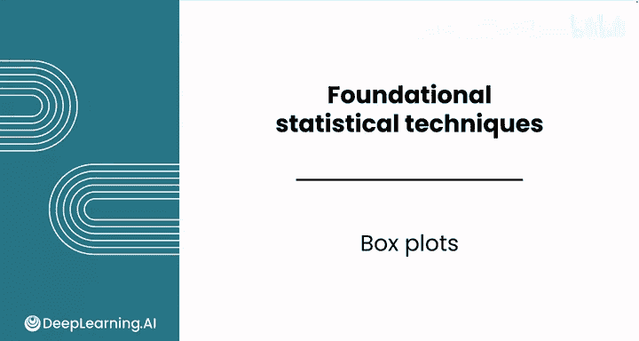
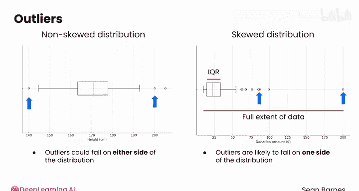
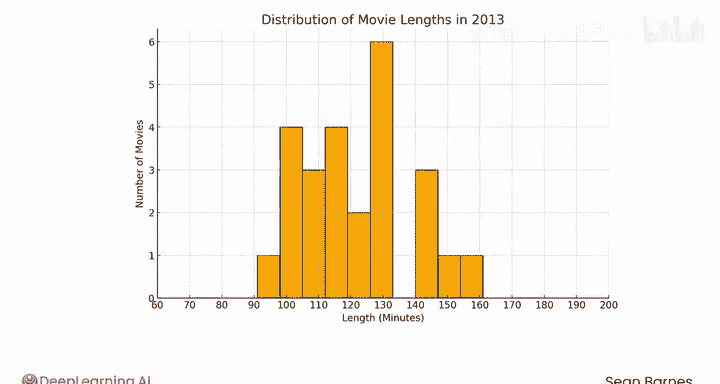
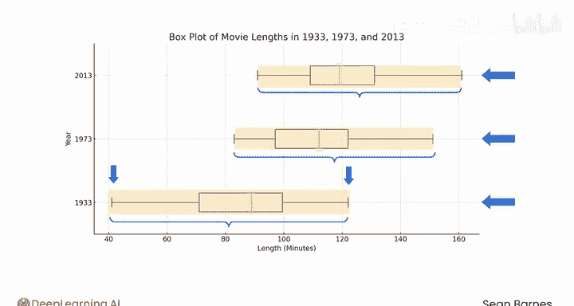
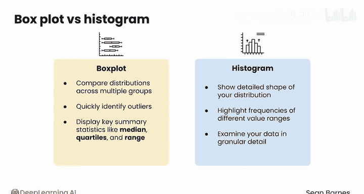

# 吴恩达《数据分析（数据分析基础／应用统计学，1-2课／共5课）｜DeepLearning.AI Data Analytics》中英字幕（claude-4-s - P90：19_箱线图.zh_en - GPT中英字幕课程资源 - BV1SCXrYuEwr

Another great visualization tool for distributions is the box plot。

 Also sometimes called a box and whiskers plot by cat enthusiasts。

 They're a bit less common than histograms， but quite useful。 You should know how to interpret them。

 A box plot visualizes the quarttels of the data， including the medium。

 which you saw previously is the second quartile。 The first and third quarttels from the box and the whiskers typically extend to the smallest and largest values that are within 1。

5 times the IQR from the first and third quarts。 The box covers the length of the intercorrtile range。

 recall that intercorrtile range is just the difference between the third and first quarts。

 Box plots also help visualize outliers。 Outliers are any values that lie beyond the whiskers and are often represented as individual markers In non sked distributions。

 outliers could fall on either side of the center of the distribution。 For example。

 there are outliers on either side of the distribution for human height。

 People who are unusually short and unusually tall。 for sked distributions。 However。

 Most of the outliers are likely to。😊。

AllOn one side of the distribution This is because most of the values and skewed distributions are highly concentrated in one region of the distribution。

 which causes the intercorrtile range to be small relative to the full extent of the data。

 For example， in this distribution of charity donations。

 most donations are 10 to $20 but there are a few larger donations So most outliers are likely to be large donations not really small As a quick reminder you saw this histogram of movie durations in the year 2013 in an earlier lesson。

 You guess that the mean movie duration was somewhere between 120 and 130 Now that you're familiar with IQR you can construct a box plot for the same data to compare the two visualizations。

 Here's a box plot of the same movie durations data It's easier to tell that the median is a bit below 120 minutes and that 50% of the data is roughly between 108 and 132 minutes box plots are especially good for comparing multiple distributions since you're directly comparing the medians quatile。

And potential outliers， as well as the variability。

 whereas a histogram does not enable those comparisons as directly。

 even when you control for bend size and axis scale。

 let's see how box plots enable better comparison for the movie duration data。

 Here are box plots for movie durations from 1933 in the bottom，1973 in the middle。

 in 2013 on the top。 What can you tell about the distributions。

 The median value for 2013 as you have seen is around 1 hundred20。 While for 1973 it close to 115。

 That's not a massive difference and the variability in those two years as similar。

 considering both the range and IQR。1933 is a bit of a different story。

 It media duration is around 90 minutes。 What a time。

 and it seems movies regularly were as short as 40 minutes。 The range only barely reaches 120。

 which was the median length and 2013 It seems between 1933 and 2013。

 there was a noticeable shift in movie durations。 But that in the latter half of this period。

 the chains had。😊。

uch its course so when should you choose a box plot versus a histogram。

 histograms are a great choice when you want to show the detailed shape of your distribution。

Highlight frequencies of different value ranges in your data or examine your data in granular detail B plots。

 on the other hand， are ideal when you want to compare distributions across multiple groups。

 quickly identify outliers or display key summary statistics like the median。

 quartels and range at a glance。

Histograms and boxbos are both powerful tools for data visualization before you complete the upcoming ungraded La。

 I hope you'll join me in the next video to see how to use LLMs to help you with spreadsheet errors and formulas I'll see there。

