# 吴恩达《数据分析（数据分析基础／应用统计学，1-2课／共5课）｜DeepLearning.AI Data Analytics》中英字幕（claude-4-s - P91：20_演示：使用LLM处理电子表格公式错误.zh_en - GPT中英字幕课程资源 - BV1SCXrYuEwr

You've encountered a lot of complex formulas and spreadsheet tasks so far。

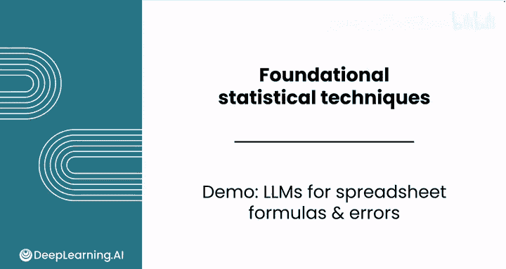

A large language model can serve as a helpful thought partner for writing formulas。

 as well as troubleshooting any errors you may encounter。Alright， so you've seen this data before。

 this is the data set of the top 25 movies in each year， their rating on IMDB。

 the number of ratings they have and their duration。

 Let's say you're working with this data in a spreadsheet and you've set up a few calculations that you want to do Let's say you want to see how many movies are over two hours。

 you know you want to use countf so count the number of movies if it's greater than 120 minutes。

So you select your E column greater than 120 minutes。

But you get this error frustrating because it says formula parse error。

 It really doesn't tell you that much。 So one option you have is you can chat with an L L M to help you resolve the error。

 Here's a prompt you can use。 Hey， I got a formula。 parse error。 Can you help me fix it。

 Here's my formula。To help the model， you might want to add a few rows of the data。

 and then you can select a few rows of your data。And copy those into the prompt。

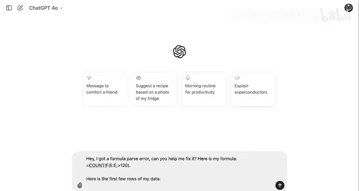

It first tells you that the error in your formula is due to the way the condition is written。

 It tells you that in an Excel， conditions within the count if function must be enclosed in quotes。

 So notice that it assumes you're using Excel for your spreadsheet。

 you could also follow up with a question asking if this solution also applies to Google sheetets。

 It verifies the solution also applies to Google sheetets。

 So it seems like the problem is the missing quotes around the condition in the count if function。

 So you can copy the code for your Google sheets formula and correct the formula in the cell。

 Now you can see that the formula correctly executes and it returns about 638 movies that are greater than two hours。

😊。

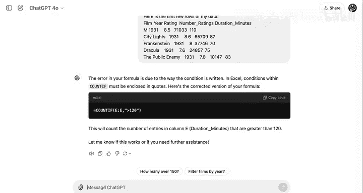

If you want to count the total number of movies here， you can scroll down to the bottom。

 The last row is 2052。 So if you subtract one， that gives you a total of 2051 movies。

 So that's kind of tedious。 Maybe the number of movies will change if you add more years。

 How can I count the number of rows in my dataset with a formula。 Give me some options。

 It's a helpful technique so you can choose the best one。

 You can see that there's a lot of options here。 You could ask it to limit it to just the best two or three。

 But for now， let's walk through what each of these options mean。

 The first one suggests using the count a function to account all the rows in the data。

 including the blank rows。 You might not be familiar with the count a function。

 but let's just see what happens。

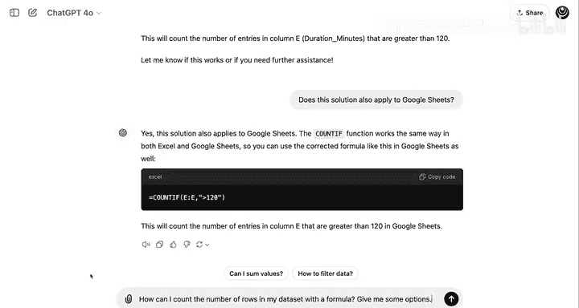

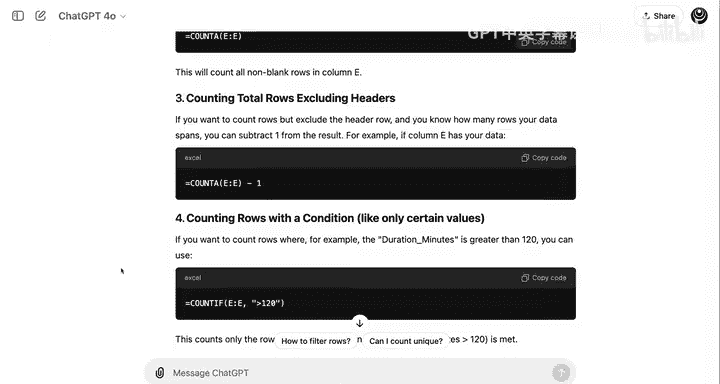

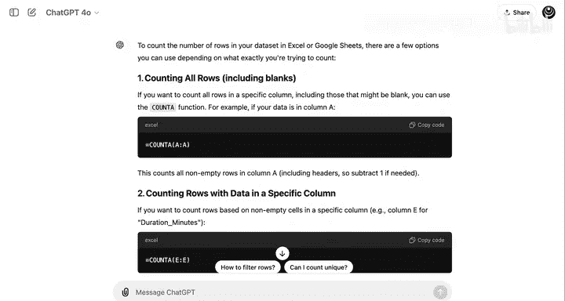

Here you can see the result of 2052 total movies， but you know that this is one more than the actual number of movies in the data。

It seems like count a is also counting the header row。

 It turns out that if you look at the third option， you can see that it accounts for this correction。

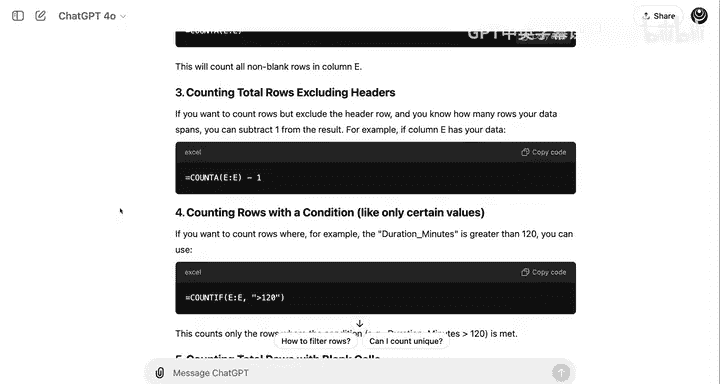

So if you subtract one from your formula， then you'll get the correct answer of 2051 movies。

 I happen to know that the count function can also get you to the same result。

 So if I replace the count a function with count。Remove the -1。

And you have to select a column with a numerical feature。

And now you can see you can get the correct count of total movies。

 If you go back into the chat G prompt， you might notice that the count function was not among the options。

 This is a good example of how you might not always see the best solution suggested by the LL M。

 let's complete the calculation of the percent of movies that are greater than two hours。

 You can see that about 31% of movies are greater than two hours， which is just under one thirdd。

 Let's say I want to highlight each row from column A to column E。

 if and only if the duration of that movie is in the 75th percentile。

 So let's just go ahead and calculate the 75th percentile。 So again。

 you'll want to use the percentile function。😊。

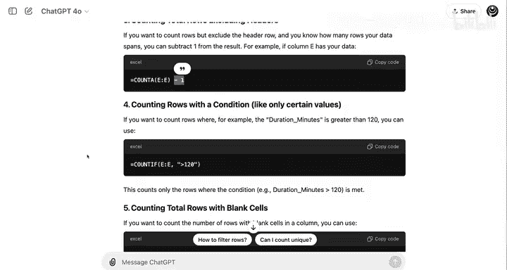

Select the duration column。And then input 0。75 for the 75th percentile。

You can see that the 75th percentile duration is 125 minutes。

 so let's go over to chattptT to help figure out how to apply conditional formatting to the data。

 This will require a custom formula in your conditional formatting， which is hard to remember。

 So an LLM is a really good resource。 How can I use conditional formatting to highlight the entire row from column A to column E green if the duration is in the 75th percentile or higher My 75th percentile is in cell H 6。

 This is an important reference so that the formula that the LLM provides to you will reference the correct cell。

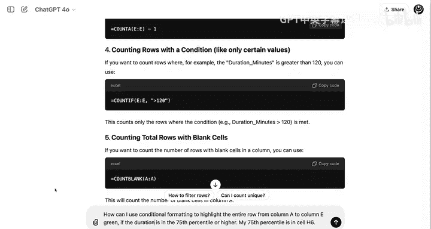

So can see that the LLM provides you with a series of steps to apply your conditional formatting。

First， it tells you to select the rows of data。Then it tells you how to initiate the conditional formatting。

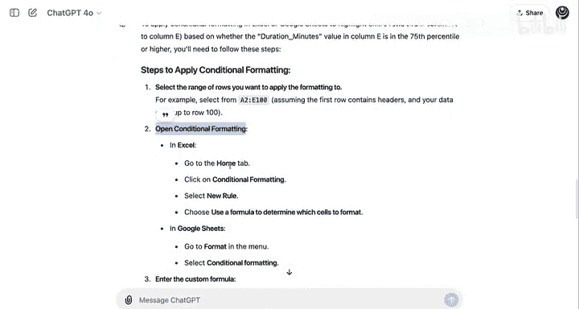

And then it tells you how to enter the custom formula so you can copy this custom formula。

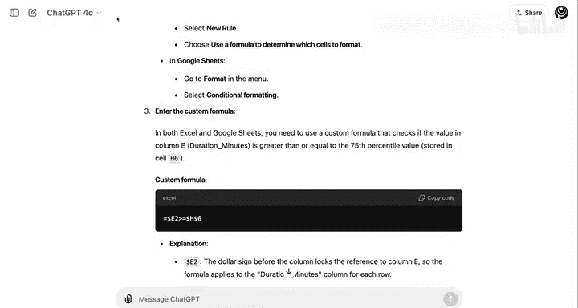

You need to select all the columns in your data and then use command click or control click to deselect the cells in the header row because you don't want the header row to be conditionally formatted。

Insert a custom formula under the format rules。This is where you're going to copy in the formula from the LLM。

The movie Marius had a duration of 1 hundred and 30 minutes， which is， in fact。

 greater than a 75th percentile of 125 minutes。 You can continue to scroll down to see if you find any more examples。

 And you see a few more here in 1935。😊，Remember that typically， the older movies were not as long。

 So you won't see as many examples in the earlier years in this dataset set as you will。

 once you scroll further and further down into the current years。

 So this commissional formatting helps you see at a glance。

 which of these movies are in the 75th percentile or higher based on a duration。

 L O Ms can help you discover spreadsheet functionality and enjoy working with them more。

 You've learn a ton so far in this module。 Coming up。

 you'll take the practice assessment for this lesson， as well as complete two practice labs。

 And the first， you'll practice calculating variability and skew using the song dataset set from the previous lesson。

😊，In the second， you'll work with the large language model to explore new spreadsheet functionality and troubleshoot errors。

Once you're done， join me in the next lesson to explore correlation。

