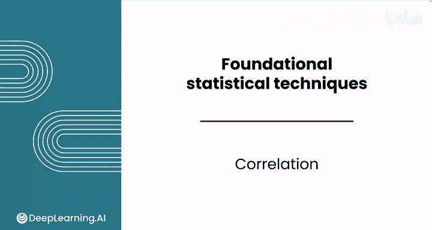
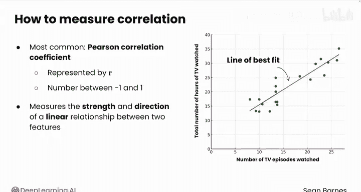
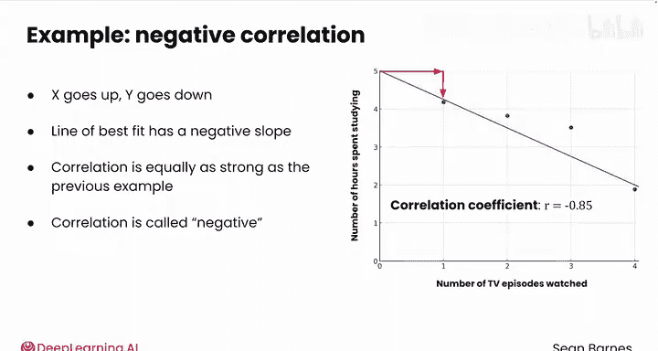
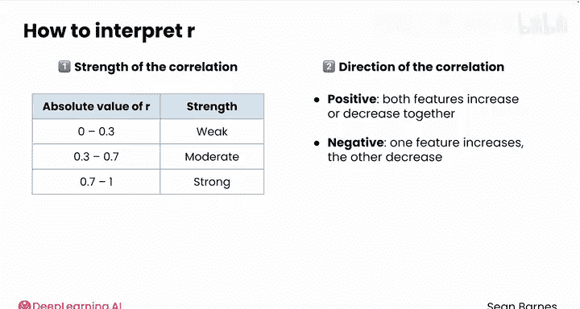
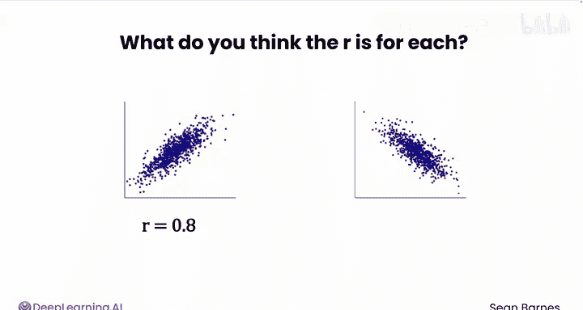
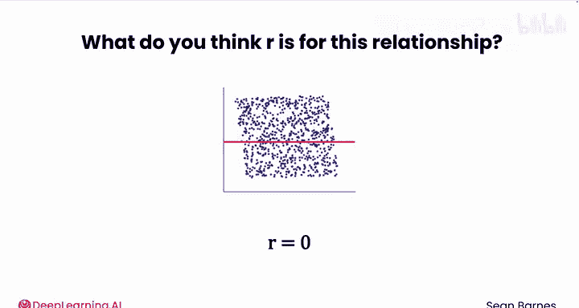

# 吴恩达《数据分析（数据分析基础／应用统计学，1-2课／共5课）｜DeepLearning.AI Data Analytics》中英字幕（claude-4-s - P92：21_相关分析.zh_en - GPT中英字幕课程资源 - BV1SCXrYuEwr

Correlation is a way to quantify the relationship between two numerical features。

You've seen scatter plots that visually represent how two features are related。 Now。

 you'll formalize that relationship。 There are multiple ways of measuring correlation。

 but the most common is the piearing correlation coefficient。

 which is often represented by lowercase R。 R is always a number between -1 and1。

 Let's start with the intuition behind this measure。

 say you have a scatter plot of two numerical features。 on the X axis。

 you have the number of TV episodes watched and on the y axis。

 the total number of hours of TV watched。 You can think of R as measuring how well you can fit a straight line through these points called a line of best fit。

 More technically， R measures the strength and direction of a linear relationship between two features。

 Let's take the perfect case。 say you have these points for your scatter plot。

 The straight line has a consistent slope。 meaning for every one unit change in X。

 Y changes by a consistent amount。 That would make sense for a TV show where every episode is exactly the same length。

 say 45 minutes。 If you know how many episodes of TV someone watched。😊。

You also know exactly how long they've been watching TV for In this example。

 you have a line at y equals 0。75 x， meaning that each episode is threequarter of an hour。

 So this line has a slope of positive 0。75。 and for every change of 1 and x Y changes by 0。

75 In this case， the correlation coefficient R equals positive1。

 You can say that x and y are perfectly correlated because changes in x produce exactly predictable changes in y。

 Now， imagine your data is less perfect with this set of points。

 It's not as easy to fit a line through the middle。

 but it is definitely possible to get a good approximation。

 Each point is either a little above or a little below the line， but as x goes up。

 Y also goes up and it's relatively predictable how much it will go up。

 you can tell that the more TV episodes you watch。 the more time you've watched TV but the episodes are all the same length。

 the correlation coefficient might be close to positive 0。85 In this scatter plot。

 the line of best fit is the same as the previous one。😊，But the correlation isn't as strong。

 Here's another example whereas X goes up Y goes down。 In this case。

 X is the number of TV episodes watched and Y is the number of hours spent studying。

 So the more TV a person watches the less time they might have to study In this case。

 the line of best fit has a negative slope。 However。

 the correlation is equally as strong as the previous example。

 The correlation coefficient would be around negative 0。85。 remember。

 you should think of correlation as essentially about how well you can fit a straight line to the data。

 regardless of whether the relationship is positive or negative。 So when X goes up Y goes down。

 and it goes down a roughly predictable amount。 This correlation is as strong as the previous example。

 It's just called negative like the slope of the line of best fit。

 Here's what a scatter plot would look like with no correlation。

 which means the correlation coefficient is equal to 0。

 This graph represents the number of TV episodes watched and the amount of water each person drank in a day。

 you can drink water whether you watch TV or not。

So there doesn't appear to be any relationship。 The line of best fit has a slope of0 because as x goes up。

 Y doesn't go up or down in any predictable way。 So the line of best fit just predicts the mean value of y。

 no matter the x value。 That's the best possible guess。 and it's not very good。

 calculating R by hand can get complicated。 but computers nowadays make it much easier。

 Let's examine how to interpret r， which tells you two important things about the relationship between two features。

 First， the strength of the correlation。 here's a general guide for interpreting r based on its absolute value or distance from 0。

 Po or negative values between 0 and 0。3 indicate a weak correlation。 between 0。3 and 0。7。

 positive or negative suggests a moderate correlation。 between 0。

7 and one positive or negative indicates a strong correlation。 Second。

 R tells you the direction of the correlation。 A positive R means both features tend to increase or decrease together。

 A negative r means that as one feature increases。😊。

Other tends to decrease noticeice that interpreting R is a similar process to interpreting SkuU。

 which also has a strength and a direction Here are three scatter plots What do you think the R is for each Here's a hit see how they all look like a straight line。

These each have an R of1。You can perfectly fit a line to this data。 And as one feature goes up。

 so does the other。 The slope of the line is positive， no matter how big or how small。

 and the relationship is highly predictable。 What about these three scatter plots。

 What are do you think they have。These each have an R of negative one。

 You can fit a line perfectly through them。 However， as x goes up， y actually goes down。

 making the correlation negative。Here are two scatter plots with correlations of 0。8 and minus 0。8。

 Can you tell which is which？The one on the left is positive 0。8。

 while the one on the right is negative 0。8。 okay， last one。

 what's your guess for the correlation of this scatter plot？

It's zero。There's no discernible relationship here。 And the straight line here will just be flat。

Great work studying correlations。 It's always exciting to calculate a number that maps onto your intuition about the data。

😊，Join me in the next video to learn more about the difference between correlation and causation。

