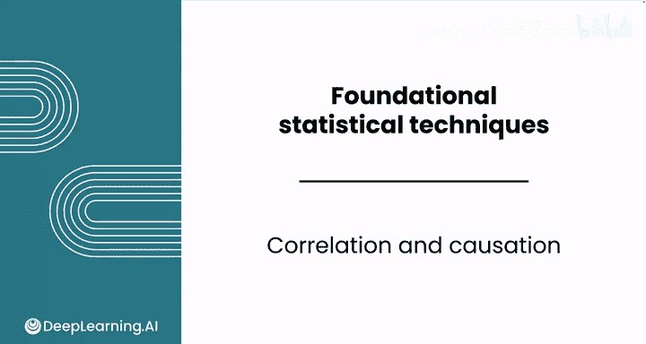
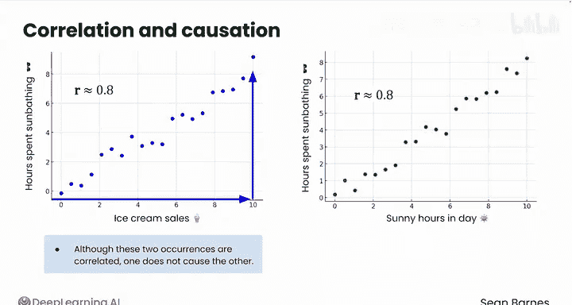
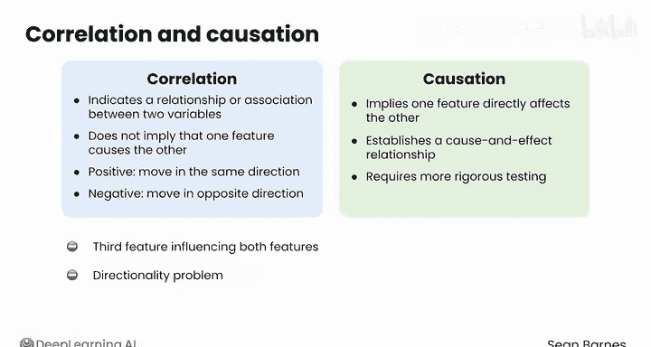

# 吴恩达《数据分析（数据分析基础／应用统计学，1-2课／共5课）｜DeepLearning.AI Data Analytics》中英字幕（claude-4-s - P93：22_相关与因果.zh_en - GPT中英字幕课程资源 - BV1SCXrYuEwr

Correlation can be easy to misinterpret because it's often confused with a related concept。

 causation。

Correlation and causation might sound similar， but they refer to two different aspects of the relationship between two features。

 Take a look at this plot of ice cream sales on the X axis and the number of hours spent sun bathathing on the y axis。

 You can see that as ice cream sales go up， So do hours spent sunbathing。

 The R value might be around positive 0。8。 Based on that information。

 can you conclude that buying ice cream causes people to sunbthe more。No。

 although these two occurrences are correlated， one does not cause the other。

Have a look at this very similar plot of the number of sunny hours in the day and the number of hours spent sunbathing。

 You can see that the plot is quite similar to the one you saw a moment ago。

 The R value might again be around positive 0。8， but is there causation。

Yes， there is， because the availability of sunlight directly affects people's ability to sunbathe。

 You would be less likely to sunbathe on a cloudy day。

 Causation means that one event is the result of another。 Theres a cause and effect relationship。😊。

To sum of the difference， correlation indicates a relationship or association between two features。

 but does not imply that one feature causes the other。

 It is positive when the features move in the same direction or negative when the features move in opposite directions。

 Causation on the other hand， implies that one feature directly affects the other。

 and it establishes a cause and effect relationship。

 you can't establish causation using a scatter plot or the Pearson correlation coefficient。

 It requires more rigorous testing than correlation。

 you should note that there might be a third feature influencing both features of interest。

 giving the illusion that the directly affect each other。

 in the case of the ice pa and sunbathing example， while these two correlate。

 they are both actually caused by sunnier days， a third feature。

 Another potential pitfall is the directionality problem， Even if a cause relationship exists。

 it might be challenging to determine which feature is the cause and which is the effect without experimental evidence。

 It's clear that sunni your days cause more sunbathing and not vice versa。

 but how about if you're interested in the relationship。😊。

Between loneliness and social media usage， do lonely people use more social media or does social media make people feel more lonely？

While correlation can be established using scatter plots and the Pearson correlation coefficient。

 causation requires a higher level of rigor。 Be mindful of how you interpret correlation。

Follow me to the next video to see how to run a correlation analysis in a spreadsheet。

