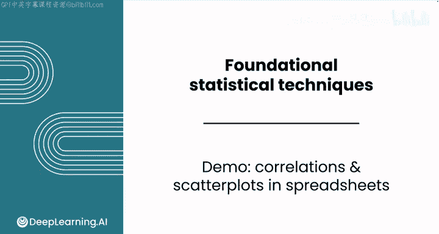
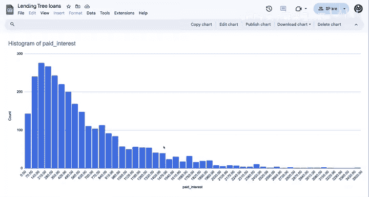
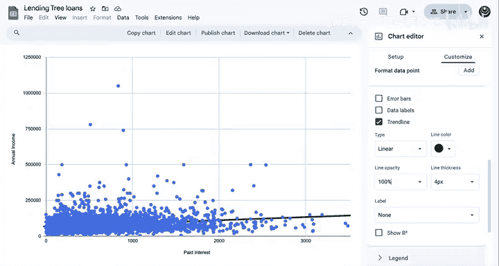

# 吴恩达《数据分析（数据分析基础／应用统计学，1-2课／共5课）｜DeepLearning.AI Data Analytics》中英字幕（claude-4-s - P94：23_演示：电子表格中的相关分析与散点图.zh_en - GPT中英字幕课程资源 - BV1SCXrYuEwr

Let's put correlation into practice on the lending tree dataset set。

 You can choose any pair of numerical features to see how they correlate。 As a reminder。

 this data set includes thousands of loans made through the lending tree platform。

 which allows individuals to lend to other individuals。 Each row represents a particular loan。

 and each column includes features about the person who took out the loan， like their job title。😊。

An annual income， as well as information about the loan， like the amount。And don't forget。

 if you'd like to follow along with the demo， you can find the spreadsheet and the solution in the downloads tab。

 So far， you've taken a look at the distribution of the paid interest feature and examined its central tenancy。

 variability and skewness。😊，This is an interesting feature from a lender's point of view。

 but it's even more useful with more context。 You're also interested in which factors contribute to higher interest and loan amounts。

 Let's consider the correlation between paid interest and installment。 Remember。

 the installment is the monthly payment the applicants should be making。

 Here's paid interest and here's installment。 How do you expect these features to be correlated。

 Positive or negative。😊。

Strong， moderate or weak。 You might want to start by just visualizing the relationship between these two numerical features。

You may want to add a trim line so that you can see the potential linear correlation between the two features。

First off， the trend line has a positive slope for small values of paid interest。

 You also get small values of installment， and you have a lot of these points。

 For larger values of paid interest， you get bigger values of installment。

 but less density of points。 This suggests a positive correlation。

 probably between moderate and strong。 Now， you may want to find the actual correlation between the two features。

 You can use the coral function。 And then you can just select the two columns of data。😊。

The correlation is about 0。69， which is on the boundary of moderate and strong positive correlation。

 You should also note that correlation is a symmetric calculation。

 This means the order in which you select the columns does not matter。 You' will get the same result。

 Let's take a look at some other examples。 Let's take a look at how the paid interest correlates with the annual income。

 Again， you can create a scatter plot to get a visual sense of the correlation between these two features。

And again， you can add a trend line vivid data so you can visualize the pattern overall。

 What do you see in this scatterterplot？Overall， there's a higher density of points with low paid interest and low annual income。

 but the points are pretty dispersed。You also get some points pretty far away that will affect the correlation。

 Overall， the points loosely fit the trend line， meaning that there is likely not a strong linear relationship between these features。

 This suggests a weak positive correlation。 Next， you can calculate the actual correlation。

Go back to the data tab and select the two columns to calculate the correlation。 Again。

 the order that you select the columns does not matter since the calculation is symmetric。

 The correlation between paid interest and annual income is around 0。20。

 This is much lower than the previous correlation calculation。 and suggest a weak。

 positive correlation。 Overall， this is consistent with the trends that you observed in the scatter plot。

 The more people make in a year， the more interest they pay。

 but there are a lot of other factors that explain the variation and interest paid。

 It's difficult to predict the exact value of interest paid based on income。

 Let's take a look at two other features。 An income and debt to income。

 De to income is the ratio between how much money you owe on loans and how much money you make in a year。

 A lower debt to income ratio means a person has proportionally less debt and is more likely to be able to pay off a new loan。

 This correlation helps answer the question。 What's the relationship between how much money these borrowers make。

 and the relative amount of debt they have。 How do you expect these features to be correlated。

 Po or negative。Strong， moderate or weak。Let's take a look at the calculation。

And select the two features from the data。 The result is around negative 0。177。 So in this case。

 it's a negative relationship suggesting that people with higher incomes。

 on average have lower debt to income ratio or vice versa。 In addition。

 the small magnitude of the correlation suggests that this relationship is weak overall。

Great work using scatter plots to spot the sign and magnitude of a correlation。

 as well as interpreting the output of the coral function。 That takes you to the end of this lesson。

😊，Next up， you'll complete the practice assessment as well as the practice La for this lesson in the practice lab。

 you'll explore the correlations between different features of music in order to build an even better playlist Once you're done。

 follow me to the next lesson on segmentation。