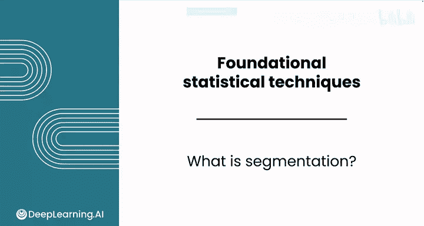
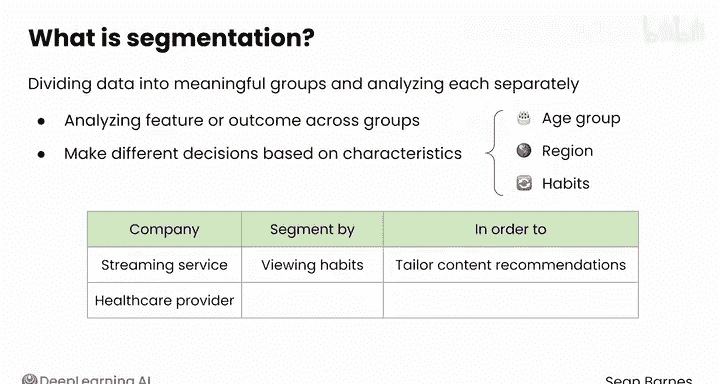
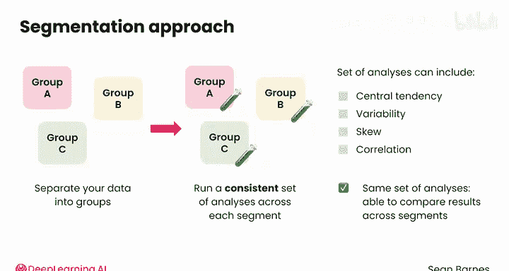
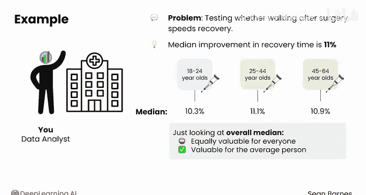
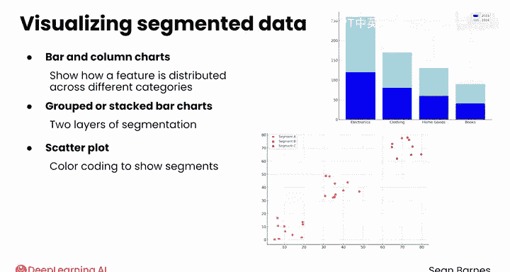

# 吴恩达《数据分析（数据分析基础／应用统计学，1-2课／共5课）｜DeepLearning.AI Data Analytics》中英字幕（claude-4-s - P95：24_什么是分群分析.zh_en - GPT中英字幕课程资源 - BV1SCXrYuEwr

Segmentation is a powerful technique that allows you to develop insights for subsets of your data。

 You saw several examples of segmentation and data analytics foundations。

 but now let's formalize this concept。😊。

At its core， segmentation is about dividing your data into meaningful groups and analyzing each group separately。

 General， it's useful when you're interested in analyzing a particular feature or outcome across different groups。

 it's also valuable when you might want to make different decisions based on group characteristics Common segmentations include age group geographical region or habits For instance。

 a streaming service might segment its users by viewing habits to tailor content recommendations or healthcare provider might segment patients by risk factors to determine appropriate interventions。

 The approach is straightforward。 you separate your data into these groups and then run a consistent set of analyses across each segment。

 these analyses often include descriptive statistics like measures of central tendency variabilityability or sw and correlation analyses。

 using the same set of analyses is important because you want to be able to compare results across your segments。

 Let's look more closely at the healthcare example say your're testing whether walking after surgery speeds recovery。

 You know the median improvement and recovery。😊。

is 11%， but you might want to compare the effect across age groups。

 I walking after surgery more effective for the young the old。

 So you segment your data by age group and measure the median recovery time for each group。

 Let's say you find that for 18 to 24 year olds， the median improvement and recovery time was 10。

3% for 25 to 40 year olds， it was 11。1% and for 45 to 64 year olds， it was 10。9%。

 So walking after surgery is beneficial no matter the age。 If you just look at the overall median。

 you wouldn't be able to say for certain whether it is equally valuable for everyone。

 just that it's valuable for the average person。 segmentation is crucial in the medical field。

 drugs and other interventions often affect men and women differently and require different dosages for children。

 There's no magical segmentation method。 It doesn't have a formula like the Pearson correlation coefficient does。

 It describes an approach of breaking down the data and trying to learn about how different subset compare to each other。

 for visualizing segment and data。 you have several options。

Bar and column charts are great for showing how a single feature is distributed across different categories。

 You can also further segment your data using grouped or stacked bar charts。

 so two layers of segmentation scatter plots can be enhanced with color coding to show different segments within the data you can also show several smaller scatter plots in a grid one for each segment line charts can be segmented by using multiple lines each representing a different group As always。

 when creating these visualizations， don't forget the principles of good design that you've already learned。

😊。

Clarity， efficiency and context are still crucial when displaying segmented data。

 Great work with segmentation。 Join me in the next video to see a powerful spreadsheet technique for working with data from multiple files。

 which is common in segmentation tasks。😊。