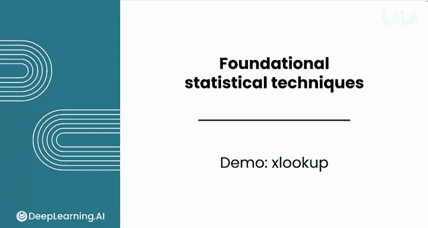
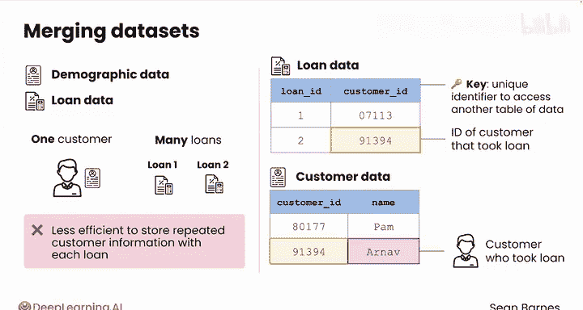

# 吴恩达《数据分析（数据分析基础／应用统计学，1-2课／共5课）｜DeepLearning.AI Data Analytics》中英字幕（claude-4-s - P96：25_演示：XLOOKUP函数.zh_en - GPT中英字幕课程资源 - BV1SCXrYuEwr

Oftentimes， customer data and product data are stored separately。

 They may be collected and analyzed in different ways。 However。

 if you want to segment product usage patterns based on customer features。

 you'll need to merge these data sets。 It's a common task in data analytics。

 In the case of the lending treeree loan data you've seen throughout this module。

 the customer demographic data like their income and the loan data like the interest paid where likely originally stored in separate files。

 One customer may have many loans so it's less efficient to store this repeated customer information together with each loan Here's what typically happens。

 the loan data has a feature called customer ID and its value for each loan is the idea of the customer that took it out。

 So if you take that key and search the data set of customers。

 you'll come back with one unique result。 the customer who took out the loan。

 the main advantage of this approach is that you can store the customer and loan data separately while still having access to both The feature customer ID is called a key a unique identifier that allows you to access another。

Table of data Now in order to perform segmentation analysis。

 you'll need to merge these two datasets that way you can answer questions like how does income correlate with interestpa spreadsheets have a powerful function called Xlookup that allows you to combine data from multiple tables in this case to create detailed profiles of customers with the most profitable loans let's see how that works。

 So if you take that ID and search the data set of customers。

 you'll come back with one unique result。 the customer who took out the loan so let's take a look at this data As a reminder you were previously working with data about different loans to analyze potential investment opportunities In this case there are demographics of the applicants in one tab and loan data and the other notice in the applicant tab the data is not sorted by customer ID So it's not as straightforward to just copy over the loan data over to the applicants even if the customer data was sorted one applicant might have many loans which would throw off the alignment of these two datasets you may also notice that there's a customer ID column in both sheets of data。

Customer ID is the key of a data and enables you to join the two datasets together。

 Suppose you wanted to join some of the applicant demographic data onto the loan data。

 So for example， if you wanted to add the job title of the first customer onto this data you could copy the customer ID and then search for that ID in the applicant demographics This person is an office administrator so you could copy this value over to your loan data and then add it to the first row obviously this is not an efficient process so there has to be a way to do this more efficiently using your programmatic solution So for this task you're going to use the Xlookup function you may want to take a look at the help to understand how this function actually works the first parameter in the function is the search key。

This is the customer ID that you want to use to join the applicant data onto the loan data This is going to be the customer ID of that particular row The next parameter you want to use is the lookup range that's going to be the entire column of customer IDs in the applicant dataset。

The third value is the result range。 This is the column of the feature that you want to return in the data。

Close your parentheses。And there you see that it's pulling in the office administrator。

 you can choose to fill this formula down the column or you can wrap the entire formula in an array formula。

 The array formula function just takes a function like this X lookup and applies it to a range of cells。

 Array formula is useful here because you want to apply this X lookup function to every customer ID in the first column。

Notice that in the first cell， you have to change the single cell reference to the entire column。

That was so much faster than searching for individual customer IDs and then copying and pasting the result into the column。

 Let's repeat that process for another feature in the applicant's data set  employment link again。

 you can use the array formula and the Excel lookup function。

 Ar formula will just apply this X lookup function to a range of cells rather than just one cell Select your customer ID select the reference range and this time you want to select the employment link column。

So again what's happening here is that you're taking the customer ID。

 you're using it to search for the matching customer ID in the applicant's data set。

 and then you want to return the corresponding employment link from Colency and there you have it。

 you'd now join the employment links for all of the customers into your loan data。Create work。

 follow me to the next and final video of this module where you'll explore how to apply descriptive statistics to segmented data using pivot tables。

